# New ward concepts, round 2: five chosen to build (designed 2026-11-25, decided 2026-11-27)

Design only: no game code was changed, and nothing is built yet. Of the six concepts, five are chosen to build (decisions below); the Runewright is kept at the end for reference. The mock-ups are drawn with the game's own ward kit, so they use the same units, tier ladder, notches and pips, crowns, tier 5 sigil and diadem, body-and-face rule and height caps as the real wards. They live in `docs/concepts/new-wards-2/`, rendered by `docs/concepts/_src/render-nw2.mjs` (art in `nw2-art.mjs`, effects in `nw2-fx.mjs`), and in the gallery on port 3002 under "New ward concepts". Numbers (damage, costs, radii) are first estimates to show the shape of each ward, not tuned balance.

## Decisions (2026-11-27)

| # | Question | Decision |
|---|---|---|
| 1 | Which to build | **Five:** the Heartfire Avatar, the Astral Choir, the Ferrylight, the Undertow and the Lampwright. **Not** the Runewright. |
| 2 | Hero rules | **No heroes.** The Avatar and the Choir are ordinary wards that are stronger and cost more to match: no limit on how many, placed anywhere. The Avatar's "near the Heartfire" rule is dropped. The one-of-each tier 5 rule still applies to them, as to every ward. New prices and stacking rules: section 1. |
| 3 | Ashfork has lava, not water | **Lava variants** of both water wards, with identical stats: a basalt barge and a spirit of molten rock. |
| 4 | A water-ward cap on Mirefen | **No cap.** Mirefen is the water map. |
| 5 | A pushback limit | **None in the game for now**, so we can see how it plays. The test tools get a stall guard so a stalled wave can't hang a bot or balance run (build notes, below). |
| 6 | Overlaps and look-alikes | **Settled** (next two tables). Both look-alikes are fixed in the mock-ups. |
| 7 | The Lampwright's performance | **Designed in from the start:** caps on candles and a cheap way to draw them (section 3a, "Performance design"). |

Unchanged from the proposal, since nothing said otherwise: Rimecoil's frozen lakes count as water (the ward breaks a hole in the ice), and the Avatar's star path stays **Orrery**, because Constellation is already the Snare's Flashmines tier 5.

### Overlaps settled

| Overlap | Settled by |
|---|---|
| **Avatar Solar against the Prism's Focus.** Both were a beam that ramps up on one strong target. The Prism's Focus tier 4 is even called Sunspear. | **Solar is no longer a beam.** The torrent of motes builds **Heat** on its target, and at 10 Heat the target bursts in a **solar flare** that hits everything around it. The Prism keeps the beams; the Avatar is homing motes and area flares. Its Sunfall ability stays, because it's a pillar from the sky, not a beam from the ward. Mock-up redrawn. |
| **Avatar Eclipse against the Beacon.** Both affect the wards around them. | They work in opposite directions: Eclipse takes power from its neighbours and the Beacon gives it. A tether isn't a Beacon boost and stacks with one. Since Avatars are now unlimited, **a ward can be tethered to only one Eclipse.** |
| **Avatar Lent Stars against the Beacon's Lighthouse.** Both give a ward Veiled sight. | Kept, since a lent star is mainly an extra gun. A ward can hold at most one lent star. |
| **Choir against the Rime Spire.** Both are area pulses. | **The Choir never slows or freezes**, so Chorus tier 3 loses its 10% slow. The Rime Spire is cold control in a small circle. The Choir is light Arcane damage over a third of the map, plus Hush. Each note hits at most 80 enemies (Endless Winter caps at 60). |
| **Choir against the Storm Coil.** Both are Arcane, strong against shields. | No change. The Coil chains through a pack; the Choir touches everything lightly. Damage types are meant to be shared. |
| **Ferrylight Lighthouse Barge against the Beacon's Lighthouse.** Both gave nearby wards range and Veiled sight. | **The Barge no longer boosts wards at all.** Its beam works on the Gloom instead: it sweeps the road and **Dazzles** whatever it lights, slowing them (Heavies included, bosses at half strength) and revealing Veiled while they're lit. The Beacon stays the only light that makes wards better. Beacon Fire (map-wide sight) is replaced by *Lightfall*. Mock-up redrawn. |
| **Ferrylight Harpooner against the Ballista and the Undertow.** All three push Gloom back. | No change beyond targeting: the Harpooner defaults to *First*. The Ballista nudges every enemy it pierces 14-24 px. The Undertow holds one stretch of road. The Harpooner drags **one chosen enemy** a long way, which makes it the "rescue a leaker" tool. |
| **Undertow against the Rime Spire.** Both are Frost slows. | The Undertow never freezes. Its slow is a current that also pulls back, and it doesn't stack with the Rime's: an enemy takes only its strongest slow, as now. The look-alike is fixed too (below). |
| **Lampwright against the Ember Censer.** Both are Fire and both Scorch. | Scorched is shared on purpose, because it's the second Mender answer. The Censer is a cone aimed at enemies. The Lampwright never aims at an enemy: its candles wait on the road ahead. |
| **Lampwright Tallow against the Mortar's Cinder and Inferno.** Both put burning ground on the road. | **Wax Flood** (a river of burning wax, too close to Inferno's lake of fire) is replaced by ***Wax Seal***: everything standing on a candle is stuck for 1.5 s (Heavies 0.5 s, not bosses). Candles are small, long-lived and thrown ahead of the Gloom. Cinder pools are big, short-lived and land where the shells hit. |
| **Lampwright against the Thornlight Snare.** Both put things on the road. | No change. The Snare is one trap you place on the road yourself; the Lampwright keeps throwing new candles. |
| **New against new.** Beaconwax, the Lighthouse Barge and Lent Stars all reveal Veiled. | Kept. Revealing is common already (Longeye, Rime Spire, Beacon), and each of these does it differently: points on the road, a sweeping beam, a star on one ward. |

### Look-alikes fixed (in the mock-ups)

- **Kindlings Undertow against the Rime Spire.** It's now sea-blue rather than frost-white: a wave whose top curls over into a breaking crest with foam on its lip, with a band of foam swirling round it. The Rime Spire stays a pale frost dome.
- **Lanterns Lampwright against the Beacon.** It's now a squat, wide lamp hanging from the hook of a crooked lamplighter's pole. The Beacon is an upright lamp on a straight post.

Both were re-rendered with the cap and body-box checks: 6 wards x 2 skins x 10 states, 0 problems. See the lineup and silhouette test at the end.

### What the five cover

| Gap (from `tower-ideas.md`) | Covered by |
|---|---|
| **Herald (haste) has no counter** | Astral Choir: *Hush*, no haste works inside its song. Ferrylight Great Light: a Herald in the beam loses its aura while it's lit. Partly: the Undertow's slows. |
| **Menders countered only by the Ember Censer** | Lampwright: its candles Scorch (no healing). The Undertow's tier 5, Drowned Deep: nothing in its whirl can be healed or shielded. |
| **Nothing holds Heavies or bosses** | Partly. The Lighthouse Barge Dazzles Heavies from tier 2 (bosses at half strength). The Ferrylight's tier 5, Heartline, anchors them. The Lampwright's Wax Seal holds Heavies for 0.5 s. This is weaker than the Runewright's Seal would have been. |
| **Nothing moves the Gloom backwards** | The Undertow (all paths), the Ferrylight Harpooner, the Astral Choir's Requiem tier 5. |
| **Nothing keeps producing on the path** | Lampwright (candles). |
| **Water is dead space on every map** | Ferrylight and the Undertow, with the lava variants on Ashfork. |
| **No late-game ward to save up for** | The Avatar and Choir tier 5s (about 29-31k). |

### Still open (decide at build time)

1. **Shop keys.** The 12 wards already use 1-9, 0, - and =. Five more need keys: a second shop row toggled with Tab, or Shift+1-5. Holding Shift currently shows ward details, so Tab is cleaner.
2. **Prices.** All prices are first estimates, to be set from power per gold (`node tools/report.js`) once the wards exist.

### Build notes

- **Stall guard in the test tools only (decision 5).** `tools/bot.js` (`while (!game.over && !game.clear)`) and `tools/solo.js` have no time limit today. `tools/tier5.js` stops a wave at 400 s of simulated time, and `tools/smoke.js` at a fixed number of frames. Add one shared guard used by every tool that plays waves:
  - A wave that hasn't cleared after max(300 s, 5x the time it takes to spawn) of simulated time ends as **stalled**. That's its own outcome, neither a win nor a loss.
  - The tool records the wave, the enemies left and how far they were pushed back, prints it in the summary, and fails or flags the run.
  - A whole run also has an overall cap.
  - The tools count the pushback (px per wave and per ward), so the evidence for any later cap is there.
  - **The game itself gets no timeout and no cap.**
- **Both skins**, the lava variants, the 46 / 68 / 104 px height caps and the body-and-face rule, all as in the mock-ups. `registerNewWards()` in `nw2-art.mjs` is the starting point for the real art.
- **Water placement** is the reverse of land: on a pond only, with the footprint inside the shore. Lava counts on Ashfork and frozen lakes on Rimecoil.
- **The Undertow's R action** moves its whirlpool, reusing the Wandering Light's post UI.
- **Bots:** water builds for each map, builds with several Avatars and Choirs (now that they're unlimited), and endless builds. The tier 5 test (`tools/tier5.js`) should cover the 15 new tier 5s.

## How these follow the rules

- **Upgrade framework:** each ward has Might / Many / Craft paths (one bigger thing / more of it / a trick). The paths split visibly at tier 2, change form at tier 3, reach a crowned tier 4, and add a second form at tier 5 that frames the ward from behind. The mock-ups draw tiers 0, 2, 4 and 5 on every path in both skins. Tiers 1 and 3 are described here but not drawn.
- **Role silhouettes:** four new families, each meant to pass the black-shape test. *Avatar* is a tall robed figure with a disc behind its head. *Choir* is a ring of small figures. *Vessel* is a long low hull with a mast, always on water. *Spring* is a teardrop rising from a foam ring, always on water. The two road-makers are figures beside a tool: a basket of candles (Lampwright) or a rune tablet (Runewright). See the silhouette test below for where they're close.
- **Damage colours:** the six use six of the eight colours, so none needs a ninth. Avatar Radiant (yellow, sun glyph), Choir Arcane (violet, zigzag), Ferrylight Kinetic (silver, unlit, arrow), Undertow Frost (cyan, snowflake), Lampwright Fire (red, flame), Runewright Blast (orange, burst). A path that adds an element shows it as an accent: the Frost Rune's cyan glyphs, Beaconwax's yellow reveal ring.
- **Body and face; height caps:** checked with the same tests as `tools/wards.mjs`, on 6 wards x 2 skins x 10 states. All pass: no ward breaks its cap, and no gear covers more than 30% of a body box. Heights are printed under each cell of the sheets.
- **Original:** the names, art and mechanics are new. Where an idea is a genre staple (a beam, a slowing area, a trap) the twist is the game's own: Heartfire light, freed Gloom, runes, candles.

---

# 1. Premium wards: stronger, and priced to match

**Decided (2026-11-27): no heroes.** These are ordinary wards, just stronger and dearer. There's no limit on how many you build or where you put them; only the usual one-of-each tier 5 rule applies.

**Pricing (first estimate):** the price follows the power, so their power per gold stays in the same band as the other wards in `tools/report.js`.

| | Base | Tiers 1-4 | Tier 5 (about 4.5x its tier 4) |
|---|---|---|---|
| Heartfire Avatar | 900 | 180 / 420 / 1,500 / 7,000 | about 31,000 |
| Astral Choir | 850 | 170 / 400 / 1,400 / 6,600 | about 29,000 |
| A normal ward, for comparison | 150-500 | about 100 / 250 / 900 / 4,400 | about 16,000-22,000 |

Their base power is unchanged from the concept. The Avatar does about 48 DPS of homing Radiant at 200 px, more than three base Bolt Wards. The Choir hits over four times a Rime Spire's area. On these numbers either can come around wave 4-6 instead of wave 10.

**Stacking rules,** needed now that there's no limit: Hush doesn't stack. A ward can be tethered to only one Eclipse and can hold only one lent star. Choir notes hit at most 80 enemies each.

## 1a. Heartfire Avatar

**Role:** premium ward: sustained single-target damage, with each path picking a specialism. **Damage:** Radiant (ignores resistances). **Base cost:** about 900. **Family:** Avatar (new): a tall figure with a disc behind its head.

**What it does:** a shard of the Heartfire given form. It pours out a relentless torrent of radiant motes: about 8 a second at 6 damage each (about 48 DPS, three base Bolt Wards' worth). The motes home in on one target within 200 px, and they hit flyers. Its own glow reveals Veiled within 110 px of it, but not across its full range. It can be placed anywhere (the "near the Heartfire" rule is dropped). In the game, the torrent is a stream of damage ticks (8 a second) drawn as a ribbon of motes, not 8 projectile objects a second.

**Looks.** Kindlings: a towering sun-spirit in an ivory robe, a sun halo behind its head, a mote of light in its raised hand. Lanterns: a great golden chandelier on a gilded stand, its centre lantern the light, a ring of arms each holding a small lamp.

| Path | Identity | Tier 1 | Tier 2 | Tier 3 | Tier 4 (+ ability) | Tier 5: signature |
|---|---|---|---|---|---|---|
| **Solar** (Might) | the motes heat their target until it bursts in a solar flare (not a beam: that's the Prism) | **Kindled Core**: motes x1.5 damage | **Heat**: each mote adds 1 Heat to its target. At 12 Heat it flares: 60 Radiant damage to everything within 40 px | **Solar Flare**: flares at 10 Heat, x3 damage, plus 3% of the target's max health (1% for bosses); radius 55 | **Noonfire**: flares x6 and leave the enemies they hit sun-marked, taking +15% from every ward for 3 s. *Ability, Sunfall:* a 6 s pillar from the sky on the strongest enemy, 4% of its max health per second, bosses included | **Zenith**: a great sun rises behind it. *High Noon:* when a target dies, its Heat jumps to the next target, and each flare on a boss makes it take +5% from every ward (up to +50%) |
| **Orrery** (Many) | a court of stars, each firing on its own | **First Star**: one star orbits and fires motes at a different target | **Twin Stars**: 2 stars, +20 range | **Orrery**: 4 stars on a brass armillary; each has its own targeting (First, Strong, Close, Flyers); stars x2 vs flyers | **Starwheel**: 6 stars, firing twice as fast. *Ability, Starfall:* every star dives onto its target and bursts (6 blasts, radius 50), returning after 3 s | **Grand Orrery**: a huge armillary sphere behind it. *Lent Stars:* up to 3 stars can be sent to circle other wards anywhere on the map; they fire from there, and a ward with a star sees Veiled |
| **Eclipse** (Craft) | it feeds on the light of the wards around it | **Penumbra**: tethers to wards within 120 px (max 6), +6% damage each; tethered wards lose 3% | **Umbra**: up to 8 tethers, +8% each; +25 tether radius | **Eclipse**: the halo darkens to an eclipse; tethered wards stop losing damage and share its Veiled sight | **Total Eclipse**: +10% per tether, up to 10. *Ability, Corona:* for 8 s every tethered ward fires 40% faster and the torrent doubles | **Syzygy**: a black sun and three aligned moons. *Alignment:* every 10 s every tethered ward fires one free shot at the Avatar's target at once, each at x3 its normal damage and in its own damage type |

**Strengths.** Relentless damage that ignores resistances. Solar's flares make it a boss killer that also clears the crowd round a boss (the Gravemaw, Veilmother, Bastion, Hollow King). Orrery hits flyers and spreads its fire. Eclipse rewards a dense build and lends Veiled sight to the wards around it. It's the natural late-game target to save for.

**Weaknesses.** Single target at base, so crowds, Broods and Skitter rushes leak past it until Solar's flares or Orrery. It has no control at all: no slow, stun or push, so hasted Herald rushes still get through. At about 900 it's a wave 4-6 purchase. Its sight of Veiled is short. Eclipse is weak on its own, and Heat is wasted on small Gloom that die before they flare.

**Synergies.** Bolt Ward Hunter's Mark (marks multiply the beam). Rime Spire and the Undertow (slowed enemies stay in the beam). Beacon (counts as a tether; War Drum speeds the stars). Eclipse with anything clustered. **Overlap (settled):** Solar was a ramping beam like the Prism's Focus, so it's now Heat and flares. Eclipse takes from neighbours where the Beacon gives.

**Risks.** Balance: with no limit, several Avatars must not beat the same gold spent on normal wards, so the bot needs multi-Avatar builds. Eclipse stacking: one Eclipse per ward (above). Performance: the torrent is damage ticks drawn as one ribbon with a few highlights, not projectiles. Stars at tier 4 Orrery are 6 projectiles per Avatar. Several Avatars at quality 0 draw the ribbon only. UI: Lent Stars needs a "send to a ward" action, like the Wandering Light's R.


The Avatar on every path, both skins. Tier 5: Zenith's sun, the Grand Orrery's armillary, Syzygy's black sun.


Solar's torrent heating a Gravemaw until it flares (7 of 10 Heat marks lit). The Orrery's stars, each on its own target. Eclipse tethered to a Bolt Ward, a Mortar and a Rime Spire.

## 1b. Astral Choir

**Role:** premium ward: area damage across most of the map. **Damage:** Arcane (x2 against shields, a fifth against Nullbacks). **Base cost:** about 850. **Family:** Choir (new): a ring of small figures on a round dais.

**What it does:** a circle of celestial singers. Every note strikes every enemy within 230 px (at most 80) for 8 damage, about one note every 1.2 s. That radius covers roughly a third of the map. Notes hit flyers and Veiled (it's an area effect). **Hush:** no Gloom inside the song can be hasted: a Herald's aura does nothing there. This is the Herald counter.

**Looks.** Kindlings: three robed singers on a round dais, the middle one bigger (the face anchor), notes rising. Lanterns: a carillon, a ring of glass bell-lanterns on posts round a centre lantern.

| Path | Identity | Tier 1 | Tier 2 | Tier 3 | Tier 4 (+ ability) | Tier 5: signature |
|---|---|---|---|---|---|---|
| **Hymn** (Might) | notes build to one crushing crescendo | **Deeper Voice**: notes x1.4 | **Rising Hymn**: every 6th note is a crescendo, x10 on the strongest enemy in range | **Crescendo**: every 4th note, x25, and it stuns for 1 s (Heavies are slowed instead) | **Grand Crescendo**: every 3rd note, x40. *Ability, Fortissimo:* the next 5 notes are all crescendos | **Great Bell**: a huge bell of light behind the choir. *Tolling:* each crescendo also hits everything within 60 px of its target, and a boss it hits can't call its phase adds for 4 s |
| **Chorus** (Many) | more singers, faster notes | **Second Voice**: +30% note rate | **Quartet**: 5 singers, x1.6 rate, +20 radius | **Choir Stalls**: 7 singers, x2.2 rate (no slow: that's the Rime Spire's job) | **Massed Choir**: x3.5 rate. *Ability, Chorale:* for 6 s every note hits twice | **Heavenly Host**: tiers of tiny singers on arcs of stars. *Echo:* every note echoes 0.5 s later at 60% damage across the whole map |
| **Requiem** (Craft) | the Gloom it kills are freed as wisps that fly back down the road | **Gentle Requiem**: 15% of kills in the song free a wisp that flies back up the road and strikes the first enemy it meets (30 damage) | **Lament**: 30%; wisps pass through 2 enemies | **Requiem**: every kill frees a wisp (up to 20 alive); wisps reveal the Veiled they pass and strip a layer | **Homecoming**: wisps pass through 4, x2 damage. *Ability, Release:* every living wisp joins one flood that sweeps the road back to the Rift | **Last Requiem**: a spiral of freed wisps rising through an arch of light. *Redemption:* shells and hulks (not bosses) killed in the song rise as a great lantern-wisp that walks back down the road for 6 s, holding back the small Gloom it meets (Heavies push through and take damage) |

**Strengths.** Crowds of every kind: Skitters, Broods, Shamblers, flocks of Gloomwings, Veiled Wisps (area), Aegis shields (Arcane x2). Counters the Herald. Requiem fights at the *start* of the road, where nothing else is. One ward covers what would take three or four area wards.

**Weaknesses.** Nullbacks shrug off Arcane (a fifth of the damage), and the Bastion calls them in. The damage per note is low, so Husks, Dreadhulks and bosses are only scratched except on Hymn. It costs more than any other base ward. Its huge radius means it can't be placed "for" one spot, and a second Choir mostly covers the same ground.

**Synergies.** Mortar and the Bolt Ward cover the Nullbacks. The Undertow and Rime Spire hold crowds inside the song. Bolt Ward marks multiply every note. **Overlap (settled):** the Rime Spire's area pulses: the Choir never slows. The Storm Coil is also Arcane, which is fine, since damage types are shared.

**Risks.** Balance: map-wide area damage could make small Gloom trivial, so the damage per note must stay low and scale on its paths. Simulation: notes hit at most 80 enemies each (the Rime caps at 30, Endless Winter at 60), using one grid query per note. Visuals: one expanding ring and a few notes per strike, not one per enemy. Requiem's wisps are capped at 20.


The Choir on every path. Tier 5: the Great Bell (see-through, so the singers stay visible), the Heavenly Host, the Last Requiem's arch.


Hymn's crescendo on a Dreadhulk. Chorus striking the whole road, a Herald silenced. Requiem's freed wisps flying back down the road.

## Avatar against Choir

| | Heartfire Avatar | Astral Choir |
|---|---|---|
| Job | single target, bosses; a build-around (Eclipse) | crowds over most of the map |
| Fills a gap | the late-game focus; Veiled sight for neighbours | Herald (Hush); the start of the road (Requiem) |
| Blind spots | crowds; no control; short Veiled sight | Nullbacks; low per-hit damage; bosses (except Hymn) |
| Overlap (settled) | Prism (now Heat and flares, not a beam) | Rime Spire (the Choir never slows) |
| Most novel part | Lent Stars, Eclipse tethers | Hush, freed wisps |

They complement each other: the Avatar kills the big things the Choir scratches, and the Choir clears the crowds the Avatar can't. **Both are being built** as unlimited premium wards.

---

# 2. Water wards

## Water on each map

Measured from `data/maps.js` with the road from `sim/path.js` (`render-nw2.mjs` prints it). "Spots" are grid points 16 px apart and at least 12 px inside the shore. A ward needs about four, so divide by four for a rough count of wards. "In reach" means within 130 px of a road. The closest a pond comes to the road is 68-100 px on every map, so **a water ward needs a reach of at least about 110 px** to touch the road at all.

| Map | Its "water" | Area | Spots (≈ wards) | In reach of the road | Proposal |
|---|---|---|---|---|---|
| Hollowmere | 4 ponds | 24,000 px² | 50 (≈12) | 48 | Ponds are water as they are. Each pond fits only 1-2 tier 4 water wards (the render shows two just fitting). |
| Ashfork | 4 lava pools | 32,600 px² | 75 (≈19) | 43 (one pool is 140 px from any road) | **Lava variant (decided):** lava counts as water for these two wards, same stats, recoloured as a basalt barge and a magma spirit. The light, notches and whirlpool keep the ward's damage colour (cyan for the Undertow), so the one-channel rule holds. |
| Rimecoil | 4 frozen lakes | 46,000 px² | 115 (≈29) | 96 | Frozen lakes count (as proposed). The ward breaks a hole in the ice (a ring of dark water and a white jagged rim under it). |
| Mirefen | the black lake, in 4 long pieces | 109,000 px² | 272 (≈68) | 272 | Plenty, all in reach: water wards are strongest here. **Decided: no cap.** It's the water map. |

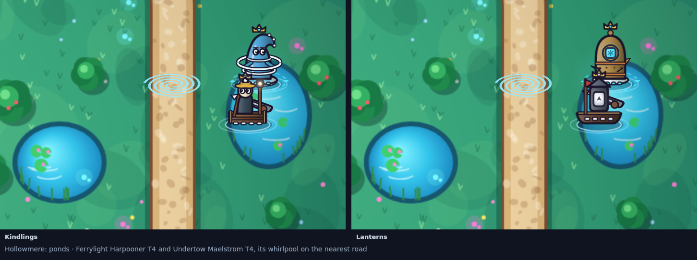
Hollowmere: a pond beside the road fits two tier 4 water wards, just.

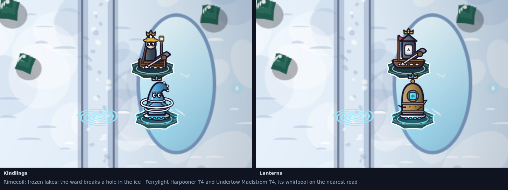
Rimecoil: each ward has broken a hole in the frozen lake.

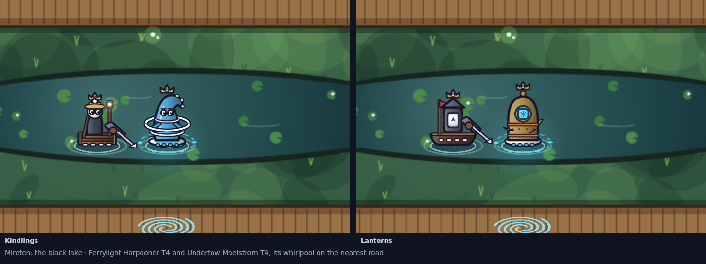
Mirefen: the black lake between the causeway's straights. Every spot is in reach.

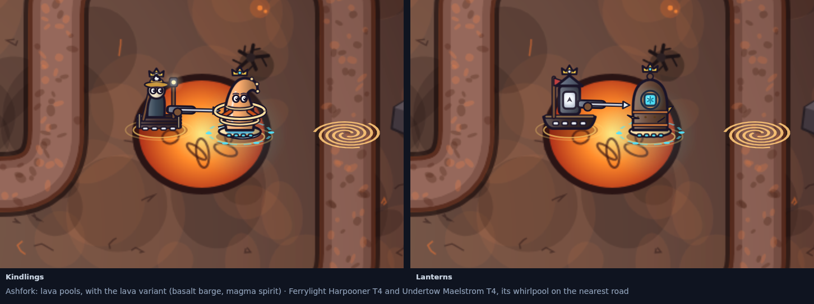
Ashfork: the lava variant, a basalt barge and a spirit of molten rock in a lava pool.

**Placement rule:** a water ward can only be placed on a pond (the reverse of every other ward), and its footprint must fit inside the shore. Water spots don't compete with land, which is the category's main draw. Water wards float (they bob gently, like the Wandering Light) and stand in rings of ripples instead of on a plinth.

## 2a. Ferrylight

**Role:** water. Single target and pierce, then a path choice of drag-back, patrols or a Dazzling beam. **Damage:** Kinetic (unlit). **Base cost:** about 400. **Family:** Vessel (new): a long low hull with a mast.

**What it does:** a lantern-lit raft drifting on the water. Its keeper throws a boathook-bolt about once a second (12 damage, range 165) at enemies on the road, targeting *First* by default. It hits flyers.

**Looks.** Kindlings: a ferry-keeper kindling in an oilskin hat on a log raft, poling, a lantern on its mast. Lanterns: a lantern-boat whose cabin is the lantern.

| Path | Identity | Tier 1 | Tier 2 | Tier 3 | Tier 4 (+ ability) | Tier 5: signature |
|---|---|---|---|---|---|---|
| **Harpooner** (Might) | piercing harpoons that drag the Gloom back up the road | **Barbed Hook**: x1.5 damage, pierce 2 | **Harpoon**: pierce 4; the first enemy hit is dragged 30 px back up the road (not Heavies) | **Harpoon Gun** (a deck gun on a winch): x2.5 damage, ignores armour, drags 60 px; Heavies are slowed 40% instead | **Whaler**: drags 90 px, chaining up to 3. *Ability, Reel In:* harpoons the strongest non-boss in range and drags it 300 px back | **Heartline**: a colossal winch-ballista whose chain glows. *Anchor Line:* harpooned enemies are chained to the raft for 3 s and can't move further from it, Heavies included (bosses 1 s) |
| **Flotilla** (Many) | it launches little light-rafts that patrol and fire | **Oarsman**: x1.3 rate | **Light-raft**: one light-raft patrols the shore and fires its own bolts | **Flotilla**: 3 rafts, which patrol any water within 300 px | **Lantern Fleet**: 5 faster rafts. *Ability, Broadside:* every raft fires fans of 6 bolts for 4 s | **Lantern Armada**: a tall ship of light behind it. *Shore Party:* rafts can run up onto the road for 120 px each side of their water, firing, then return |
| **Lighthouse Barge** (Craft) | a sweeping beam that Dazzles the Gloom it lights (it never boosts wards: that's the Beacon) | **Signal Lamp**: +25 range | **Lamp Mast**: a lamp sweeps a 30° arc of road back and forth. Gloom in it are Dazzled (20% slower, Heavies too), and Veiled in it are revealed while lit | **Lighthouse**: the beam sweeps 400 px of road. Dazzled 35% slower and they take +15% from every ward | **Great Light**: Dazzled 45% slower (bosses at half strength), and a Herald in the beam loses its haste aura while lit. *Ability, Lightfall:* the beam stops and holds one spot for 6 s: everything in it stops dead for 1 s, then stays Dazzled (bosses are only slowed) | **Harbour Star**: a great lighthouse behind it, twin beams. *Safe Harbour:* the two beams sweep in opposite directions. Anything lit by both at once stops for 2 s (bosses 0.5 s), and Veiled lit by either stay revealed for 6 s |

**Strengths.** Free placement on water. The Harpooner sends fast leakers and hasted rushes back. The Flotilla covers flyers over the ponds. The Lighthouse Barge slows whole stretches of road, Heavies included, and reveals Veiled as it sweeps. Flexible: three quite different jobs.

**Weaknesses.** Water only (lava on Ashfork). On Hollowmere many pond spots are 75-100 px from the road, so short-range builds can't reach. Drags fail on Heavies and bosses until tier 5. Kinetic is resisted by Husks and the Bastion, except on the Harpoon Gun. Weak against crowds except on the Flotilla. Strongest on Mirefen (no cap, by decision).

**Synergies.** The Mortar, Rime, Undertow and Lampwright (enemies dragged back walk through their zones again). The Thornlight Snare (re-triggers). **Overlap (settled):** the Ballista nudges every enemy it pierces, the Undertow holds a stretch, and the Harpooner drags one chosen enemy far. The Lighthouse Barge no longer boosts wards, so it doesn't overlap the Beacon's Lighthouse.

**Risks.** Drag-back loops: **no pushback limit for now (decision 5).** We watch how it plays, with the test tools' stall guard and pushback counts as the safety net. A Dazzle doesn't stack with other slows (strongest wins). Moving an enemy back means lowering its distance along the path, and a flyer's along its flight line. Five rafts per ward are moving units, which is cheap. UI: none beyond the water placement rule.

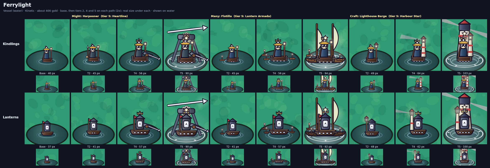
The Ferrylight on every path, shown on water. Tier 5: Heartline's gantry and lance, the Armada's sails, the Harbour Star lighthouse.

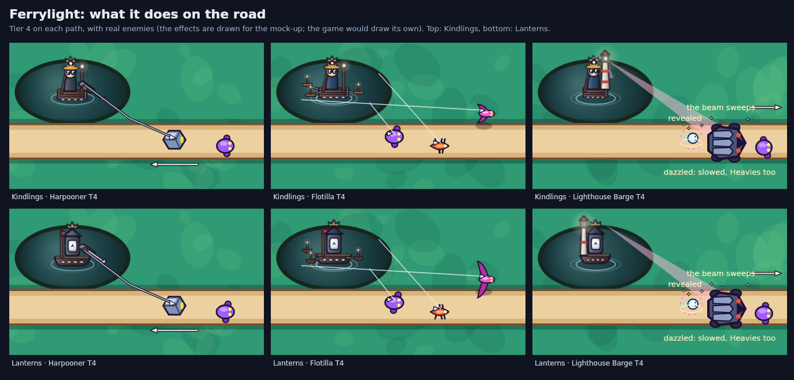
A harpoon dragging a Husk back up the road. Light-rafts firing at a Gloomwing and Shamblers. The lighthouse beam sweeping the road, revealing a Wisp and Dazzling a Dreadhulk.

## 2b. The Undertow

**Role:** water. Crowd control on the nearest stretch of road: slows, then drags back. **Damage:** Frost. **Base cost:** about 450. **Family:** Spring (new): a teardrop rising from a foam ring.

**What it does:** a lake spirit rises from the water and twists the nearest stretch of road (within 150 px) into a whirlpool 40 px across. Gloom inside are slowed 35%, pulled back 12 px a second and take 4 damage a second. R moves the whirlpool to another stretch within reach, as the Wandering Light moves its post. It doesn't touch flyers.

**Looks.** Kindlings: a sea-blue lake spirit rising from the water, its top curling over into a breaking crest with foam on its lip, and a band of foam swirling round it (so it doesn't read as the Rime Spire's pale frost dome). Lanterns: a brass diving-bell lantern rising out of the water, its porthole the light.

| Path | Identity | Tier 1 | Tier 2 | Tier 3 | Tier 4 (+ ability) | Tier 5: signature |
|---|---|---|---|---|---|---|
| **Maelstrom** (Might) | bigger, damaging whirlpools | **Strong Current**: slow 45%, pull 18 px/s | **Whirlpool**: radius 55, 12 damage/s; Gloom inside take +15% from everything | **Maelstrom**: radius 70, 30/s, pull 30 px/s; small Gloom spin in place for 1 s as they enter | **Great Whirl**: radius 85, 60/s. *Ability, Riptide:* for 5 s it pulls everything within 140 px into its centre (not bosses) | **Great Maelstrom**: a waterspout behind it. *Waterspout:* every 12 s it lifts the small Gloom in it and drops them 200 px back up the road; it can pluck Gloomwings out of the air and drop them as walkers for 3 s |
| **Tidecaller** (Many) | waves surge across the road, knocking crowds back | **Swell**: +20 reach | **Wave**: every 4 s a wave crosses a 90 px stretch, knocking non-Heavies back 40 px | **Tidecaller**: two stretches, 60 px; Heavies slowed 50% for 1 s | **Spring Tide**: a wave every 2.5 s, 80 px. *Ability, Flood:* for 6 s the road within 220 px floods: everything at half speed, non-Heavies pushed back 120 px | **Tidal Throne**: a towering wave about to break, behind it. *Breaking Wave:* every 15 s a great wave runs 300 px back down the road toward the Rift, carrying every non-boss with it |
| **Abyss** (Craft) | small Gloom are pulled under; big ones lose layers | **Deep Water**: the whirl's dark centre deals +8/s | **Undertow Grip**: small one-layer Gloom that stay 1.5 s in the centre are pulled under (half bounty) | **Abyss**: anything with 1-2 layers is pulled under every 2 s; tough Gloom (Husks, Aegis) lose a layer every 2 s inside it | **Drowning Deep**: Heavies lose 2% of their health a second inside it. *Ability, Maw:* for 4 s it swallows every non-tough enemy within 80 px | **Drowned Deep**: a black ring of the deep behind it, tendrils rising. *The Deep:* bosses in the whirl lose 1% of their max health a second, and nothing inside can be healed or shielded |

**Strengths.** Control from somewhere nobody else can stand. It counters fast Gloom: Skitters, Wisps, and Herald rushes, since its slow eats the haste. It handles Brood swarms and corners where crowds bunch. Abyss strips Husks and cleans up small Gloom. Its tier 5 is a third Mender answer. It sets up every area ward on the same stretch.

**Weaknesses.** Water only. It works on one stretch of road, the one nearest its pond. No flyers (except the Waterspout). Heavies halve its slows and ignore its drags and spins; bosses can't be pulled under. Low damage until Maelstrom 3. A pond far from the road is useless to it.

**Synergies.** Mortar, Storm Coil, Censer, Rime and Choir on its stretch. The Ferrylight. Lampwright candles under the whirl. **Overlap:** Rime Spire (Frost, slow). **Settled:** the Undertow never freezes, its current also pulls back, and its slow doesn't stack with the Rime's (strongest wins). It works from water. The look-alike is fixed.

**Risks.** Stalling: drag-back stacks with harpoons and waves, and there's **no cap for now (decision 5)**. The test tools' stall guard keeps bots and balance runs from hanging, and they report how far Gloom were pushed back. Readability: the whirlpool must not hide the road, so draw it as one cached rotating sprite at low alpha. Moving its stretch needs the R action (an existing UI pattern).

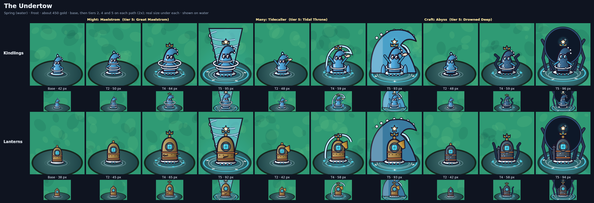
The Undertow on every path, on water. Tier 5: the Great Maelstrom's waterspout, the Tidal Throne's wave, the Drowned Deep's black ring.

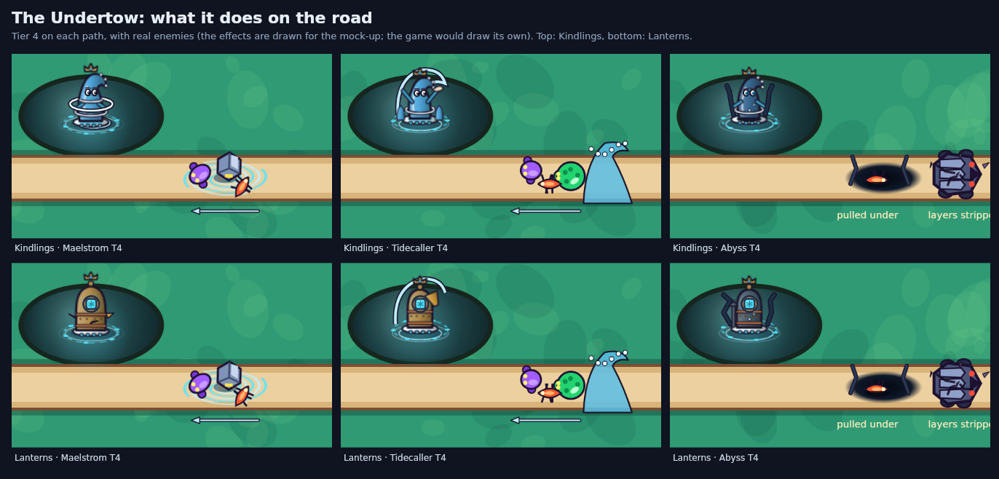
A whirlpool on the road dragging Gloom back. A wave knocking a crowd back. The Abyss pulling a Skitter under and stripping a Dreadhulk's layers.

## Ferrylight against the Undertow

| | Ferrylight | The Undertow |
|---|---|---|
| Job | damage, then drag / patrol / support | control of one stretch of road |
| Fills a gap | water space; Dazzle holds Heavies; Herald (Great Light) | water space; moving the Gloom back; fast leakers; Herald (partly), Mender (tier 5) |
| Blind spots | armour (Kinetic); Heavies until tier 5; crowds | flyers; Heavies and bosses; only one stretch |
| Overlap (settled) | Ballista (it nudges, the Harpooner drags one far) | Rime Spire (never freezes; pulls back) |
| Most novel part | Shore Party; Anchor Line | the road becoming a whirlpool; Waterspout |

**Both are being built.** The Undertow is about *the road next to the water*. The Ferrylight is a raft that fights from the water. With the Lighthouse Barge now working on the Gloom, the two don't share a job. Both work on all four maps, with the lava variants on Ashfork.

---

# 3. Off-path wards that keep putting things on the path

**Decided:** the Lampwright is being built; the Runewright isn't (it's kept below for reference). Both stand beside the road like any ward and keep producing objects on it. The Thornlight Snare is one trap you place yourself.

## 3a. Lampwright

**Role:** road-maker. Cheap, constant crowd-thinning with burning candles. **Damage:** Fire (burn; Scorched: no healing). **Base cost:** about 225. **Family:** Thrower (new): a figure beside a basket of what it throws.

**What it does:** a lamplighter who keeps tossing lit wax candles onto the road within 140 px, about one every 1.4 s. It aims ahead of the Gloom, at stretches they're about to walk. A candle burns for 8 s, with up to 6 alive per Lampwright (caps: "Performance design", below). Anything that walks over one (within 12 px) burns for 6 damage a second for 2 s and is **Scorched**, so it can't be healed: a second Mender counter. Candles hit Veiled. They can't touch flyers.

**Looks.** Kindlings: a sooty lamplighter in a cap with a long lighting pole and a basket of candles. Lanterns: a squat, soot-black lamp hanging from a crooked lamplighter's pole, with a candle hopper and a little throwing arm (not an upright lamp on a post, which is the Beacon).

| Path | Identity | Tier 1 | Tier 2 | Tier 3 | Tier 4 (+ ability) | Tier 5: signature |
|---|---|---|---|---|---|---|
| **Tallow** (Might) | bigger, longer-lasting candles | **Thick Wax**: candles last 12 s, +50% burn | **Pillar Candles**: radius 20, 14/s | **Wax Vat**: great tallow candles, radius 28, 30/s, 18 s; their wax puddles slow 20% | **Everburning**: radius 34, 70/s. *Ability, Wax Seal:* the wax hardens: everything standing on a candle is stuck for 1.5 s (Heavies 0.5 s, not bosses) | **Undying Taper**: a giant dripping candle behind it. *Taper:* you place one giant candle in range that never goes out and burns everything within 60 px at three times the tier 4 rate |
| **Wickstorm** (Many) | many small candles, thrown fast | **Quick Hands**: +40% toss rate | **Taper Bandolier**: tosses 2 at once, up to 10 alive | **Candle Wheel**: a spinning wheel slings 4 small candles in a line, up to 18 alive | **Wickstorm**: up to 24, x2 rate. *Ability, Wickfall:* scatters 24 candles over the road in range at once (within the caps: the oldest go out) | **Thousand Wicks**: a candelabra tree of flames behind it. *Wildwick:* when an enemy dies on a candle, the candle splits in two (within the caps, at most 8 splits a second), so a crowd lights its own way |
| **Beaconwax** (Craft) | candles that reveal Veiled and slow anything near | **Bright Wax**: candles reveal Veiled within 30 px | **Votive Light**: slow 15% within 30 px; reveal 50 px | **Beaconwax**: each candle is a small beacon: Veiled within 70 px count as seen by every ward; slow 25% | **Vigil**: enemies within 40 px of a candle take +15% damage. *Ability, Night Watch:* for 10 s every candle flares: reveal radius x2, slow 40% | **Eternal Vigil**: a rose window of light behind it. *Vigil Line:* candles link to their neighbours with lines of light; anything crossing a line is revealed, slowed and burned |

**Strengths.** Crowds and swarms: Skitters, Broods, Shamblers. Menders (Scorched). Veiled (area, and Beaconwax's reveal). Cheap, so it's an early ward. It never needs line of sight to a target, only road in range.

**Weaknesses.** Flyers: none. Heavies and bosses barely notice a short burn per pass. Fast enemies spend little time on a candle. Candles land where it guesses, not where you choose. Poor single-target damage. Useless with no road in range.

**Synergies.** Anything that keeps enemies on the candles: the Undertow, Rime Spire, Ferrylight's harpoon. The Censer's Ash (enemies stripped of resistance). **Overlap (settled):** the Censer's Scorched is shared on purpose (the Mender answer), but the Censer aims a cone and the Lampwright never aims. Wax Flood became Wax Seal, so Tallow no longer copies Inferno's lake of fire. The Snare is one trap you place yourself.

**Risks.** Performance, the biggest risk of the five, is designed for below. **Clutter:** candles could hide the road and the enemies' feet, so they stay small and low and are drawn under the enemies. Balance: burns don't stack; a new burn refreshes the old one.

### Performance design (decided: built in from the start)

**Caps** (simulation rules, so bots and balance never depend on graphics quality):

| | Candles alive per Lampwright |
|---|---|
| Base, Beaconwax | 6, then 8 from Beaconwax tier 2 |
| Tallow | 6, then 5 from tier 3 (fewer, bigger candles) |
| Wickstorm | 10 at tier 2, 18 at tier 3, 24 at tier 4 (was 32) |
| **Map-wide, all Lampwrights together** | **160** |

- When a cap is reached, the oldest candle goes out first (a short fade). Candles in flight count against the cap.
- Wickfall and Wildwick stay within both caps, and Wildwick splits at most 8 times a second per ward.
- The upgrade panel says "160 candles on the map at most".

**Simulation:**
- **Storage.** One flat pool of candles on the game (`game.candles`), reused objects with no allocation per frame. Each holds x, y, route, distance along the road, radius, damage, time left and its ward.
- **Ticks.** Candles tick every 0.25 s, like ground zones (`updateZones`), not every frame. Each tick is one `game.grid` query: at the cap that's 640 small queries a second.
- **Status effects.** The burn and Scorched reuse the Censer's existing burn and `searT` state. An enemy burns from one candle per tick, so overlapping candles don't stack. The only new field on an enemy is a last-tick time, like `zoneT`.
- **Throws.** A throw picks its spot once, ahead of the leading enemy on the nearest road (`map.nearestRoute`), from the enemies already in range.
- **Vigil Line.** Links are rebuilt only when a candle lands or goes out (neighbours within 70 px, ordered by distance along the road), never every frame.

**Drawing** (in the ground pass with the zones and the Snare, before the enemies, so no ghosts):
- **Sprites.** Each skin has its own candle sprites: wax stubs for Kindlings, little glass votives for Lanterns. There are three sizes (taper, pillar, great tallow), each a pre-rendered image with 4 flame frames and the glow and any wax puddle baked in. That means no gradients, shadowBlur or save/restore per candle.
- **Draw calls by `Renderer.quality`:**
  - 2: one `drawImage` per candle body, then all flames in one `lighter` pass, 2 calls per candle.
  - 1: one call per candle, with body and flame from a single baked frame.
  - 0: no flicker; small candles are one batched path of dots (about 1 call for all of them), and big ones one `drawImage` each.
- **Other pieces.** Fading candles are grouped into a few alpha steps. All Vigil Line links are one path and one stroke. A candle in flight is one `drawImage` on its arc, with no trail.
- **Budget.** At the 160 cap that's at most about 320 calls in the ground section at full quality and about 30 at quality 0. Check with a `perf.mjs` stress scene (several Wickstorm tier 4s at the cap, wave 80) before it ships. The FPS overlay shows the candle count.

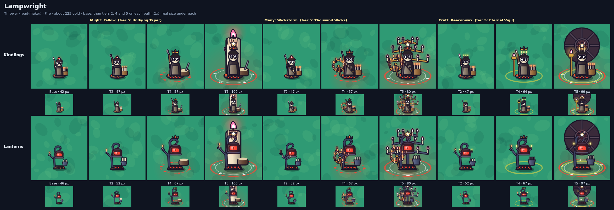
The Lampwright on every path. Tier 5: the Undying Taper, the Thousand Wicks candelabra, the Eternal Vigil's rose window.


Great tallow candles. A road scattered with small Wickstorm candles. Beaconwax candles revealing a Wisp. The Mender walking over them is Scorched.

## 3b. Runewright (not chosen; kept for reference)

**Role:** road-maker. Burst traps where you choose. **Damage:** Blast. **Base cost:** about 325. **Family:** Carver (new): a figure beside a rune tablet.

**What it does:** a rune-carver who etches glyphs into the road. You choose up to 3 rune spots within 150 px: press R, then click the road, as with the Wandering Light's post. By default it uses the nearest corner. It carves a rune about every 5 s and keeps 2 armed at once. A rune arms in 1 s and goes off when an enemy steps on it: a blast 50 px across for 60 damage. Runes hit Veiled (they trigger by area). Flyers never touch them. Fewer but stronger than candles, and placed by you.

**Looks.** Kindlings: a stone-carver in a grey apron with hammer and chisel, a slate rune tablet beside it with a glowing glyph. Lanterns: a carved waystone lantern with a chisel arm.

| Path | Identity | Tier 1 | Tier 2 | Tier 3 | Tier 4 (+ ability) | Tier 5: signature |
|---|---|---|---|---|---|---|
| **Ember Rune** (Might) | fiery explosions | **Deep Cut**: x1.5 blast damage | **Ember Rune**: radius 65, leaves a 3 s fire patch (a Fire accent: Scorched) | **Rune of Ruin**: x3; blasted enemies take +30% for 4 s (cracked plate) | **Wrathrune**: x6, radius 80. *Ability, Chain Detonation:* every armed rune goes off at once at x2 | **Ember Script**: a colossal rune-stone behind it, its rune burning. *Script:* a rune going off sets off the next rune within 120 px 0.3 s later, each 20% bigger: a chain reaction down the road |
| **Frost Rune** (Many) | many small runes that freeze the crowd in place | **Quick Chisel**: carves 40% faster | **Frost Rune**: runes freeze everything within 45 px for 1 s (Heavies slowed 50%); holds 4 | **Rune Field**: carves 3 small runes at once in a cluster; holds 9; freeze 1.5 s | **Hoarfrost Field**: holds 15; freeze 2 s; frozen enemies take +30%. *Ability, Glacial Script:* freezes everything on every rune spot for 3 s | **Winter Script**: a circle of standing frost stones behind it. *Rime Line:* frost spreads along the road between neighbouring runes, slowing everything on those stretches by 50% |
| **Seal Rune** (Craft) | a seal that briefly stops even big enemies | **Binding Mark**: runes also slow 30% for 2 s | **Seal Rune**: the first enemy on it is sealed: it stops for 1.5 s (Heavies 0.5 s, bosses 0.25 s), and its aura is silenced for 4 s (Herald haste, Mender heals, Aegis shield regrowth) | **Greater Seal**: 2.5 s (Heavies 1 s); seals the 3 nearest | **Sigil of Binding**: seals everything within 50 px; Heavies 1.5 s, bosses 0.6 s; silence 8 s. *Ability, Seal of Silence:* silences every Herald and Mender on the map for 8 s | **Seal of Ages**: a huge floating seal ring with chains behind it. *Ward of Ages:* once a wave, a boss that steps on a seal is held for 3 s and its next phase call is cancelled |

**Strengths.** Burst exactly where crowds bunch (corners, merges). The Seal Rune is the only control in the game that works on Heavies and bosses, briefly, and it silences Heralds and Menders, so it covers both gaps at once. Frost Runes freeze whole crowds. It gives the player a real "where" decision.

**Weaknesses.** Flyers: none. Slow carving: only a few runes are armed at once, so a dense wave can step on them all and walk on. One trigger per rune: a lone Skitter can waste a rune. Weak sustained damage. It needs a little attention (choosing spots), though the default works. Bosses get only fractions of a second of seal.

**Synergies.** The Undertow and Ferrylight's harpoon bunch Gloom onto runes. The Mortar and Choir finish frozen or sealed crowds. **Overlap:** the Thornlight Snare, also a trap on the road. The difference: the Snare is a single fixed object you place on the road. The Runewright stays off the road and keeps carving new runes at spots you choose.

**Risks.** UI: choosing spots (reuse the Wandering Light's post UI, and show rune spots as faint circles). Balance: Chain Detonation with several Runewrights is a big burst, and seal-locking bosses is stall cheese. Limit it: each boss can be sealed at most once every 10 s, and seals never stack. Performance: low, at most 15 runes per ward.

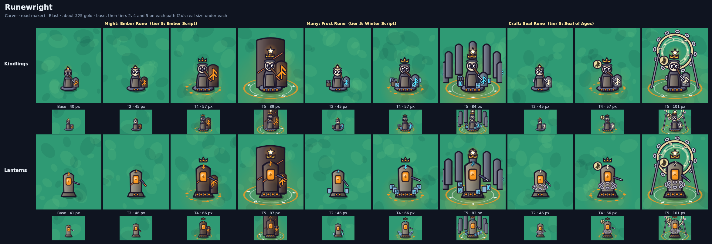
The Runewright on every path. Tier 5: the Ember Script stone, the Winter Script circle, the Seal of Ages ring.

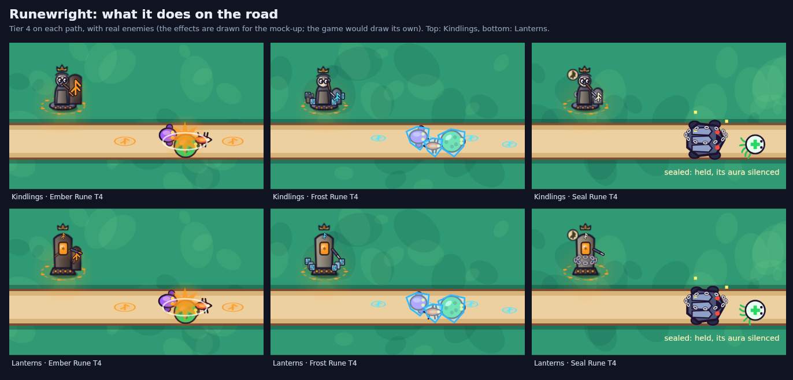
An Ember Rune going off under a crowd. A Frost Rune field freezing a crowd. A Seal Rune holding a Dreadhulk.

## Lampwright against Runewright (the Lampwright was chosen)

| | Lampwright | Runewright |
|---|---|---|
| Job | constant, cheap chip damage over a stretch | burst and control at chosen spots |
| Fills a gap | Mender (Scorched); Veiled support (Beaconwax) | Herald and Mender (silence); holding Heavies (seal) |
| Blind spots | flyers; Heavies; precise targeting | flyers; dense waves (few runes armed); sustained damage |
| Objects on the road | many (candles) | few (runes) |
| Overlap | Censer, Cinder, Snare | Snare |
| Most novel part | Wildwick, Vigil Line | Seal, Script chain reactions |

---

# Lineup and silhouette test


The 12 current wards and the six concepts (gold) at real size, base, tier 4 and tier 5, both skins. `lineup-2x.png` is the same sheet doubled.

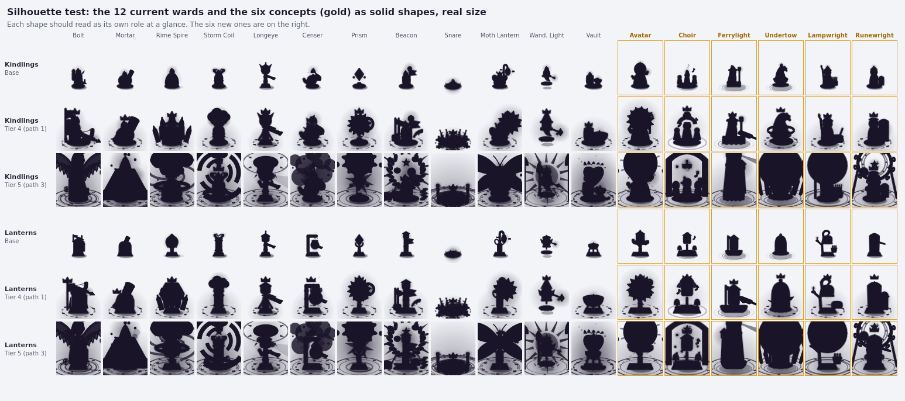
The same lineup as solid shapes (glows show as grey haze).

What it shows:
- **They fit the roster's scale.** The new base wards stand 37-46 px, like the current ones. The two premium wards read as more important through width and mass (a halo disc, a dais of singers), not height, since they use the normal caps.
- **Distinct:** the Avatar (big round halo head), the Choir (a row of small figures, unlike anything else), the Ferrylight (a hull and mast on water), the Runewright (figure plus tablet; Lanterns a rounded headstone shape).
- **Closest pairs, now fixed** (re-rendered 2026-11-27):
  - The Kindlings Undertow at base against the Kindlings Rime Spire. Both were pale-cyan domed spirits, and both are Frost. **Fixed:** the Undertow is now a sea-blue wave curling over into a breaking crest, with a band of foam round it, standing in water.
  - The Lanterns Lampwright at base against the Lanterns Beacon. Both were a lamp on a post. **Fixed:** the Lampwright is now a squat, wide lamp hanging from the hook of a crooked pole.
- **Tier 5s are all big framing shapes**, like the current ones, so at tier 5 the silhouette test is about the second form's outline: sun, armillary, black sun; bell, choir rows, arch; gantry, sails, lighthouse; spout, wave, ring; taper, candelabra, rose window; stone, circle, seal ring. All 18 differ.

# Rerunning it

```
CANVAS_MODULES=~/scratch/rnd/node_modules FONT_DIR=<dir with DejaVuSans.ttf and DejaVuSans-Bold.ttf> \
  node docs/concepts/_src/render-nw2.mjs [check|sheets|attack|lineup|water]   # default: everything
```

It prints the cap and body-box checks and the water numbers above, and writes everything in `docs/concepts/new-wards-2/` in a few seconds. The new wards exist only inside the script: `registerNewWards()` adds them to the skin tables in that process. The game never sees them.
