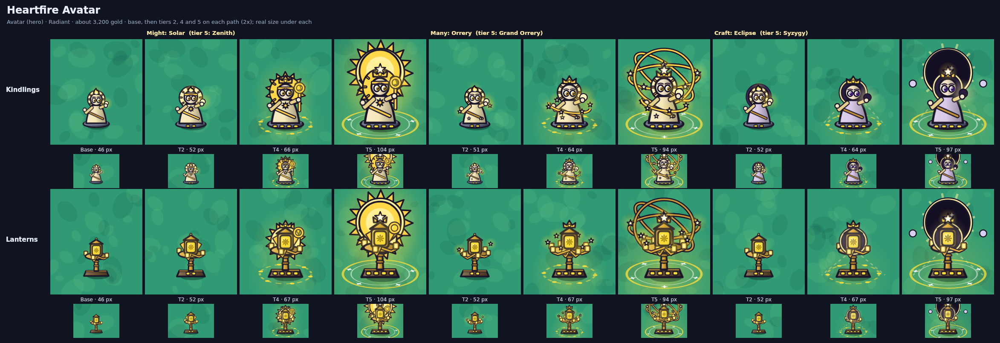
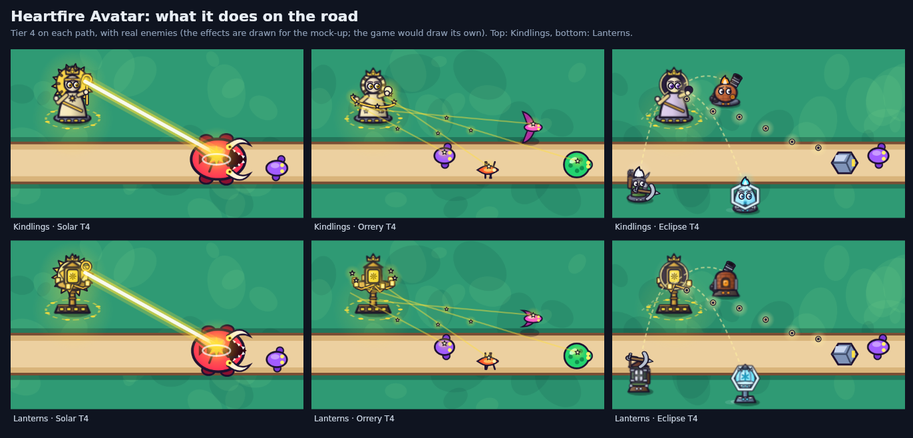
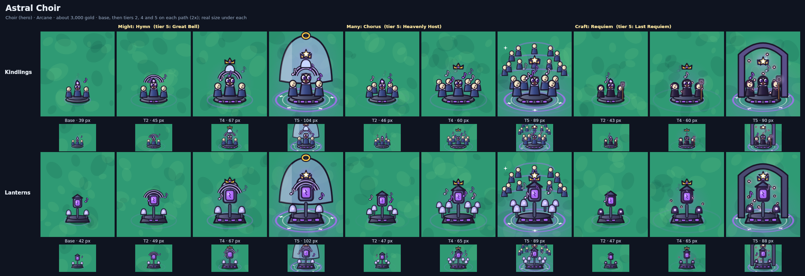
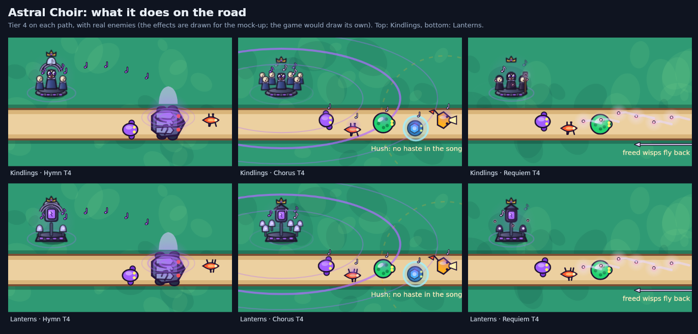
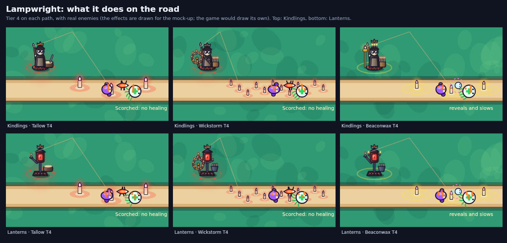
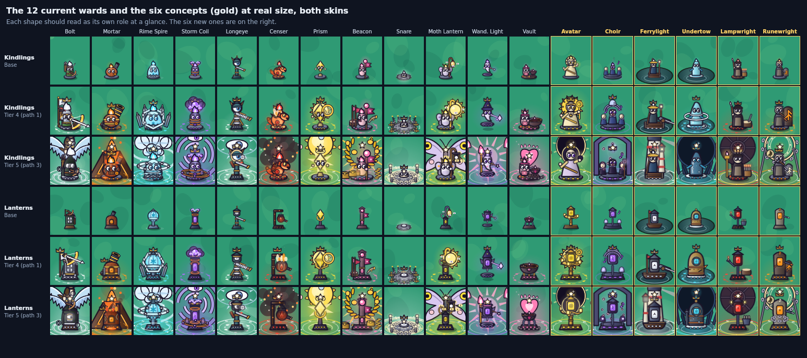

# New ward concepts, round 2: six designs to choose from (2026-11-25)

Design only: no game code was changed. The mock-ups are drawn with the game's own ward kit, so they use the same units, tier ladder, notches and pips, crowns, tier 5 sigil and diadem, body-and-face rule and height caps as the real wards. They live in `docs/concepts/new-wards-2/`, rendered by `docs/concepts/_src/render-nw2.mjs` (art in `nw2-art.mjs`, effects in `nw2-fx.mjs`), and in the gallery on port 3002 under "New ward concepts". Numbers (damage, costs, radii) are first estimates to show the shape of each ward, not tuned balance.

## Summary

**My recommendation for each pair:**

| Category | Recommend | Over | Why |
|---|---|---|---|
| Hero ward | **Astral Choir** | Heartfire Avatar | It's a new role: the only ward that touches most of the map at once. Its song cancels Herald haste (the roster's one threat with no counter), and Requiem's freed wisps carry the game's story, since the Gloom are corrupted lights. The Avatar is the stronger fantasy and its Orrery and Eclipse paths are fresh. But its Solar path overlaps the Prism's Focus beam, and in the end it mostly adds damage. I'd keep the Avatar as the second hero. |
| Water ward | **The Undertow** | Ferrylight | It's purer and more distinct. It reshapes a stretch of road into a whirlpool, the game's first real "move the Gloom backwards" ward, and it works the same on every water map. The Ferrylight's three paths overlap existing wards: the Harpooner overlaps the Ballista's knockback and the Lighthouse Barge overlaps the Beacon's Lighthouse path. |
| Road-maker | **Runewright** | Lampwright | You choose where the runes go, a new kind of decision. The Seal Rune is the only control that briefly holds Heavies and bosses, and it silences Heralds and Menders, so it covers both named gaps. It also keeps very few objects on the road. The Lampwright is charming and cheap but overlaps the Censer and Cinder fire. Its dozens of candles are the biggest performance risk of the six. |

**The gaps each concept fills:**

| Gap (from `tower-ideas.md`) | Filled by |
|---|---|
| **Herald (haste) has no counter** | Astral Choir: *Hush*, no haste works inside its song. Runewright Seal Rune: sealed Heralds are silenced. Partly: the Undertow's slows. |
| **Menders countered only by the Ember Censer** | Lampwright: its burning wax Scorches (no healing). Runewright Seal Rune: silences Menders. Undertow's tier 5 Drowned Deep: nothing in its whirl can be healed or shielded. |
| **Nothing holds Heavies or bosses** | Runewright Seal Rune (short holds, with limits). Ferrylight's tier 5 Heartline (anchored, 1 s on bosses). |
| **Nothing moves the Gloom backwards** | The Undertow (all paths), Ferrylight Harpooner, Astral Choir's Requiem tier 5. |
| **Nothing keeps producing on the path** | Lampwright (candles), Runewright (runes). |
| **Water is dead space on every map** | Ferrylight, the Undertow. |
| **No late-game "hero" to save up for** | Heartfire Avatar, Astral Choir. |

**Decisions I need from you:**
1. **Which concept in each pair** to build (my picks are above).
2. **Hero pricing and rules.** I propose a base cost of about 3,000-3,200 (a player has about 7k gold in total by wave 10). The tier 5 would cost about 25-28k, so it's an endless-mode purchase. I suggest one of each hero per map, or decide it's one hero in total. The Avatar's "near the Heartfire" placement rule is optional. Both heroes currently use the normal height caps (46 / 68 / 104 px) and get their presence from width and mass; give them their own caps if you want them taller.
3. **Ashfork has lava, not water.**
   - (a) **Recommended:** lava pools count as water for these wards, using a *lava variant* with identical stats: a basalt barge and a spirit of molten rock (mocked up below).
   - (b) Add a small lake to Ashfork. That changes the map, so the bot would need rerunning there.
   - (c) No water wards on Ashfork.
4. **Rimecoil's frozen lakes**: I recommend they count. The ward breaks a hole in the ice (drawing only, mocked up below).
5. **Mirefen is mostly water.** It has about 5x Hollowmere's water spots, and every one of them is in reach of the road. Accept it as "the water map", or cap water wards (say 4 per map).
6. **A pushback limit**, if a drag-back ward ships: cap how far one enemy can be moved back per wave (say 400 px), so harpoons, whirls and waves can't stall a wave forever.
7. **Two overlaps to settle if those concepts are chosen.** First, the Avatar's Solar beam against the Prism's Focus: keep it as a boss-percentage beam, or change it to "sunspears" (piercing lances). Second, the Ferrylight's Lighthouse Barge against the Beacon's Lighthouse: make them not stack, or give the Ferrylight a different third path.
8. **A rename I made:** you suggested "Constellation" for the Avatar's star path, but Constellation is already a tier 5 (the Thornlight Snare's Flashmines). I called the path **Orrery** instead.

## How these follow the rules

- **Upgrade framework:** each ward has Might / Many / Craft paths (one bigger thing / more of it / a trick). The paths split visibly at tier 2, change form at tier 3, reach a crowned tier 4, and add a second form at tier 5 that frames the ward from behind. The mock-ups draw tiers 0, 2, 4 and 5 on every path in both skins. Tiers 1 and 3 are described here but not drawn.
- **Role silhouettes:** four new families, each meant to pass the black-shape test. *Avatar* is a tall robed figure with a disc behind its head. *Choir* is a ring of small figures. *Vessel* is a long low hull with a mast, always on water. *Spring* is a teardrop rising from a foam ring, always on water. The two road-makers are figures beside a tool: a basket of candles (Lampwright) or a rune tablet (Runewright). See the silhouette test below for where they're close.
- **Damage colours:** the six use six of the eight colours, so none needs a ninth. Avatar Radiant (yellow, sun glyph), Choir Arcane (violet, zigzag), Ferrylight Kinetic (silver, unlit, arrow), Undertow Frost (cyan, snowflake), Lampwright Fire (red, flame), Runewright Blast (orange, burst). A path that adds an element shows it as an accent: the Frost Rune's cyan glyphs, Beaconwax's yellow reveal ring.
- **Body and face; height caps:** checked with the same tests as `tools/wards.mjs`, on 6 wards x 2 skins x 10 states. All pass: no ward breaks its cap, and no gear covers more than 30% of a body box. Heights are printed under each cell of the sheets.
- **Original:** the names, art and mechanics are new. Where an idea is a genre staple (a beam, a slowing area, a trap) the twist is the game's own: Heartfire light, freed Gloom, runes, candles.

---

# 1. Super-powerful, expensive wards ("heroes")

Proposed hero rules, shared by both: about 3,000+ gold at base. One of each per map (or one hero in total: decision 2). Upgrade costs scale up: roughly 500 / 1,200 / 2,800 / 7,500 / 26,000 for tiers 1-5, against about 100 / 220 / 750 / 3,900 / 17,500 for a normal ward. Heroes keep the one-of-each tier 5 rule. At base, a hero should feel like a tier 2-3 ward in power and cover more than any single normal ward, but cost about as much as a whole early defence.

## 1a. Heartfire Avatar

**Role:** hero, sustained single-target damage, with each path picking a specialism. **Damage:** Radiant (ignores resistances). **Base cost:** about 3,200. **Family:** Avatar (new): a tall figure with a disc behind its head.

**What it does:** a shard of the Heartfire given form. It pours out a relentless torrent of radiant motes: about 8 a second at 6 damage each (about 48 DPS, three base Bolt Wards' worth). The motes home in on one target within 200 px, and they hit flyers. Its own glow reveals Veiled within 110 px of it, but not across its full range. A shard can't wander far from its fire: it must be placed within 380 px of the Heartfire (optional rule, decision 2). So it guards the end of the road, not the start.

**Looks.** Kindlings: a towering sun-spirit in an ivory robe, a sun halo behind its head, a mote of light in its raised hand. Lanterns: a great golden chandelier on a gilded stand, its centre lantern the light, a ring of arms each holding a small lamp.

| Path | Identity | Tier 1 | Tier 2 | Tier 3 | Tier 4 (+ ability) | Tier 5: signature |
|---|---|---|---|---|---|---|
| **Solar** (Might) | the motes fuse into one burning beam that melts bosses | **Kindled Core**: motes x1.5 damage | **Sunlance**: every 5th mote is a lance that pierces 6 and ignores armour | **Solar Flare**: the torrent becomes a beam on one target, ramping x1 to x4 over 2.5 s (resets on a new target); +50% vs bosses | **Noonfire**: ramps to x8; the ground under the target burns (Scorched). *Ability, Sunfall:* a 6 s pillar on the strongest enemy, 4% of its max health per second, bosses included | **Zenith**: a great sun rises behind it. *High Noon:* the beam keeps its ramp while any boss is in range, and each second on the same boss makes it take +5% from every ward (up to +50%) |
| **Orrery** (Many) | a court of stars, each firing on its own | **First Star**: one star orbits and fires motes at a different target | **Twin Stars**: 2 stars, +20 range | **Orrery**: 4 stars on a brass armillary; each has its own targeting (First, Strong, Close, Flyers); stars x2 vs flyers | **Starwheel**: 6 stars, firing twice as fast. *Ability, Starfall:* every star dives onto its target and bursts (6 blasts, radius 50), returning after 3 s | **Grand Orrery**: a huge armillary sphere behind it. *Lent Stars:* up to 3 stars can be sent to circle other wards anywhere on the map; they fire from there, and a ward with a star sees Veiled |
| **Eclipse** (Craft) | it feeds on the light of the wards around it | **Penumbra**: tethers to wards within 120 px (max 6), +6% damage each; tethered wards lose 3% | **Umbra**: up to 8 tethers, +8% each; +25 tether radius | **Eclipse**: the halo darkens to an eclipse; tethered wards stop losing damage and share its Veiled sight | **Total Eclipse**: +10% per tether, up to 10. *Ability, Corona:* for 8 s every tethered ward fires 40% faster and the torrent doubles | **Syzygy**: a black sun and three aligned moons. *Alignment:* every 10 s every tethered ward fires one free shot at the Avatar's target at once, each at x3 its normal damage and in its own damage type |

**Strengths.** Relentless damage that ignores resistances. Solar is the best boss killer in the game, against the Gravemaw, Veilmother, Bastion and Hollow King. Orrery hits flyers and spreads its fire. Eclipse rewards a dense build and lends Veiled sight to the wards around it. It's the natural late-game target to save for.

**Weaknesses.** Single target at base and on Solar, so crowds, Broods and Skitter rushes leak past it until Orrery. It has no control at all: no slow, stun or push, so hasted Herald rushes still get through. At 3,200 it can't come before about wave 8-10. Its sight of Veiled is short. The Heartfire rule means the start of the road is someone else's job. Eclipse is weak on its own, and Solar overkills small Gloom.

**Synergies.** Bolt Ward Hunter's Mark (marks multiply the beam). Rime Spire and the Undertow (slowed enemies stay in the beam). Beacon (counts as a tether; War Drum speeds the stars). Eclipse with anything clustered. **Overlap:** Solar against the Prism's Focus and Dawnbreaker (decision 7).

**Risks.** Balance: a hero concentrates power in one ward, so a run is won or lost on it; the bot needs hero builds. Eclipse stacking with Beacons needs clear rules. Performance: about 8 motes a second, plus 6 stars at tier 4 Orrery, is about 60 projectiles a second. Draw the torrent as one ribbon with a few highlights rather than as single motes. UI: Lent Stars needs a "send to a ward" action, like the Wandering Light's R. The Heartfire rule needs a placement ring.


The Avatar on every path, both skins. Tier 5: Zenith's sun, the Grand Orrery's armillary, Syzygy's black sun.


Solar's beam melting a Gravemaw. The Orrery's stars, each on its own target. Eclipse tethered to a Bolt Ward, a Mortar and a Rime Spire.

## 1b. Astral Choir

**Role:** hero, area damage across most of the map. **Damage:** Arcane (x2 against shields, a fifth against Nullbacks). **Base cost:** about 3,000. **Family:** Choir (new): a ring of small figures on a round dais.

**What it does:** a circle of celestial singers. Every note strikes every enemy within 230 px for 8 damage, about one note every 1.2 s. That radius covers roughly a third of the map. Notes hit flyers and Veiled (it's an area effect). **Hush:** no Gloom inside the song can be hasted: a Herald's aura does nothing there. This is the Herald counter.

**Looks.** Kindlings: three robed singers on a round dais, the middle one bigger (the face anchor), notes rising. Lanterns: a carillon, a ring of glass bell-lanterns on posts round a centre lantern.

| Path | Identity | Tier 1 | Tier 2 | Tier 3 | Tier 4 (+ ability) | Tier 5: signature |
|---|---|---|---|---|---|---|
| **Hymn** (Might) | notes build to one crushing crescendo | **Deeper Voice**: notes x1.4 | **Rising Hymn**: every 6th note is a crescendo, x10 on the strongest enemy in range | **Crescendo**: every 4th note, x25, and it stuns for 1 s (Heavies are slowed instead) | **Grand Crescendo**: every 3rd note, x40. *Ability, Fortissimo:* the next 5 notes are all crescendos | **Great Bell**: a huge bell of light behind the choir. *Tolling:* each crescendo also hits everything within 60 px of its target, and a boss it hits can't call its phase adds for 4 s |
| **Chorus** (Many) | more singers, faster notes | **Second Voice**: +30% note rate | **Quartet**: 5 singers, x1.6 rate, +20 radius | **Choir Stalls**: 7 singers, x2.2 rate; notes slow 10% for 1 s | **Massed Choir**: x3.5 rate. *Ability, Chorale:* for 6 s every note hits twice | **Heavenly Host**: tiers of tiny singers on arcs of stars. *Echo:* every note echoes 0.5 s later at 60% damage across the whole map |
| **Requiem** (Craft) | the Gloom it kills are freed as wisps that fly back down the road | **Gentle Requiem**: 15% of kills in the song free a wisp that flies back up the road and strikes the first enemy it meets (30 damage) | **Lament**: 30%; wisps pass through 2 enemies | **Requiem**: every kill frees a wisp (up to 20 alive); wisps reveal the Veiled they pass and strip a layer | **Homecoming**: wisps pass through 4, x2 damage. *Ability, Release:* every living wisp joins one flood that sweeps the road back to the Rift | **Last Requiem**: a spiral of freed wisps rising through an arch of light. *Redemption:* shells and hulks (not bosses) killed in the song rise as a great lantern-wisp that walks back down the road for 6 s, holding back the small Gloom it meets (Heavies push through and take damage) |

**Strengths.** Crowds of every kind: Skitters, Broods, Shamblers, flocks of Gloomwings, Veiled Wisps (area), Aegis shields (Arcane x2). Counters the Herald. Requiem fights at the *start* of the road, where nothing else is. One ward covers what would take three or four area wards.

**Weaknesses.** Nullbacks shrug off Arcane (a fifth of the damage), and the Bastion calls them in. The damage per note is low, so Husks, Dreadhulks and bosses are only scratched except on Hymn. It's expensive and one per map. Its huge radius means it can't be placed "for" one spot.

**Synergies.** Mortar and the Bolt Ward cover the Nullbacks. The Undertow and Rime Spire hold crowds inside the song. Bolt Ward marks multiply every note. **Overlap:** Storm Coil (Arcane against shields) and Rime Spire (area pulses). The Choir is bigger but slower and weaker per hit.

**Risks.** Balance: map-wide area damage could make small Gloom trivial, so the damage per note must stay low and scale on its paths. Simulation: "every enemy in radius" is uncapped (the Rime caps at 30), but one pass a note is cheap. Visuals: one expanding ring and a few notes per strike, not one per enemy. Requiem's wisps are capped at 20.


The Choir on every path. Tier 5: the Great Bell (see-through, so the singers stay visible), the Heavenly Host, the Last Requiem's arch.


Hymn's crescendo on a Dreadhulk. Chorus striking the whole road, a Herald silenced. Requiem's freed wisps flying back down the road.

## Avatar against Choir

| | Heartfire Avatar | Astral Choir |
|---|---|---|
| Job | single target, bosses; a build-around (Eclipse) | crowds over most of the map |
| Fills a gap | the late-game focus; Veiled sight for neighbours | Herald (Hush); the start of the road (Requiem) |
| Blind spots | crowds; no control; short Veiled sight | Nullbacks; low per-hit damage; bosses (except Hymn) |
| Overlap | Prism (Solar) | Storm Coil, Rime Spire |
| Most novel part | Lent Stars, Eclipse tethers | Hush, freed wisps |

They complement each other: the Avatar kills the big things the Choir scratches, and the Choir clears the crowds the Avatar can't. If both ship, I'd make them two heroes of one hero rule (one of each per map), with the Choir first.

---

# 2. Water wards

## Water on each map

Measured from `data/maps.js` with the road from `sim/path.js` (`render-nw2.mjs` prints it). "Spots" are grid points 16 px apart and at least 12 px inside the shore. A ward needs about four, so divide by four for a rough count of wards. "In reach" means within 130 px of a road. The closest a pond comes to the road is 68-100 px on every map, so **a water ward needs a reach of at least about 110 px** to touch the road at all.

| Map | Its "water" | Area | Spots (≈ wards) | In reach of the road | Proposal |
|---|---|---|---|---|---|
| Hollowmere | 4 ponds | 24,000 px² | 50 (≈12) | 48 | Ponds are water as they are. Each pond fits only 1-2 tier 4 water wards (the render shows two just fitting). |
| Ashfork | 4 lava pools | 32,600 px² | 75 (≈19) | 43 (one pool is 140 px from any road) | **Lava variant** (recommended, decision 3): lava counts as water for these two wards, same stats, recoloured as a basalt barge and a magma spirit. The light, notches and whirlpool keep the ward's damage colour (cyan for the Undertow), so the one-channel rule holds. |
| Rimecoil | 4 frozen lakes | 46,000 px² | 115 (≈29) | 96 | Frozen lakes count. The ward breaks a hole in the ice (a ring of dark water and a white jagged rim under it). |
| Mirefen | the black lake, in 4 long pieces | 109,000 px² | 272 (≈68) | 272 | Plenty, all in reach: water wards would be strongest here. Accept it as the water map, or cap water wards per map (decision 5). |


Hollowmere: a pond beside the road fits two tier 4 water wards, just.


Rimecoil: each ward has broken a hole in the frozen lake.


Mirefen: the black lake between the causeway's straights. Every spot is in reach.


Ashfork: the lava variant, a basalt barge and a spirit of molten rock in a lava pool.

**Placement rule:** a water ward can only be placed on a pond (the reverse of every other ward), and its footprint must fit inside the shore. Water spots don't compete with land, which is the category's main draw. Water wards float (they bob gently, like the Wandering Light) and stand in rings of ripples instead of on a plinth.

## 2a. Ferrylight

**Role:** water. Single target and pierce, then a path choice of drag-back, patrols or shore support. **Damage:** Kinetic (unlit). **Base cost:** about 400. **Family:** Vessel (new): a long low hull with a mast.

**What it does:** a lantern-lit raft drifting on the water. Its keeper throws a boathook-bolt about once a second (12 damage, range 165) at enemies on the road. It hits flyers.

**Looks.** Kindlings: a ferry-keeper kindling in an oilskin hat on a log raft, poling, a lantern on its mast. Lanterns: a lantern-boat whose cabin is the lantern.

| Path | Identity | Tier 1 | Tier 2 | Tier 3 | Tier 4 (+ ability) | Tier 5: signature |
|---|---|---|---|---|---|---|
| **Harpooner** (Might) | piercing harpoons that drag the Gloom back up the road | **Barbed Hook**: x1.5 damage, pierce 2 | **Harpoon**: pierce 4; the first enemy hit is dragged 30 px back up the road (not Heavies) | **Harpoon Gun** (a deck gun on a winch): x2.5 damage, ignores armour, drags 60 px; Heavies are slowed 40% instead | **Whaler**: drags 90 px, chaining up to 3. *Ability, Reel In:* harpoons the strongest non-boss in range and drags it 300 px back | **Heartline**: a colossal winch-ballista whose chain glows. *Anchor Line:* harpooned enemies are chained to the raft for 3 s and can't move further from it, Heavies included (bosses 1 s) |
| **Flotilla** (Many) | it launches little light-rafts that patrol and fire | **Oarsman**: x1.3 rate | **Light-raft**: one light-raft patrols the shore and fires its own bolts | **Flotilla**: 3 rafts, which patrol any water within 300 px | **Lantern Fleet**: 5 faster rafts. *Ability, Broadside:* every raft fires fans of 6 bolts for 4 s | **Lantern Armada**: a tall ship of light behind it. *Shore Party:* rafts can run up onto the road for 120 px each side of their water, firing, then return |
| **Lighthouse Barge** (Craft) | it reveals Veiled and boosts wards on the shore | **Signal Lamp**: +25 range | **Lamp Mast**: Veiled within 140 px count as seen by every ward | **Lighthouse**: a sweeping beam reveals Veiled wherever it passes (400 px); wards within 150 px get +20% range and +10% rate | **Great Light**: shore boost +30% range, +15% rate. *Ability, Beacon Fire:* for 8 s every ward on the map sees Veiled | **Harbour Star**: a great lighthouse behind it, twin beams. *Safe Harbour:* anything caught in a beam is slowed 30% and takes +20% damage from every ward |

**Strengths.** Free placement on water. The Harpooner sends fast leakers and hasted rushes back. The Flotilla covers flyers over the ponds. The Lighthouse Barge gives Veiled sight and boosts the wards on the shore without taking land. Flexible: three quite different jobs.

**Weaknesses.** Water only (Ashfork depends on decision 3). On Hollowmere many pond spots are 75-100 px from the road, so short-range builds can't reach. Drags fail on Heavies and bosses until tier 5. Kinetic is resisted by Husks and the Bastion, except on the Harpoon Gun. Weak against crowds except on the Flotilla. Too strong on Mirefen without a limit.

**Synergies.** The Mortar, Rime, Undertow and Lampwright (enemies dragged back walk through their zones again). The Thornlight Snare (re-triggers). **Overlap:** the Ballista's knockback (Harpooner); the Beacon's Lighthouse path, reveal and range (Lighthouse Barge, decision 7).

**Risks.** Drag-back loops: limit how often one enemy can be dragged (once per 4 s, at most 3 times) and add the global pushback cap (decision 6). Moving an enemy back means lowering its distance along the path, and a flyer's along its flight line. Five rafts per ward are moving units, which is cheap. UI: none beyond the water placement rule.


The Ferrylight on every path, shown on water. Tier 5: Heartline's gantry and lance, the Armada's sails, the Harbour Star lighthouse.


A harpoon dragging a Husk back up the road. Light-rafts firing at a Gloomwing and Shamblers. The lighthouse beam revealing a Wisp and boosting a ward on the shore.

## 2b. The Undertow

**Role:** water. Crowd control on the nearest stretch of road: slows, then drags back. **Damage:** Frost. **Base cost:** about 450. **Family:** Spring (new): a teardrop rising from a foam ring.

**What it does:** a lake spirit rises from the water and twists the nearest stretch of road (within 150 px) into a whirlpool 40 px across. Gloom inside are slowed 35%, pulled back 12 px a second and take 4 damage a second. R moves the whirlpool to another stretch within reach, as the Wandering Light moves its post. It doesn't touch flyers.

**Looks.** Kindlings: a translucent blue lake spirit rising from a swirl of foam, with a wave-crest for its head flame. Lanterns: a brass diving-bell lantern rising out of the water, its porthole the light.

| Path | Identity | Tier 1 | Tier 2 | Tier 3 | Tier 4 (+ ability) | Tier 5: signature |
|---|---|---|---|---|---|---|
| **Maelstrom** (Might) | bigger, damaging whirlpools | **Strong Current**: slow 45%, pull 18 px/s | **Whirlpool**: radius 55, 12 damage/s; Gloom inside take +15% from everything | **Maelstrom**: radius 70, 30/s, pull 30 px/s; small Gloom spin in place for 1 s as they enter | **Great Whirl**: radius 85, 60/s. *Ability, Riptide:* for 5 s it pulls everything within 140 px into its centre (not bosses) | **Great Maelstrom**: a waterspout behind it. *Waterspout:* every 12 s it lifts the small Gloom in it and drops them 200 px back up the road; it can pluck Gloomwings out of the air and drop them as walkers for 3 s |
| **Tidecaller** (Many) | waves surge across the road, knocking crowds back | **Swell**: +20 reach | **Wave**: every 4 s a wave crosses a 90 px stretch, knocking non-Heavies back 40 px | **Tidecaller**: two stretches, 60 px; Heavies slowed 50% for 1 s | **Spring Tide**: a wave every 2.5 s, 80 px. *Ability, Flood:* for 6 s the road within 220 px floods: everything at half speed, non-Heavies pushed back 120 px | **Tidal Throne**: a towering wave about to break, behind it. *Breaking Wave:* every 15 s a great wave runs 300 px back down the road toward the Rift, carrying every non-boss with it |
| **Abyss** (Craft) | small Gloom are pulled under; big ones lose layers | **Deep Water**: the whirl's dark centre deals +8/s | **Undertow Grip**: small one-layer Gloom that stay 1.5 s in the centre are pulled under (half bounty) | **Abyss**: anything with 1-2 layers is pulled under every 2 s; tough Gloom (Husks, Aegis) lose a layer every 2 s inside it | **Drowning Deep**: Heavies lose 2% of their health a second inside it. *Ability, Maw:* for 4 s it swallows every non-tough enemy within 80 px | **Drowned Deep**: a black ring of the deep behind it, tendrils rising. *The Deep:* bosses in the whirl lose 1% of their max health a second, and nothing inside can be healed or shielded |

**Strengths.** Control from somewhere nobody else can stand. It counters fast Gloom: Skitters, Wisps, and Herald rushes, since its slow eats the haste. It handles Brood swarms and corners where crowds bunch. Abyss strips Husks and cleans up small Gloom. Its tier 5 is a third Mender answer. It sets up every area ward on the same stretch.

**Weaknesses.** Water only. It works on one stretch of road, the one nearest its pond. No flyers (except the Waterspout). Heavies halve its slows and ignore its drags and spins; bosses can't be pulled under. Low damage until Maelstrom 3. A pond far from the road is useless to it.

**Synergies.** Mortar, Storm Coil, Censer, Rime, Choir and Runewright runes on its stretch. The Ferrylight. Lampwright candles under the whirl. **Overlap:** Rime Spire (Frost, slow). The Undertow's difference is that it pulls back and works from water.

**Risks.** Stalling: drag-back stacking with harpoons and waves needs the per-enemy pushback cap (decision 6). Readability: the whirlpool must not hide the road, so draw it as one cached rotating sprite at low alpha. Moving its stretch needs the R action (an existing UI pattern).


The Undertow on every path, on water. Tier 5: the Great Maelstrom's waterspout, the Tidal Throne's wave, the Drowned Deep's black ring.


A whirlpool on the road dragging Gloom back. A wave knocking a crowd back. The Abyss pulling a Skitter under and stripping a Dreadhulk's layers.

## Ferrylight against the Undertow

| | Ferrylight | The Undertow |
|---|---|---|
| Job | damage, then drag / patrol / support | control of one stretch of road |
| Fills a gap | water space; Veiled support | water space; moving the Gloom back; fast leakers; Herald (partly), Mender (tier 5) |
| Blind spots | armour (Kinetic); Heavies until tier 5; crowds | flyers; Heavies and bosses; only one stretch |
| Overlap | Ballista knockback; Beacon Lighthouse | Rime Spire |
| Most novel part | Shore Party; Anchor Line | the road becoming a whirlpool; Waterspout |

The Undertow is the stronger idea for a water ward: it's about *the road next to the water*, which is what makes water placement interesting. The Ferrylight is a good ward that happens to float. Either works on all four maps under decisions 3 and 4.

---

# 3. Off-path wards that keep putting things on the path

Both stand beside the road like any ward and keep producing objects on it. The Thornlight Snare is one trap you place yourself.

## 3a. Lampwright

**Role:** road-maker. Cheap, constant crowd-thinning with burning candles. **Damage:** Fire (burn; Scorched: no healing). **Base cost:** about 225. **Family:** Thrower (new): a figure beside a basket of what it throws.

**What it does:** a lamplighter who keeps tossing lit wax candles onto the road within 140 px, about one every 1.4 s. It aims ahead of the Gloom, at stretches they're about to walk. A candle burns for 8 s, with up to 6 alive per Lampwright. Anything that walks over one (within 12 px) burns for 6 damage a second for 2 s and is **Scorched**, so it can't be healed: a second Mender counter. Candles hit Veiled. They can't touch flyers.

**Looks.** Kindlings: a sooty lamplighter in a cap with a long lighting pole and a basket of candles. Lanterns: a soot-black lamp-post lantern with a candle hopper and a little throwing arm.

| Path | Identity | Tier 1 | Tier 2 | Tier 3 | Tier 4 (+ ability) | Tier 5: signature |
|---|---|---|---|---|---|---|
| **Tallow** (Might) | bigger, longer-lasting candles | **Thick Wax**: candles last 12 s, +50% burn | **Pillar Candles**: radius 20, 14/s | **Wax Vat**: great tallow candles, radius 28, 30/s, 18 s; their wax puddles slow 20% | **Everburning**: radius 34, 70/s. *Ability, Wax Flood:* a 200 px river of burning wax along the road for 6 s | **Undying Taper**: a giant dripping candle behind it. *Taper:* you place one giant candle in range that never goes out and burns everything within 60 px at three times the tier 4 rate |
| **Wickstorm** (Many) | many small candles, thrown fast | **Quick Hands**: +40% toss rate | **Taper Bandolier**: tosses 2 at once, up to 10 alive | **Candle Wheel**: a spinning wheel slings 4 small candles in a line, up to 20 alive | **Wickstorm**: up to 32, x2 rate. *Ability, Wickfall:* scatters 30 candles over the road in range at once | **Thousand Wicks**: a candelabra tree of flames behind it. *Wildwick:* when an enemy dies on a candle, the candle splits in two (up to the cap), so a crowd lights its own way |
| **Beaconwax** (Craft) | candles that reveal Veiled and slow anything near | **Bright Wax**: candles reveal Veiled within 30 px | **Votive Light**: slow 15% within 30 px; reveal 50 px | **Beaconwax**: each candle is a small beacon: Veiled within 70 px count as seen by every ward; slow 25% | **Vigil**: enemies within 40 px of a candle take +15% damage. *Ability, Night Watch:* for 10 s every candle flares: reveal radius x2, slow 40% | **Eternal Vigil**: a rose window of light behind it. *Vigil Line:* candles link to their neighbours with lines of light; anything crossing a line is revealed, slowed and burned |

**Strengths.** Crowds and swarms: Skitters, Broods, Shamblers. Menders (Scorched). Veiled (area, and Beaconwax's reveal). Cheap, so it's an early ward. It never needs line of sight to a target, only road in range.

**Weaknesses.** Flyers: none. Heavies and bosses barely notice a short burn per pass. Fast enemies spend little time on a candle. Candles land where it guesses, not where you choose. Poor single-target damage. Useless with no road in range.

**Synergies.** Anything that keeps enemies on the candles: the Undertow, Rime Spire, Ferrylight's harpoon. The Censer's Ash (enemies stripped of resistance). **Overlap:** the Censer (Fire, Scorched), the Mortar's Cinder burning pools, the Snare (things on the road).

**Risks.** **Performance:** up to 32 candles per Lampwright, and several Lampwrights, means hundreds of ground objects. It needs a map-wide cap (say 120 candles, the oldest go out first), one cached sprite per candle size and a shared flame animation. **Clutter:** candles can hide the road and the enemies' feet, so keep them small and low. Balance: burns don't stack, a new burn refreshes the old.


The Lampwright on every path. Tier 5: the Undying Taper, the Thousand Wicks candelabra, the Eternal Vigil's rose window.


Great tallow candles. A road scattered with small Wickstorm candles. Beaconwax candles revealing a Wisp. The Mender walking over them is Scorched.

## 3b. Runewright

**Role:** road-maker. Burst traps where you choose. **Damage:** Blast. **Base cost:** about 325. **Family:** Carver (new): a figure beside a rune tablet.

**What it does:** a rune-carver who etches glyphs into the road. You choose up to 3 rune spots within 150 px: press R, then click the road, as with the Wandering Light's post. By default it uses the nearest corner. It carves a rune about every 5 s and keeps 2 armed at once. A rune arms in 1 s and goes off when an enemy steps on it: a blast 50 px across for 60 damage. Runes hit Veiled (they trigger by area). Flyers never touch them. Fewer but stronger than candles, and placed by you.

**Looks.** Kindlings: a stone-carver in a grey apron with hammer and chisel, a slate rune tablet beside it with a glowing glyph. Lanterns: a carved waystone lantern with a chisel arm.

| Path | Identity | Tier 1 | Tier 2 | Tier 3 | Tier 4 (+ ability) | Tier 5: signature |
|---|---|---|---|---|---|---|
| **Ember Rune** (Might) | fiery explosions | **Deep Cut**: x1.5 blast damage | **Ember Rune**: radius 65, leaves a 3 s fire patch (a Fire accent: Scorched) | **Rune of Ruin**: x3; blasted enemies take +30% for 4 s (cracked plate) | **Wrathrune**: x6, radius 80. *Ability, Chain Detonation:* every armed rune goes off at once at x2 | **Ember Script**: a colossal rune-stone behind it, its rune burning. *Script:* a rune going off sets off the next rune within 120 px 0.3 s later, each 20% bigger: a chain reaction down the road |
| **Frost Rune** (Many) | many small runes that freeze the crowd in place | **Quick Chisel**: carves 40% faster | **Frost Rune**: runes freeze everything within 45 px for 1 s (Heavies slowed 50%); holds 4 | **Rune Field**: carves 3 small runes at once in a cluster; holds 9; freeze 1.5 s | **Hoarfrost Field**: holds 15; freeze 2 s; frozen enemies take +30%. *Ability, Glacial Script:* freezes everything on every rune spot for 3 s | **Winter Script**: a circle of standing frost stones behind it. *Rime Line:* frost spreads along the road between neighbouring runes, slowing everything on those stretches by 50% |
| **Seal Rune** (Craft) | a seal that briefly stops even big enemies | **Binding Mark**: runes also slow 30% for 2 s | **Seal Rune**: the first enemy on it is sealed: it stops for 1.5 s (Heavies 0.5 s, bosses 0.25 s), and its aura is silenced for 4 s (Herald haste, Mender heals, Aegis shield regrowth) | **Greater Seal**: 2.5 s (Heavies 1 s); seals the 3 nearest | **Sigil of Binding**: seals everything within 50 px; Heavies 1.5 s, bosses 0.6 s; silence 8 s. *Ability, Seal of Silence:* silences every Herald and Mender on the map for 8 s | **Seal of Ages**: a huge floating seal ring with chains behind it. *Ward of Ages:* once a wave, a boss that steps on a seal is held for 3 s and its next phase call is cancelled |

**Strengths.** Burst exactly where crowds bunch (corners, merges). The Seal Rune is the only control in the game that works on Heavies and bosses, briefly, and it silences Heralds and Menders, so it covers both gaps at once. Frost Runes freeze whole crowds. It gives the player a real "where" decision.

**Weaknesses.** Flyers: none. Slow carving: only a few runes are armed at once, so a dense wave can step on them all and walk on. One trigger per rune: a lone Skitter can waste a rune. Weak sustained damage. It needs a little attention (choosing spots), though the default works. Bosses get only fractions of a second of seal.

**Synergies.** The Undertow and Ferrylight's harpoon bunch Gloom onto runes. The Mortar and Choir finish frozen or sealed crowds. **Overlap:** the Thornlight Snare, also a trap on the road. The difference: the Snare is a single fixed object you place on the road. The Runewright stays off the road and keeps carving new runes at spots you choose.

**Risks.** UI: choosing spots (reuse the Wandering Light's post UI, and show rune spots as faint circles). Balance: Chain Detonation with several Runewrights is a big burst, and seal-locking bosses is stall cheese. Limit it: each boss can be sealed at most once every 10 s, and seals never stack. Performance: low, at most 15 runes per ward.


The Runewright on every path. Tier 5: the Ember Script stone, the Winter Script circle, the Seal of Ages ring.


An Ember Rune going off under a crowd. A Frost Rune field freezing a crowd. A Seal Rune holding a Dreadhulk.

## Lampwright against Runewright

| | Lampwright | Runewright |
|---|---|---|
| Job | constant, cheap chip damage over a stretch | burst and control at chosen spots |
| Fills a gap | Mender (Scorched); Veiled support (Beaconwax) | Herald and Mender (silence); holding Heavies (seal) |
| Blind spots | flyers; Heavies; precise targeting | flyers; dense waves (few runes armed); sustained damage |
| Objects on the road | many (candles) | few (runes) |
| Overlap | Censer, Cinder, Snare | Snare |
| Most novel part | Wildwick, Vigil Line | Seal, Script chain reactions |

---

# Lineup and silhouette test


The 12 current wards and the six concepts (gold) at real size, base, tier 4 and tier 5, both skins. `lineup-2x.png` is the same sheet doubled.


The same lineup as solid shapes (glows show as grey haze).

What it shows:
- **They fit the roster's scale.** The new base wards stand 37-46 px, like the current ones. The two heroes read as more important through width and mass (a halo disc, a dais of singers), not height, since they use the normal caps.
- **Distinct:** the Avatar (big round halo head), the Choir (a row of small figures, unlike anything else), the Ferrylight (a hull and mast on water), the Runewright (figure plus tablet; Lanterns a rounded headstone shape).
- **Closest pairs, to fix if chosen:**
  - The Kindlings Undertow at base against the Kindlings Rime Spire. Both are pale-cyan domed spirits, and both are Frost. The Undertow always stands in water and has a pointed crest, which helps, but its base should get a stronger wave-crest head or a swirl around it.
  - The Lanterns Lampwright at base against the Lanterns Beacon. Both are a lamp on a post. The candle hopper and throwing arm set it apart from tier 2, but at base it's close. A squat lantern on a crooked pole or a little cart would fix it.
- **Tier 5s are all big framing shapes**, like the current ones, so at tier 5 the silhouette test is about the second form's outline: sun, armillary, black sun; bell, choir rows, arch; gantry, sails, lighthouse; spout, wave, ring; taper, candelabra, rose window; stone, circle, seal ring. All 18 differ.

# Rerunning it

```
CANVAS_MODULES=~/scratch/rnd/node_modules FONT_DIR=<dir with DejaVuSans.ttf and DejaVuSans-Bold.ttf> \
  node docs/concepts/_src/render-nw2.mjs [check|sheets|attack|lineup|water]   # default: everything
```

It prints the cap and body-box checks and the water numbers above, and writes everything in `docs/concepts/new-wards-2/` in a few seconds. The new wards exist only inside the script: `registerNewWards()` adds them to the skin tables in that process. The game never sees them.
