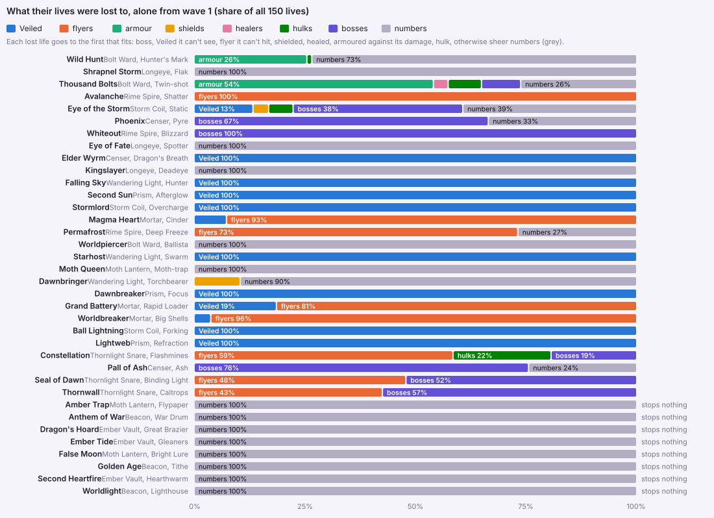

# Tier 5 report: every capstone tested on its own (after the boost)

Re-run on 2026-11-28 at `5acddd3`, after the tier 5 power boost and with the five new wards (51 tier 5s). The first report (2026-11-24, before the boost) is in git history (`1025586`). Hollowmere, Medium, from `tools/t5study.js` (built on `tools/solo.js`): one seed for every tier 5, three seeds for the outliers (Shrapnel Storm, Wild Hunt, Worldpiercer, Ball Lightning, Kingslayer, Dawnbringer, Seal of Dawn, Heartline, Heavenly Host). Tables from `tools/t5report.js`, charts and the summary table from `tools/t5charts.js`; how to rerun them is at the end.

## Summary

The targets (decided 2026-11-27, BTD6-like): alone from wave 1 most tier 5s reach waves 60-80 and the best about 100; blind ones may stop earlier but no earlier than about wave 25; with blind spots removed every tier 5 reaches at least 55; every tier 5 is at least 3x its tier 4; the support tier 5s clearly pull their weight beside a partner.

- **Alone, the tier 5s that can see and hit everything reach 58-98:** Shrapnel Storm (Longeye, Flak) 98, Wild Hunt (Bolt Ward, Hunter's Mark) 94, Thousand Bolts (Bolt Ward, Twin-shot) 92, then Heavenly Host (Astral Choir, Chorus) 81, Zenith (Heartfire Avatar, Solar) 79, Great Bell 74, Eye of the Storm 72, Elder Wyrm, Grand Orrery 69, Last Requiem 68, Phoenix, Harbour Star 66, Eye of Fate 63, Pall of Ash 62, Moth Queen 61, Kingslayer 59, Dawnbringer 59. Before the boost the best was about 50 and most were under 30.
- **With blind spots removed, every attacking tier 5 but two reaches 55 or more** (most 61-80). The two that don't: **Heartline** (Ferrylight, Harpooner) 23 and **Ball Lightning** (Storm Coil, Forking) 44 (55 on seed 1, 44 over three seeds). Heartline covers too little road from its pond; power doesn't help it (x10 to x200 all stop at 20-24). Ball Lightning gets *worse* above about x24. Both need a design look, not more numbers.
- **Blind tier 5s alone stop at 21-24, a little short of "about 25"** (the Mortars, Prisms, Starhost, Snares, the Undertow, Lampwright and Lantern Armada). The early waves now forgive them (Veiled and flyers cost 1 life each up to wave 20, and ease back in over 21-24), so they all reach the 20s instead of 9-17; wave 21-23 is where they now fall. Easing over 21-26 instead would push them to ~25 (tell me if you want it).
- **Every attacking tier 5 is at least 3.7x its tier 4** (late DPS, blind spots removed); most are 6-60x. The lowest: Kingslayer 3.7x, Ball Lightning 4.2x, Last Requiem 4.6x.
- **Support tier 5s** (the defence beside them now spends its gold, so the economy ones count): beside a Bolt Ward partner (65 with Veiled revealed) Anthem of War and Worldlight take it to 85, Second Heartfire to 81, Golden Age 73, Dragon's Hoard and Ember Tide 72. Beside a Mortar (which needs flyers brought low) False Moon takes it from 21 to 49 alone (61 revealed) and Amber Trap to 48 (58). The economy three add the least (+7-8 waves, about double the defence's power).
- **Prices now follow strength** (decided): Shrapnel Storm's ward costs 42k in all, Wild Hunt 32k, Thousand Bolts 34k; the premium wards' tier 5s 32-40k; most others 24-34k.
- **A bug fixed along the way:** a second path's `set` could lower pierce or armour-piercing (Hunter's Mark's tier 2 undid Worldpiercer's lance): Worldpiercer alone 13 -> 26.
- **The Second Heartfire bug** (warmAt 0 fell back to half full) is fixed: it is always warm now.

## At a glance

All 51 tier 5s in one table, then four charts. On the report page (port 3002), click a column header to sort by it (click again to reverse), and hover over a chart for its numbers.
- **Waves** are the last wave cleared starting at wave 1 with the ward pre-built: alone, with Veiled revealed, and with every blind spot removed (Veiled revealed, flyers hittable, immunities lifted; for ground-only wards, flyers pass free).
- **vs tier 4** is its late DPS divided by its tier 4's, with every blind spot removed. The target is 3x or more.
- **Main killer** is the cause of most of the lives it lost alone, with its share.
- The charts and this table are made by `tools/t5charts.js`; the charts are also saved as SVG files in `docs/tier5-charts/`.

<!-- t5charts:summary -->
<div class="t5sum">
<table class="sortable"><thead><tr><th data-sort="num" class="r">#</th><th data-sort="text">Tier 5</th><th data-sort="text">Ward</th><th data-sort="text">Path</th><th data-sort="num" class="r">Alone</th><th data-sort="num" class="r">Veiled revealed</th><th data-sort="num" class="r">Veiled + flyers</th><th data-sort="num" class="r">vs tier 4</th><th data-sort="num" class="r">Cost</th><th data-sort="text">Main killer (alone)</th></tr></thead>
<tbody><tr><td data-v="1" class="r">1</td><td data-v="Shrapnel Storm"><strong>Shrapnel Storm</strong></td><td data-v="Longeye">Longeye</td><td data-v="Flak">Flak</td><td data-v="98.333" class="r q4">98.3</td><td data-v="98.333" class="r q4">98.3</td><td data-v="98.333" class="r q4">98.3</td><td data-v="72.562" class="r q4">72.6x</td><td data-v="41570" class="r">42k</td><td data-v="numbers 0.007" class="kill"><span class="t5sw t5sw-gray"></span>numbers 99%</td></tr>
<tr><td data-v="2" class="r">2</td><td data-v="Wild Hunt"><strong>Wild Hunt</strong></td><td data-v="Bolt Ward">Bolt Ward</td><td data-v="Hunter's Mark">Hunter's Mark</td><td data-v="93.667" class="r q4">93.7</td><td data-v="93.667" class="r q4">93.7</td><td data-v="93.667" class="r q4">93.7</td><td data-v="64.978" class="r q4">65.0x</td><td data-v="31500" class="r">32k</td><td data-v="numbers 0.044" class="kill"><span class="t5sw t5sw-gray"></span>numbers 96%</td></tr>
<tr><td data-v="3" class="r">3</td><td data-v="Thousand Bolts"><strong>Thousand Bolts</strong></td><td data-v="Bolt Ward">Bolt Ward</td><td data-v="Twin-shot">Twin-shot</td><td data-v="92" class="r q4">92</td><td data-v="92" class="r q4">92</td><td data-v="92" class="r q4">92</td><td data-v="58.811" class="r q4">58.8x</td><td data-v="33900" class="r">34k</td><td data-v="armour 0.240" class="kill"><span class="t5sw t5sw-s3"></span>armour 76%</td></tr>
<tr><td data-v="4" class="r">4</td><td data-v="Heavenly Host"><strong>Heavenly Host</strong></td><td data-v="Astral Choir">Astral Choir</td><td data-v="Chorus">Chorus</td><td data-v="81.333" class="r q4">81.3</td><td data-v="81.333" class="r q4">81.3</td><td data-v="81.333" class="r q4">81.3</td><td data-v="25.479" class="r q4">25.5x</td><td data-v="39490" class="r">39k</td><td data-v="bosses 0.556" class="kill"><span class="t5sw t5sw-s7"></span>bosses 44%</td></tr>
<tr><td data-v="5" class="r">5</td><td data-v="Zenith"><strong>Zenith</strong></td><td data-v="Heartfire Avatar">Heartfire Avatar</td><td data-v="Solar">Solar</td><td data-v="79" class="r q4">79</td><td data-v="79" class="r q4">79</td><td data-v="79" class="r q4">79</td><td data-v="55.318" class="r q4">55.3x</td><td data-v="39100" class="r">39k</td><td data-v="Veiled 0.120" class="kill"><span class="t5sw t5sw-s1"></span>Veiled 88%</td></tr>
<tr><td data-v="6" class="r">6</td><td data-v="Great Bell"><strong>Great Bell</strong></td><td data-v="Astral Choir">Astral Choir</td><td data-v="Hymn">Hymn</td><td data-v="74" class="r q4">74</td><td data-v="74" class="r q4">74</td><td data-v="74" class="r q4">74</td><td data-v="10.004" class="r q4">10.0x</td><td data-v="35990" class="r">36k</td><td data-v="numbers 0.233" class="kill"><span class="t5sw t5sw-gray"></span>numbers 77%</td></tr>
<tr><td data-v="7" class="r">7</td><td data-v="Eye of the Storm"><strong>Eye of the Storm</strong></td><td data-v="Storm Coil">Storm Coil</td><td data-v="Static">Static</td><td data-v="72" class="r q4">72</td><td data-v="86" class="r q4">86</td><td data-v="86" class="r q4">86</td><td data-v="38.669" class="r q4">38.7x</td><td data-v="32900" class="r">33k</td><td data-v="numbers 0.513" class="kill"><span class="t5sw t5sw-gray"></span>numbers 49%</td></tr>
<tr><td data-v="8" class="r">8</td><td data-v="Grand Orrery"><strong>Grand Orrery</strong></td><td data-v="Heartfire Avatar">Heartfire Avatar</td><td data-v="Orrery">Orrery</td><td data-v="69" class="r q4">69</td><td data-v="78" class="r q4">78</td><td data-v="78" class="r q4">78</td><td data-v="28.042" class="r q4">28.0x</td><td data-v="40100" class="r">40k</td><td data-v="numbers 0.360" class="kill"><span class="t5sw t5sw-gray"></span>numbers 64%</td></tr>
<tr><td data-v="9" class="r">9</td><td data-v="Elder Wyrm"><strong>Elder Wyrm</strong></td><td data-v="Censer">Censer</td><td data-v="Dragon's Breath">Dragon's Breath</td><td data-v="69" class="r q4">69</td><td data-v="69" class="r q4">69</td><td data-v="69" class="r q4">69</td><td data-v="6.976" class="r q4">7.0x</td><td data-v="29845" class="r">30k</td><td data-v="Veiled 0.467" class="kill"><span class="t5sw t5sw-s1"></span>Veiled 53%</td></tr>
<tr><td data-v="10" class="r">10</td><td data-v="Last Requiem"><strong>Last Requiem</strong></td><td data-v="Astral Choir">Astral Choir</td><td data-v="Requiem">Requiem</td><td data-v="68" class="r q4">68</td><td data-v="68" class="r q4">68</td><td data-v="68" class="r q4">68</td><td data-v="4.629" class="r q4">4.6x</td><td data-v="33990" class="r">34k</td><td data-v="healers 0.733" class="kill"><span class="t5sw t5sw-s5"></span>healers 27%</td></tr>
<tr><td data-v="11" class="r">11</td><td data-v="Harbour Star"><strong>Harbour Star</strong></td><td data-v="Ferrylight">Ferrylight</td><td data-v="Lighthouse Barge">Lighthouse Barge</td><td data-v="66" class="r q4">66</td><td data-v="67" class="r q4">67</td><td data-v="67" class="r q4">67</td><td data-v="48.288" class="r q4">48.3x</td><td data-v="23965" class="r">24k</td><td data-v="armour 0.667" class="kill"><span class="t5sw t5sw-s3"></span>armour 33%</td></tr>
<tr><td data-v="12" class="r">12</td><td data-v="Phoenix"><strong>Phoenix</strong></td><td data-v="Censer">Censer</td><td data-v="Pyre">Pyre</td><td data-v="66" class="r q4">66</td><td data-v="66" class="r q4">66</td><td data-v="66" class="r q4">66</td><td data-v="6.614" class="r q4">6.6x</td><td data-v="27595" class="r">28k</td><td data-v="numbers 0.720" class="kill"><span class="t5sw t5sw-gray"></span>numbers 28%</td></tr>
<tr><td data-v="13" class="r">13</td><td data-v="Eye of Fate"><strong>Eye of Fate</strong></td><td data-v="Longeye">Longeye</td><td data-v="Spotter">Spotter</td><td data-v="63" class="r q4">63</td><td data-v="63" class="r q4">63</td><td data-v="63" class="r q4">63</td><td data-v="16.713" class="r q4">16.7x</td><td data-v="24150" class="r">24k</td><td data-v="numbers 0.500" class="kill"><span class="t5sw t5sw-gray"></span>numbers 50%</td></tr>
<tr><td data-v="14" class="r">14</td><td data-v="Pall of Ash"><strong>Pall of Ash</strong></td><td data-v="Censer">Censer</td><td data-v="Ash">Ash</td><td data-v="62" class="r q4">62</td><td data-v="62" class="r q4">62</td><td data-v="62" class="r q4">62</td><td data-v="9.148" class="r q4">9.1x</td><td data-v="24395" class="r">24k</td><td data-v="numbers 0.367" class="kill"><span class="t5sw t5sw-gray"></span>numbers 63%</td></tr>
<tr><td data-v="15" class="r">15</td><td data-v="Moth Queen"><strong>Moth Queen</strong></td><td data-v="Moth Lantern">Moth Lantern</td><td data-v="Moth-trap">Moth-trap</td><td data-v="61" class="r q4">61</td><td data-v="61" class="r q4">61</td><td data-v="61" class="r q4">61</td><td data-v="28.292" class="r q4">28.3x</td><td data-v="24880" class="r">25k</td><td data-v="hulks 0.533" class="kill"><span class="t5sw t5sw-s6"></span>hulks 47%</td></tr>
<tr><td data-v="16" class="r">16</td><td data-v="Kingslayer"><strong>Kingslayer</strong></td><td data-v="Longeye">Longeye</td><td data-v="Deadeye">Deadeye</td><td data-v="59" class="r q3">59</td><td data-v="59" class="r q3">59</td><td data-v="59" class="r q3">59</td><td data-v="3.704" class="r q4">3.7x</td><td data-v="27470" class="r">27k</td><td data-v="numbers 0.124" class="kill"><span class="t5sw t5sw-gray"></span>numbers 88%</td></tr>
<tr><td data-v="17" class="r">17</td><td data-v="Dawnbringer"><strong>Dawnbringer</strong></td><td data-v="Wandering Light">Wandering Light</td><td data-v="Torchbearer">Torchbearer</td><td data-v="58.667" class="r q3">58.7</td><td data-v="58.667" class="r q3">58.7</td><td data-v="58.667" class="r q3">58.7</td><td data-v="42.663" class="r q4">42.7x</td><td data-v="23965" class="r">24k</td><td data-v="numbers 0.044" class="kill"><span class="t5sw t5sw-gray"></span>numbers 96%</td></tr>
<tr><td data-v="18" class="r">18</td><td data-v="Whiteout"><strong>Whiteout</strong></td><td data-v="Rime Spire">Rime Spire</td><td data-v="Blizzard">Blizzard</td><td data-v="39" class="r q2">39</td><td data-v="39" class="r q2">39</td><td data-v="69" class="r q4">69</td><td data-v="5.158" class="r q4">5.2x</td><td data-v="25395" class="r">25k</td><td data-v="bosses 0.000" class="kill"><span class="t5sw t5sw-s7"></span>bosses 100%</td></tr>
<tr><td data-v="19" class="r">19</td><td data-v="Avalanche"><strong>Avalanche</strong></td><td data-v="Rime Spire">Rime Spire</td><td data-v="Shatter">Shatter</td><td data-v="39" class="r q2">39</td><td data-v="39" class="r q2">39</td><td data-v="80" class="r q4">80</td><td data-v="30.118" class="r q4">30.1x</td><td data-v="32345" class="r">32k</td><td data-v="bosses 0.267" class="kill"><span class="t5sw t5sw-s7"></span>bosses 73%</td></tr>
<tr><td data-v="20" class="r">20</td><td data-v="Stormlord"><strong>Stormlord</strong></td><td data-v="Storm Coil">Storm Coil</td><td data-v="Overcharge">Overcharge</td><td data-v="33" class="r q2">33</td><td data-v="70" class="r q4">70</td><td data-v="70" class="r q4">70</td><td data-v="15.429" class="r q4">15.4x</td><td data-v="34000" class="r">34k</td><td data-v="Veiled 0.000" class="kill"><span class="t5sw t5sw-s1"></span>Veiled 100%</td></tr>
<tr><td data-v="21" class="r">21</td><td data-v="Falling Sky"><strong>Falling Sky</strong></td><td data-v="Wandering Light">Wandering Light</td><td data-v="Hunter">Hunter</td><td data-v="33" class="r q2">33</td><td data-v="74" class="r q4">74</td><td data-v="74" class="r q4">74</td><td data-v="13.89" class="r q4">13.9x</td><td data-v="30205" class="r">30k</td><td data-v="Veiled 0.000" class="kill"><span class="t5sw t5sw-s1"></span>Veiled 100%</td></tr>
<tr><td data-v="22" class="r">22</td><td data-v="Syzygy"><strong>Syzygy</strong></td><td data-v="Heartfire Avatar">Heartfire Avatar</td><td data-v="Eclipse">Eclipse</td><td data-v="32" class="r q2">32</td><td data-v="64" class="r q4">64</td><td data-v="64" class="r q4">64</td><td data-v="15.899" class="r q4">15.9x</td><td data-v="32100" class="r">32k</td><td data-v="Veiled 0.000" class="kill"><span class="t5sw t5sw-s1"></span>Veiled 100%</td></tr>
<tr><td data-v="23" class="r">23</td><td data-v="Second Sun"><strong>Second Sun</strong></td><td data-v="Prism">Prism</td><td data-v="Afterglow">Afterglow</td><td data-v="26" class="r q2">26</td><td data-v="70" class="r q4">70</td><td data-v="70" class="r q4">70</td><td data-v="10.749" class="r q4">10.7x</td><td data-v="30970" class="r">31k</td><td data-v="Veiled 0.000" class="kill"><span class="t5sw t5sw-s1"></span>Veiled 100%</td></tr>
<tr><td data-v="24" class="r">24</td><td data-v="Worldpiercer"><strong>Worldpiercer</strong></td><td data-v="Bolt Ward">Bolt Ward</td><td data-v="Ballista">Ballista</td><td data-v="25.667" class="r q2">25.7</td><td data-v="71.667" class="r q4">71.7</td><td data-v="71.667" class="r q4">71.7</td><td data-v="16.654" class="r q4">16.7x</td><td data-v="28260" class="r">28k</td><td data-v="numbers 0.133" class="kill"><span class="t5sw t5sw-gray"></span>numbers 87%</td></tr>
<tr><td data-v="25" class="r">25</td><td data-v="Magma Heart"><strong>Magma Heart</strong></td><td data-v="Mortar">Mortar</td><td data-v="Cinder">Cinder</td><td data-v="24" class="r q1">24</td><td data-v="25" class="r q2">25</td><td data-v="64" class="r q4">64</td><td data-v="6.91" class="r q4">6.9x</td><td data-v="27870" class="r">28k</td><td data-v="flyers 0.000" class="kill"><span class="t5sw t5sw-s2"></span>flyers 100%</td></tr>
<tr><td data-v="26" class="r">26</td><td data-v="Heartline"><strong>Heartline</strong></td><td data-v="Ferrylight">Ferrylight</td><td data-v="Harpooner">Harpooner</td><td data-v="23.667" class="r q1">23.7</td><td data-v="23.333" class="r q1">23.3</td><td data-v="23.333" class="r q1">23.3</td><td data-v="32.841" class="r q4">32.8x</td><td data-v="23815" class="r">24k</td><td data-v="numbers 0.031" class="kill"><span class="t5sw t5sw-gray"></span>numbers 97%</td></tr>
<tr><td data-v="27" class="r">27</td><td data-v="Dawnbreaker"><strong>Dawnbreaker</strong></td><td data-v="Prism">Prism</td><td data-v="Focus">Focus</td><td data-v="23" class="r q1">23</td><td data-v="80" class="r q4">80</td><td data-v="80" class="r q4">80</td><td data-v="28.047" class="r q4">28.0x</td><td data-v="39150" class="r">39k</td><td data-v="Veiled 0.000" class="kill"><span class="t5sw t5sw-s1"></span>Veiled 100%</td></tr>
<tr><td data-v="28" class="r">28</td><td data-v="Starhost"><strong>Starhost</strong></td><td data-v="Wandering Light">Wandering Light</td><td data-v="Swarm">Swarm</td><td data-v="23" class="r q1">23</td><td data-v="78" class="r q4">78</td><td data-v="78" class="r q4">78</td><td data-v="36.696" class="r q4">36.7x</td><td data-v="30355" class="r">30k</td><td data-v="Veiled 0.000" class="kill"><span class="t5sw t5sw-s1"></span>Veiled 100%</td></tr>
<tr><td data-v="29" class="r">29</td><td data-v="Permafrost"><strong>Permafrost</strong></td><td data-v="Rime Spire">Rime Spire</td><td data-v="Deep Freeze">Deep Freeze</td><td data-v="22" class="r q1">22</td><td data-v="22" class="r q1">22</td><td data-v="66" class="r q4">66</td><td data-v="6.25" class="r q4">6.3x</td><td data-v="24945" class="r">25k</td><td data-v="flyers 0.000" class="kill"><span class="t5sw t5sw-s2"></span>flyers 100%</td></tr>
<tr><td data-v="30" class="r">30</td><td data-v="Great Maelstrom"><strong>Great Maelstrom</strong></td><td data-v="The Undertow">The Undertow</td><td data-v="Maelstrom">Maelstrom</td><td data-v="22" class="r q1">22</td><td data-v="22" class="r q1">22</td><td data-v="75" class="r q4">75</td><td data-v="14.391" class="r q4">14.4x</td><td data-v="29680" class="r">30k</td><td data-v="flyers 0.000" class="kill"><span class="t5sw t5sw-s2"></span>flyers 100%</td></tr>
<tr><td data-v="31" class="r">31</td><td data-v="Undying Taper"><strong>Undying Taper</strong></td><td data-v="Lampwright">Lampwright</td><td data-v="Tallow">Tallow</td><td data-v="22" class="r q1">22</td><td data-v="22" class="r q1">22</td><td data-v="69" class="r q4">69</td><td data-v="84" class="r q4">84.0x</td><td data-v="23995" class="r">24k</td><td data-v="flyers 0.000" class="kill"><span class="t5sw t5sw-s2"></span>flyers 100%</td></tr>
<tr><td data-v="32" class="r">32</td><td data-v="Thousand Wicks"><strong>Thousand Wicks</strong></td><td data-v="Lampwright">Lampwright</td><td data-v="Wickstorm">Wickstorm</td><td data-v="22" class="r q1">22</td><td data-v="22" class="r q1">22</td><td data-v="65" class="r q4">65</td><td data-v="54.939" class="r q4">54.9x</td><td data-v="23985" class="r">24k</td><td data-v="flyers 0.000" class="kill"><span class="t5sw t5sw-s2"></span>flyers 100%</td></tr>
<tr><td data-v="33" class="r">33</td><td data-v="Constellation"><strong>Constellation</strong></td><td data-v="Thornlight Snare">Thornlight Snare</td><td data-v="Flashmines">Flashmines</td><td data-v="22" class="r q1">22</td><td data-v="22" class="r q1">22</td><td data-v="64" class="r q4">64</td><td data-v="8.95" class="r q4">9.0x</td><td data-v="24910" class="r">25k</td><td data-v="flyers 0.000" class="kill"><span class="t5sw t5sw-s2"></span>flyers 100%</td></tr>
<tr><td data-v="34" class="r">34</td><td data-v="Drowned Deep"><strong>Drowned Deep</strong></td><td data-v="The Undertow">The Undertow</td><td data-v="Abyss">Abyss</td><td data-v="22" class="r q1">22</td><td data-v="22" class="r q1">22</td><td data-v="62" class="r q4">62</td><td data-v="19.572" class="r q4">19.6x</td><td data-v="26580" class="r">27k</td><td data-v="flyers 0.000" class="kill"><span class="t5sw t5sw-s2"></span>flyers 100%</td></tr>
<tr><td data-v="35" class="r">35</td><td data-v="Eternal Vigil"><strong>Eternal Vigil</strong></td><td data-v="Lampwright">Lampwright</td><td data-v="Beaconwax">Beaconwax</td><td data-v="22" class="r q1">22</td><td data-v="22" class="r q1">22</td><td data-v="61" class="r q4">61</td><td data-v="9.353" class="r q4">9.4x</td><td data-v="22995" class="r">23k</td><td data-v="flyers 0.000" class="kill"><span class="t5sw t5sw-s2"></span>flyers 100%</td></tr>
<tr><td data-v="36" class="r">36</td><td data-v="Tidal Throne"><strong>Tidal Throne</strong></td><td data-v="The Undertow">The Undertow</td><td data-v="Tidecaller">Tidecaller</td><td data-v="22" class="r q1">22</td><td data-v="22" class="r q1">22</td><td data-v="61" class="r q4">61</td><td data-v="15.749" class="r q4">15.7x</td><td data-v="25910" class="r">26k</td><td data-v="flyers 0.000" class="kill"><span class="t5sw t5sw-s2"></span>flyers 100%</td></tr>
<tr><td data-v="37" class="r">37</td><td data-v="Seal of Dawn"><strong>Seal of Dawn</strong></td><td data-v="Thornlight Snare">Thornlight Snare</td><td data-v="Binding Light">Binding Light</td><td data-v="22" class="r q1">22</td><td data-v="22" class="r q1">22</td><td data-v="59" class="r q3">59</td><td data-v="18.096" class="r q4">18.1x</td><td data-v="23740" class="r">24k</td><td data-v="flyers 0.000" class="kill"><span class="t5sw t5sw-s2"></span>flyers 100%</td></tr>
<tr><td data-v="38" class="r">38</td><td data-v="Lightweb"><strong>Lightweb</strong></td><td data-v="Prism">Prism</td><td data-v="Refraction">Refraction</td><td data-v="21" class="r q1">21</td><td data-v="73" class="r q4">73</td><td data-v="73" class="r q4">73</td><td data-v="36.905" class="r q4">36.9x</td><td data-v="31170" class="r">31k</td><td data-v="Veiled 0.067" class="kill"><span class="t5sw t5sw-s1"></span>Veiled 93%</td></tr>
<tr><td data-v="39" class="r">39</td><td data-v="Lantern Armada"><strong>Lantern Armada</strong></td><td data-v="Ferrylight">Ferrylight</td><td data-v="Flotilla">Flotilla</td><td data-v="21" class="r q1">21</td><td data-v="69" class="r q4">69</td><td data-v="69" class="r q4">69</td><td data-v="13.549" class="r q4">13.5x</td><td data-v="26815" class="r">27k</td><td data-v="Veiled 0.067" class="kill"><span class="t5sw t5sw-s1"></span>Veiled 93%</td></tr>
<tr><td data-v="40" class="r">40</td><td data-v="Ball Lightning"><strong>Ball Lightning</strong></td><td data-v="Storm Coil">Storm Coil</td><td data-v="Forking">Forking</td><td data-v="21" class="r q1">21</td><td data-v="44.333" class="r q2">44.3</td><td data-v="44.333" class="r q2">44.3</td><td data-v="4.186" class="r q4">4.2x</td><td data-v="27760" class="r">28k</td><td data-v="Veiled 0.000" class="kill"><span class="t5sw t5sw-s1"></span>Veiled 100%</td></tr>
<tr><td data-v="41" class="r">41</td><td data-v="Grand Battery"><strong>Grand Battery</strong></td><td data-v="Mortar">Mortar</td><td data-v="Rapid Loader">Rapid Loader</td><td data-v="21" class="r q1">21</td><td data-v="22" class="r q1">22</td><td data-v="76" class="r q4">76</td><td data-v="17.334" class="r q4">17.3x</td><td data-v="32740" class="r">33k</td><td data-v="flyers 0.020" class="kill"><span class="t5sw t5sw-s2"></span>flyers 98%</td></tr>
<tr><td data-v="42" class="r">42</td><td data-v="Thornwall"><strong>Thornwall</strong></td><td data-v="Thornlight Snare">Thornlight Snare</td><td data-v="Caltrops">Caltrops</td><td data-v="21" class="r q1">21</td><td data-v="21" class="r q1">21</td><td data-v="68" class="r q4">68</td><td data-v="21.025" class="r q4">21.0x</td><td data-v="26070" class="r">26k</td><td data-v="flyers 0.020" class="kill"><span class="t5sw t5sw-s2"></span>flyers 98%</td></tr>
<tr><td data-v="43" class="r">43</td><td data-v="Worldbreaker"><strong>Worldbreaker</strong></td><td data-v="Mortar">Mortar</td><td data-v="Big Shells">Big Shells</td><td data-v="21" class="r q1">21</td><td data-v="22" class="r q1">22</td><td data-v="67" class="r q4">67</td><td data-v="10.214" class="r q4">10.2x</td><td data-v="31590" class="r">32k</td><td data-v="flyers 0.013" class="kill"><span class="t5sw t5sw-s2"></span>flyers 99%</td></tr>
<tr><td data-v="44" class="r">44</td><td data-v="Amber Trap"><strong>Amber Trap</strong></td><td data-v="Moth Lantern">Moth Lantern</td><td data-v="Flypaper">Flypaper</td><td data-v="2" class="r q0">2</td><td data-v="2" class="r q0">2</td><td data-v="2" class="r q0">2</td><td data-v="2.208" class="r q1">2.2x</td><td data-v="21310" class="r">21k</td><td data-v="zzz" class="kill"><span class="t5sw t5sw-none"></span>stops nothing alone</td></tr>
<tr><td data-v="45" class="r">45</td><td data-v="Anthem of War"><strong>Anthem of War</strong></td><td data-v="Beacon">Beacon</td><td data-v="War Drum">War Drum</td><td data-v="2" class="r q0">2</td><td data-v="2" class="r q0">2</td><td data-v="2" class="r q0">2</td><td data-v="-1" class="r qna">no damage</td><td data-v="26970" class="r">27k</td><td data-v="zzz" class="kill"><span class="t5sw t5sw-none"></span>stops nothing alone</td></tr>
<tr><td data-v="46" class="r">46</td><td data-v="Dragon's Hoard"><strong>Dragon's Hoard</strong></td><td data-v="Ember Vault">Ember Vault</td><td data-v="Great Brazier">Great Brazier</td><td data-v="2" class="r q0">2</td><td data-v="2" class="r q0">2</td><td data-v="2" class="r q0">2</td><td data-v="-1" class="r qna">no damage</td><td data-v="24320" class="r">24k</td><td data-v="zzz" class="kill"><span class="t5sw t5sw-none"></span>stops nothing alone</td></tr>
<tr><td data-v="47" class="r">47</td><td data-v="Ember Tide"><strong>Ember Tide</strong></td><td data-v="Ember Vault">Ember Vault</td><td data-v="Gleaners">Gleaners</td><td data-v="2" class="r q0">2</td><td data-v="2" class="r q0">2</td><td data-v="2" class="r q0">2</td><td data-v="-1" class="r qna">no damage</td><td data-v="22970" class="r">23k</td><td data-v="zzz" class="kill"><span class="t5sw t5sw-none"></span>stops nothing alone</td></tr>
<tr><td data-v="48" class="r">48</td><td data-v="False Moon"><strong>False Moon</strong></td><td data-v="Moth Lantern">Moth Lantern</td><td data-v="Bright Lure">Bright Lure</td><td data-v="2" class="r q0">2</td><td data-v="2" class="r q0">2</td><td data-v="2" class="r q0">2</td><td data-v="4.903" class="r q4">4.9x</td><td data-v="22530" class="r">23k</td><td data-v="zzz" class="kill"><span class="t5sw t5sw-none"></span>stops nothing alone</td></tr>
<tr><td data-v="49" class="r">49</td><td data-v="Golden Age"><strong>Golden Age</strong></td><td data-v="Beacon">Beacon</td><td data-v="Tithe">Tithe</td><td data-v="2" class="r q0">2</td><td data-v="2" class="r q0">2</td><td data-v="2" class="r q0">2</td><td data-v="-1" class="r qna">no damage</td><td data-v="24750" class="r">25k</td><td data-v="zzz" class="kill"><span class="t5sw t5sw-none"></span>stops nothing alone</td></tr>
<tr><td data-v="50" class="r">50</td><td data-v="Second Heartfire"><strong>Second Heartfire</strong></td><td data-v="Ember Vault">Ember Vault</td><td data-v="Hearthwarm">Hearthwarm</td><td data-v="2" class="r q0">2</td><td data-v="2" class="r q0">2</td><td data-v="2" class="r q0">2</td><td data-v="-1" class="r qna">no damage</td><td data-v="25500" class="r">26k</td><td data-v="zzz" class="kill"><span class="t5sw t5sw-none"></span>stops nothing alone</td></tr>
<tr><td data-v="51" class="r">51</td><td data-v="Worldlight"><strong>Worldlight</strong></td><td data-v="Beacon">Beacon</td><td data-v="Lighthouse">Lighthouse</td><td data-v="2" class="r q0">2</td><td data-v="2" class="r q0">2</td><td data-v="2" class="r q0">2</td><td data-v="-1" class="r qna">no damage</td><td data-v="23170" class="r">23k</td><td data-v="zzz" class="kill"><span class="t5sw t5sw-none"></span>stops nothing alone</td></tr></tbody></table>
</div>
<!-- /t5charts:summary -->
<div class="key"><span class="kq0">waves: 2 (stops nothing)</span> <span class="kq1">under 25</span> <span class="kq2">25-45</span> <span class="kq3">45-60</span> <span class="kq4">60 and up</span> <span class="kq0">vs tier 4: under 1.5x</span> <span class="kq1">1.5-3x</span> <span class="kq4">3x or more (on target)</span></div>


**Take from it:** the top third reach 58-98 alone; a long line after a bar still means blind, not weak: the Prisms, Starhost, Falling Sky, Stormlord, Lantern Armada and Syzygy gain 30-57 waves once Veiled are revealed, and the Mortars, Snares, Undertows and Lampwrights 37-55 once flyers stop counting.


**Take from it:** every attacking tier 5 is now past 3x its tier 4 (Kingslayer 3.7x is the closest); most are 6-60x, and the biggest jumps (Undying Taper, Shrapnel Storm, Wild Hunt, Zenith) are 55-84x.


**Take from it:** Veiled (blue) and flyers (orange) still end every blind tier 5, now around waves 21-24; the ones that see and hit everything lose to sheer numbers (grey) in deep endless, and only Heartline and Ball Lightning fall early with no blind spot.


**Take from it:** judged by the dots (blind spots removed), every ward's three now sit between 55 and 100 except the Ferrylight's Heartline and the Storm Coil's Ball Lightning.

## Method

- **The harness** (`tools/solo.js`) starts a real game with one ward on the map, already built: tier 5 (or tier 4) on one path and tier 2 on a secondary path. Each wave is called when the last one clears, and it plays until it loses (or wave 150). Lives, leak caps and the one free Last Light save are as in a game. The ward's own ability is used as `tools/bot.js` uses abilities. The Heartfire Flare is never used.
- **Two starts.** **W1** is the last wave cleared starting at wave 1. **E41** is how many waves it clears past wave 40 when dropped straight into endless at wave 41 with fresh lives.
- **Three conditions:** alone; reveal (every Veiled enemy counts as seen by it); full (reveal, flyers hittable, and immunities lifted: the Hollow King's Frost immunity counts as a blind spot here only; for ground-only wards (Snares, the Undertow, the Lampwright) flyers pass without costing lives, since nothing can make their damage reach the air).
- **Placement and secondary path:** reused from `tools/t5spots.json`, chosen per tier 5 by `tools/t5fit.js` (the best of four candidate spots and both secondary paths, judged at a middling power). The first report searched them again for every condition; this one reuses them to keep the run to about 2 hours.
- **Power.** Every attacking tier 5 has a `power` that multiplies everything it deals, fitted to its target with `tools/t5fit.js` and written into the data with `tools/t5bake.js` (which also sets its price). Its description starts with it ("Capstone power x47 (all its damage)").
- **The early waves changed** (decided): up to wave 20 Veiled and flyers come in small groups and cost 1 life each when they get through (the Veilmother 10); waves 21-24 ease the Veiled share and the flyers back in. That is why blind tier 5s now reach the 20s.
- **Endless** is the same to wave 100 (the targets are measured on it) and grows 18% a wave after (was 8%), so only the best tier 5s see the steep part.
- **Support:** the Beacons and Ember Vaults beside a fixed Bolt Ward partner (Twin-shot tier 4, Ballista 2); the Moth Lantern's two beside a Mortar partner (Rapid Loader tier 4, Big Shells 2), since a lure only helps wards that can't hit flyers. In both the defence spends what it earns on more partner wards and upgrades (and cashes out full vaults).
- **Late DPS:** damage per second over the last three waves it played, full condition from wave 41.
- **Stalls:** a wave not cleared after max(600 s, 5x its spawning time) ends the run (`tools/stall.js`).

## Changes to the tier 5s in this boost

- **Power** on every attacking tier 5 (x3.5 to x118), and **prices** that follow it (see the table).
- **Crowd mechanics** where more damage couldn't help (each died to crowds whatever its power): Kingslayer's killing shots carry on (8 times); Eye of Fate dooms 40 and shoots every Doomed enemy it sees (its own multiplier x1.7, no power); Thornwall bites free and spreads x2.5; Seal of Dawn's dawn ring every second; Moth Queen stings every flyer in its light; Dawnbringer's torch flares every 3 s; Permafrost hits up to 80.
- **Support tier 5s:** Anthem of War +150%/+150%; Worldlight +50% damage map-wide; Golden Age 4,000 a wave; Dragon's Hoard cap 60k, 35% interest, +50% big cash-outs; Ember Tide 600% of bounties; Second Heartfire +100%/+100%; False Moon flyers take +250%; Amber Trap lures 60 from twice as far, +150%.
- **The five new wards' tier 5s** (round 2) got crowd tools of their own (see `docs/new-wards-2.md`, "Built").

## Caveats

- One ward alone is unusual: support, debuff and single-target capstones are undervalued, and wards that cover everything are overvalued.
- One seed for most rows. The campaign waves are fixed, so seeds matter only in endless; the three-seed outliers moved by at most 11 waves (Ball Lightning).
- Spots were chosen once, at a middling power, and reused. A better spot can be worth 10+ waves for some wards (Heartline above all).
- The first report's Ashfork spot check wasn't rerun.

## Tables

### Ranking (hollowmere, Medium)

Ranked by the plain game (alone): W1 + E41. "Power" ranks the same tier 5s by the full condition (blind spots removed: Veiled revealed, flyers targetable, immunities lifted; for ground-only wards flyers pass free), i.e. raw damage with the blind spots removed. Late DPS and kills are from the full condition from wave 41 and the alone condition from wave 1. Cost is the ward plus tiers 1-5 and the secondary tier 2.

| # | Tier 5 | Ward (path) | Cost | Alone W1 | Alone E41 | Reveal W1 | Reveal E41 | Full W1 | Full E41 | Power # | Late DPS | Kills (alone W1) | 2nd path |
|--:|---|---|--:|--:|--:|--:|--:|--:|--:|--:|--:|--:|---|
| 1 | **Shrapnel Storm** | Longeye (Flak) | 42k | 98.3 | 55.3 | 98.3 | 55.3 | 98.3 | 55.3 | 1 | 253k | 359k | Deadeye |
| 2 | **Wild Hunt** | Bolt Ward (Hunter's Mark) | 32k | 93.7 | 50.7 | 93.7 | 50.7 | 93.7 | 50.7 | 2 | 168k | 341k | Twin-shot |
| 3 | **Thousand Bolts** | Bolt Ward (Twin-shot) | 34k | 92 | 52 | 92 | 52 | 92 | 52 | 3 | 134k | 336k | Hunter's Mark |
| 4 | **Heavenly Host** | Astral Choir (Chorus) | 39k | 81.3 | 41 | 81.3 | 41 | 81.3 | 41 | 5 | 67k | 285k | Hymn |
| 5 | **Zenith** | Heartfire Avatar (Solar) | 39k | 79 | 39 | 79 | 39 | 79 | 39 | 8 | 45k | 281k | Orrery |
| 6 | **Great Bell** | Astral Choir (Hymn) | 36k | 74 | 34 | 74 | 34 | 74 | 34 | 15 | 37k | 244k | Chorus |
| 7 | **Eye of the Storm** | Storm Coil (Static) | 33k | 72 | 28 | 86 | 45 | 86 | 45 | 4 | 82k | 238k | Overcharge |
| 8 | **Grand Orrery** | Heartfire Avatar (Orrery) | 40k | 69 | 29 | 78 | 38 | 78 | 38 | 10 | 43k | 231k | Solar |
| 9 | **Elder Wyrm** | Censer (Dragon's Breath) | 30k | 69 | 29 | 69 | 29 | 69 | 29 | 20 | 15k | 226k | Pyre |
| 10 | **Last Requiem** | Astral Choir (Requiem) | 34k | 68 | 26 | 68 | 26 | 68 | 26 | 25 | 12k | 226k | Chorus |
| 11 | **Harbour Star** | Ferrylight (Lighthouse Barge) | 24k | 66 | 27 | 67 | 27 | 67 | 27 | 24 | 19k | 219k | Harpooner |
| 12 | **Phoenix** | Censer (Pyre) | 28k | 66 | 25 | 66 | 25 | 66 | 25 | 29 | 14k | 217k | Dragon's Breath |
| 13 | **Eye of Fate** | Longeye (Spotter) | 24k | 63 | 23 | 63 | 23 | 63 | 23 | 33 | 13k | 203k | Flak |
| 14 | **Pall of Ash** | Censer (Ash) | 24k | 62 | 24 | 62 | 24 | 62 | 24 | 32 | 15k | 199k | Dragon's Breath |
| 15 | **Moth Queen** | Moth Lantern (Moth-trap) | 25k | 61 | 21 | 61 | 21 | 61 | 21 | 38 | 11k | 194k | Bright Lure |
| 16 | **Kingslayer** | Longeye (Deadeye) | 27k | 59 | 20.3 | 59 | 20.3 | 59 | 20.3 | 39 | 17k | 186k | Flak |
| 17 | **Dawnbringer** | Wandering Light (Torchbearer) | 24k | 58.7 | 18 | 58.7 | 18 | 58.7 | 18 | 41 | 11k | 187k | Swarm |
| 18 | **Whiteout** | Rime Spire (Blizzard) | 25k | 39 | 26 | 39 | 26 | 69 | 26 | 23 | 14k | 111k | Shatter |
| 19 | **Stormlord** | Storm Coil (Overcharge) | 34k | 33 | 27 | 70 | 31 | 70 | 31 | 17 | 26k | 70k | Static |
| 20 | **Syzygy** | Heartfire Avatar (Eclipse) | 32k | 32 | 22 | 64 | 21 | 64 | 21 | 34 | 19k | 67k | Orrery |
| 21 | **Avalanche** | Rime Spire (Shatter) | 32k | 39 | 7 | 39 | 7 | 80 | 41 | 6 | 68k | 111k | Blizzard |
| 22 | **Falling Sky** | Wandering Light (Hunter) | 30k | 33 | 9 | 74 | 33 | 74 | 33 | 16 | 30k | 70k | Swarm |
| 23 | **Second Sun** | Prism (Afterglow) | 31k | 26 | 9 | 70 | 30 | 70 | 30 | 18 | 24k | 40k | Refraction |
| 24 | **Worldpiercer** | Bolt Ward (Ballista) | 28k | 25.7 | 8 | 71.7 | 36.7 | 71.7 | 36.7 | 14 | 49k | 41k | Hunter's Mark |
| 25 | **Dawnbreaker** | Prism (Focus) | 39k | 23 | 5 | 80 | 40 | 80 | 40 | 7 | 72k | 32k | Afterglow |
| 26 | **Starhost** | Wandering Light (Swarm) | 30k | 23 | 5 | 78 | 38 | 78 | 38 | 9 | 45k | 33k | Hunter |
| 27 | **Magma Heart** | Mortar (Cinder) | 28k | 24 | 3 | 25 | 7 | 64 | 23 | 31 | 15k | 34k | Big Shells |
| 28 | **Heartline** | Ferrylight (Harpooner) | 24k | 23.7 | 1.7 | 23.3 | 2 | 23.3 | 2 | 43 | 6.2k | 34k | Flotilla |
| 29 | **Permafrost** | Rime Spire (Deep Freeze) | 25k | 22 | 1 | 22 | 1 | 66 | 27 | 26 | 17k | 28k | Blizzard |
| 30 | **Lightweb** | Prism (Refraction) | 31k | 21 | 1 | 73 | 38 | 73 | 38 | 12 | 40k | 26k | Focus |
| 31 | **Great Maelstrom** | The Undertow (Maelstrom) | 30k | 22 | 0 | 22 | 0 | 75 | 34 | 13 | 18k | 29k | Abyss |
| 32 | **Undying Taper** | Lampwright (Tallow) | 24k | 22 | 0 | 22 | 0 | 69 | 28 | 21 | 16k | 27k | Beaconwax |
| 33 | **Thousand Wicks** | Lampwright (Wickstorm) | 24k | 22 | 0 | 22 | 0 | 65 | 28 | 27 | 13k | 27k | Tallow |
| 34 | **Lantern Armada** | Ferrylight (Flotilla) | 27k | 21 | 1 | 69 | 22 | 69 | 22 | 28 | 14k | 26k | Harpooner |
| 35 | **Constellation** | Thornlight Snare (Flashmines) | 25k | 22 | 0 | 22 | 0 | 64 | 25 | 30 | 14k | 27k | Binding Light |
| 36 | **Drowned Deep** | The Undertow (Abyss) | 27k | 22 | 0 | 22 | 0 | 62 | 22 | 35 | 11k | 27k | Maelstrom |
| 37 | **Tidal Throne** | The Undertow (Tidecaller) | 26k | 22 | 0 | 22 | 0 | 61 | 22 | 36 | 12k | 27k | Maelstrom |
| 38 | **Eternal Vigil** | Lampwright (Beaconwax) | 23k | 22 | 0 | 22 | 0 | 61 | 22 | 37 | 8.1k | 28k | Tallow |
| 39 | **Seal of Dawn** | Thornlight Snare (Binding Light) | 24k | 22 | 0 | 22 | 0 | 59 | 19 | 40 | 10k | 27k | Caltrops |
| 40 | **Ball Lightning** | Storm Coil (Forking) | 28k | 21 | 1 | 44.3 | 19.7 | 44.3 | 19.7 | 42 | 12k | 26k | Overcharge |
| 41 | **Grand Battery** | Mortar (Rapid Loader) | 33k | 21 | 0 | 22 | 0 | 76 | 36 | 11 | 36k | 27k | Big Shells |
| 42 | **Worldbreaker** | Mortar (Big Shells) | 32k | 21 | 0 | 22 | 0 | 67 | 31 | 19 | 30k | 27k | Rapid Loader |
| 43 | **Thornwall** | Thornlight Snare (Caltrops) | 26k | 21 | 0 | 21 | 0 | 68 | 29 | 22 | 14k | 26k | Flashmines |
| 44 | **Anthem of War** | Beacon (War Drum) | 27k | 2 | 0 | 2 | 0 | 2 | 0 | 46 | - | 0 | Lighthouse |
| 45 | **Worldlight** | Beacon (Lighthouse) | 23k | 2 | 0 | 2 | 0 | 2 | 0 | 47 | - | 0 | Tithe |
| 46 | **Golden Age** | Beacon (Tithe) | 25k | 2 | 0 | 2 | 0 | 2 | 0 | 48 | - | 0 | War Drum |
| 47 | **False Moon** | Moth Lantern (Bright Lure) | 23k | 2 | 0 | 2 | 0 | 2 | 0 | 45 | 554 | 0 | Moth-trap |
| 48 | **Amber Trap** | Moth Lantern (Flypaper) | 21k | 2 | 0 | 2 | 0 | 2 | 0 | 44 | 711 | 0 | Moth-trap |
| 49 | **Dragon's Hoard** | Ember Vault (Great Brazier) | 24k | 2 | 0 | 2 | 0 | 2 | 0 | 49 | - | 0 | Gleaners |
| 50 | **Ember Tide** | Ember Vault (Gleaners) | 23k | 2 | 0 | 2 | 0 | 2 | 0 | 50 | - | 0 | Hearthwarm |
| 51 | **Second Heartfire** | Ember Vault (Hearthwarm) | 26k | 2 | 0 | 2 | 0 | 2 | 0 | 51 | - | 0 | Great Brazier |

`+`: some seed reached the 150-wave cap. `*`: some seed stalled (tools/stall.js: a wave not cleared after max(600 s, 5x its spawn time) ends the run; counted as the waves before it).

### Tier 5 against its tier 4 (same placement and secondary path)

| Tier 5 | Tier 4 | Cost T4 -> T5 | Alone W1 T4 -> T5 | Alone E41 T4 -> T5 | Full W1 T4 -> T5 | Full E41 T4 -> T5 | Late DPS T4 -> T5 | DPS x |
|---|---|--:|--:|--:|--:|--:|--:|--:|
| Shrapnel Storm (Longeye, Flak) | Flak Curtain | 6.6k -> 42k | 25.7 -> 98.3 | 0 -> 55.3 | 25.7 -> 98.3 | 0 -> 55.3 | 3.5k -> 253k | 72.6 |
| Wild Hunt (Bolt Ward, Hunter's Mark) | Death Sentence | 5.0k -> 32k | 29.7 -> 93.7 | 1.7 -> 50.7 | 29.7 -> 93.7 | 1.7 -> 50.7 | 2.6k -> 168k | 65.0 |
| Thousand Bolts (Bolt Ward, Twin-shot) | Storm of Bolts | 5.4k -> 34k | 30 -> 92 | 1 -> 52 | 30 -> 92 | 1 -> 52 | 2.3k -> 134k | 58.8 |
| Heavenly Host (Astral Choir, Chorus) | Massed Choir | 10.0k -> 39k | 39 -> 81.3 | 0.3 -> 41 | 39 -> 81.3 | 0.3 -> 41 | 2.6k -> 67k | 25.5 |
| Zenith (Heartfire Avatar, Solar) | Noonfire | 11k -> 39k | 11 -> 79 | 0 -> 39 | 11 -> 79 | 0 -> 39 | 821 -> 45k | 55.3 |
| Great Bell (Astral Choir, Hymn) | Grand Crescendo | 10.0k -> 36k | 40 -> 74 | 0 -> 34 | 40 -> 74 | 0 -> 34 | 3.7k -> 37k | 10.0 |
| Eye of the Storm (Storm Coil, Static) | Ion Storm | 6.4k -> 33k | 21 -> 72 | 0 -> 28 | 18 -> 86 | 0 -> 45 | 2.1k -> 82k | 38.7 |
| Grand Orrery (Heartfire Avatar, Orrery) | Starwheel | 11k -> 40k | 27 -> 69 | 0 -> 29 | 28 -> 78 | 0 -> 38 | 1.5k -> 43k | 28.0 |
| Elder Wyrm (Censer, Dragon's Breath) | Dragon's Breath | 6.3k -> 30k | 9 -> 69 | 0 -> 29 | 9 -> 69 | 0 -> 29 | 2.1k -> 15k | 7.0 |
| Last Requiem (Astral Choir, Requiem) | Homecoming | 10.0k -> 34k | 9 -> 68 | 0 -> 26 | 9 -> 68 | 0 -> 26 | 2.6k -> 12k | 4.6 |
| Harbour Star (Ferrylight, Lighthouse Barge) | Great Light | 6.0k -> 24k | 5 -> 66 | 0 -> 27 | 5 -> 67 | 0 -> 27 | 400 -> 19k | 48.3 |
| Phoenix (Censer, Pyre) | Wildfire | 6.1k -> 28k | 25 -> 66 | 0 -> 25 | 25 -> 66 | 0 -> 25 | 2.0k -> 14k | 6.6 |
| Eye of Fate (Longeye, Spotter) | Eye in the Dark | 6.2k -> 24k | 17 -> 63 | 0 -> 23 | 17 -> 63 | 0 -> 23 | 759 -> 13k | 16.7 |
| Pall of Ash (Censer, Ash) | Ashen Brand | 5.9k -> 24k | 9 -> 62 | 0 -> 24 | 9 -> 62 | 0 -> 24 | 1.6k -> 15k | 9.1 |
| Moth Queen (Moth Lantern, Moth-trap) | Thousand Moths | 5.9k -> 25k | 2 -> 61 | 0 -> 21 | 2 -> 61 | 0 -> 21 | 394 -> 11k | 28.3 |
| Kingslayer (Longeye, Deadeye) | Headhunter | 7.0k -> 27k | 17 -> 59 | 0 -> 20.3 | 17 -> 59 | 0 -> 20.3 | 4.6k -> 17k | 3.7 |
| Dawnbringer (Wandering Light, Torchbearer) | Lamplighter | 6.0k -> 24k | 9.3 -> 58.7 | 0 -> 18 | 9.3 -> 58.7 | 0 -> 18 | 253 -> 11k | 42.7 |
| Whiteout (Rime Spire, Blizzard) | Endless Winter | 5.4k -> 25k | 22 -> 39 | 0 -> 26 | 27 -> 69 | 1 -> 26 | 2.8k -> 14k | 5.2 |
| Stormlord (Storm Coil, Overcharge) | Smite | 7.0k -> 34k | 22 -> 33 | 0 -> 27 | 22 -> 70 | 0 -> 31 | 1.7k -> 26k | 15.4 |
| Syzygy (Heartfire Avatar, Eclipse) | Total Eclipse | 11k -> 32k | 16 -> 32 | 0 -> 22 | 16 -> 64 | 0 -> 21 | 1.2k -> 19k | 15.9 |
| Avalanche (Rime Spire, Shatter) | Winter's Verdict | 5.8k -> 32k | 24 -> 39 | 5 -> 7 | 29 -> 80 | 5 -> 41 | 2.3k -> 68k | 30.1 |
| Falling Sky (Wandering Light, Hunter) | Comet | 6.2k -> 30k | 32 -> 33 | 1 -> 9 | 33 -> 74 | 1 -> 33 | 2.2k -> 30k | 13.9 |
| Second Sun (Prism, Afterglow) | Supernova | 7.0k -> 31k | 27 -> 26 | 0 -> 9 | 39 -> 70 | 0 -> 30 | 2.2k -> 24k | 10.7 |
| Worldpiercer (Bolt Ward, Ballista) | Siege Lance | 5.8k -> 28k | 22.3 -> 25.7 | 1 -> 8 | 26.3 -> 71.7 | 3 -> 36.7 | 3.0k -> 49k | 16.7 |
| Dawnbreaker (Prism, Focus) | Sunspear | 7.7k -> 39k | 19 -> 23 | 0 -> 5 | 25 -> 80 | 0 -> 40 | 2.6k -> 72k | 28.0 |
| Starhost (Wandering Light, Swarm) | Starswarm | 5.9k -> 30k | 23 -> 23 | 0 -> 5 | 29 -> 78 | 0 -> 38 | 1.2k -> 45k | 36.7 |
| Magma Heart (Mortar, Cinder) | Inferno | 6.4k -> 28k | 21 -> 24 | 0 -> 3 | 27 -> 64 | 0 -> 23 | 2.1k -> 15k | 6.9 |
| Heartline (Ferrylight, Harpooner) | Whaler | 5.8k -> 24k | 6 -> 23.7 | 0 -> 1.7 | 6 -> 23.3 | 0 -> 2 | 189 -> 6.2k | 32.8 |
| Permafrost (Rime Spire, Deep Freeze) | Absolute Zero | 5.4k -> 25k | 9 -> 22 | 0 -> 1 | 9 -> 66 | 0 -> 27 | 2.7k -> 17k | 6.3 |
| Lightweb (Prism, Refraction) | Kaleidoscope | 7.2k -> 31k | 21 -> 21 | 0 -> 1 | 17 -> 73 | 0 -> 38 | 1.1k -> 40k | 36.9 |
| Great Maelstrom (The Undertow, Maelstrom) | Great Whirl | 6.2k -> 30k | 9 -> 22 | 0 -> 0 | 9 -> 75 | 0 -> 34 | 1.3k -> 18k | 14.4 |
| Undying Taper (Lampwright, Tallow) | Everburning | 5.5k -> 24k | 9 -> 22 | 0 -> 0 | 9 -> 69 | 0 -> 28 | 190 -> 16k | 84.0 |
| Thousand Wicks (Lampwright, Wickstorm) | Wickstorm | 5.5k -> 24k | 9 -> 22 | 0 -> 0 | 9 -> 65 | 0 -> 28 | 245 -> 13k | 54.9 |
| Lantern Armada (Ferrylight, Flotilla) | Lantern Fleet | 5.8k -> 27k | 18 -> 21 | 0 -> 1 | 18 -> 69 | 0 -> 22 | 1.1k -> 14k | 13.5 |
| Constellation (Thornlight Snare, Flashmines) | Starfield | 5.9k -> 25k | 9 -> 22 | 0 -> 0 | 9 -> 64 | 0 -> 25 | 1.5k -> 14k | 9.0 |
| Drowned Deep (The Undertow, Abyss) | Drowning Deep | 6.1k -> 27k | 9 -> 22 | 0 -> 0 | 9 -> 62 | 0 -> 22 | 547 -> 11k | 19.6 |
| Tidal Throne (The Undertow, Tidecaller) | Spring Tide | 5.9k -> 26k | 9 -> 22 | 0 -> 0 | 9 -> 61 | 0 -> 22 | 744 -> 12k | 15.7 |
| Eternal Vigil (Lampwright, Beaconwax) | Vigil | 5.5k -> 23k | 9 -> 22 | 0 -> 0 | 9 -> 61 | 0 -> 22 | 863 -> 8.1k | 9.4 |
| Seal of Dawn (Thornlight Snare, Binding Light) | Lightbound | 5.7k -> 24k | 9 -> 22 | 0 -> 0 | 9 -> 59 | 0 -> 19 | 567 -> 10k | 18.1 |
| Ball Lightning (Storm Coil, Forking) | Maelstrom | 6.8k -> 28k | 9 -> 21 | 0 -> 1 | 9 -> 44.3 | 0 -> 19.7 | 2.9k -> 12k | 4.2 |
| Grand Battery (Mortar, Rapid Loader) | Barrage Battery | 6.2k -> 33k | 21 -> 21 | 0 -> 0 | 27 -> 76 | 1 -> 36 | 2.0k -> 36k | 17.3 |
| Worldbreaker (Mortar, Big Shells) | Cataclysm | 6.6k -> 32k | 21 -> 21 | 0 -> 0 | 26 -> 67 | 3 -> 31 | 3.0k -> 30k | 10.2 |
| Thornwall (Thornlight Snare, Caltrops) | Iron Briar | 5.6k -> 26k | 9 -> 21 | 0 -> 0 | 9 -> 68 | 0 -> 29 | 651 -> 14k | 21.0 |
| Anthem of War (Beacon, War Drum) | Warhorn | 7.0k -> 27k | 2 -> 2 | 0 -> 0 | 2 -> 2 | 0 -> 0 | - | - |
| Worldlight (Beacon, Lighthouse) | Pharos | 6.2k -> 23k | 2 -> 2 | 0 -> 0 | 2 -> 2 | 0 -> 0 | - | - |
| Golden Age (Beacon, Tithe) | Golden Hearth | 6.8k -> 25k | 2 -> 2 | 0 -> 0 | 2 -> 2 | 0 -> 0 | - | - |
| False Moon (Moth Lantern, Bright Lure) | Great Lure | 5.5k -> 23k | 2 -> 2 | 0 -> 0 | 2 -> 2 | 0 -> 0 | 113 -> 554 | 4.9 |
| Amber Trap (Moth Lantern, Flypaper) | Glue Trap | 5.3k -> 21k | 2 -> 2 | 0 -> 0 | 2 -> 2 | 0 -> 0 | 322 -> 711 | 2.2 |
| Dragon's Hoard (Ember Vault, Great Brazier) | Everburning Hearth | 6.3k -> 24k | 2 -> 2 | 0 -> 0 | 2 -> 2 | 0 -> 0 | - | - |
| Ember Tide (Ember Vault, Gleaners) | Harvest Moon | 6.0k -> 23k | 2 -> 2 | 0 -> 0 | 2 -> 2 | 0 -> 0 | - | - |
| Second Heartfire (Ember Vault, Hearthwarm) | Heart of the Hearth | 6.5k -> 26k | 2 -> 2 | 0 -> 0 | 2 -> 2 | 0 -> 0 | - | - |

### What broke it (lives lost by cause, % of all lives lost; from wave 1)

Each leak is put down to the first of: boss; Veiled (alone, and it can't see Veiled); flyer (it can't hit flyers, in the conditions that don't give it that); shielded (Aegis); healed (a Mender, or anything a Mender patched); armour (resists its damage type: Husks and the Bastion against Kinetic, Nullbacks against Arcane); hulk (Dreadhulk, Gloomcolossus); otherwise sheer numbers. "Top leaks" are the enemy types that cost it the most lives, alone from wave 1.

| Tier 5 | Alone | Reveal | Full | Top leaks (alone) |
|---|---|---|---|---|
| Shrapnel Storm (Longeye, Flak) | numbers 99% | numbers 99% | numbers 99% | shambler 149, veiled shambler 1 |
| Wild Hunt (Bolt Ward, Hunter's Mark) | numbers 96% | numbers 96% | numbers 96% | brood 89, shambler 51, husk 7 |
| Thousand Bolts (Bolt Ward, Twin-shot) | armour 76%, numbers 14%, hulks 10% | armour 76%, numbers 14%, hulks 10% | armour 76%, numbers 14%, hulks 10% | husk 114, brood 15, dreadhulk 10 |
| Heavenly Host (Astral Choir, Chorus) | bosses 44%, numbers 30%, hulks 16%, veiled 10% | bosses 44%, numbers 30%, hulks 26% | bosses 44%, numbers 30%, hulks 26% | husk 45, gravemaw 40, veiled veilmother 27 |
| Zenith (Heartfire Avatar, Solar) | veiled 88%, numbers 12% | numbers 98% | numbers 98% | veiled shambler 69, veiled wisp 63, shambler 18 |
| Great Bell (Astral Choir, Hymn) | numbers 77%, armour 23% | numbers 77%, armour 23% | numbers 77%, armour 23% | shambler 60, brood 55, nullback 35 |
| Eye of the Storm (Storm Coil, Static) | numbers 49%, veiled 35%, hulks 17% | numbers 63%, hulks 37% | numbers 63%, hulks 37% | veiled colossus 52, brood 45, dreadhulk 25 |
| Grand Orrery (Heartfire Avatar, Orrery) | numbers 64%, veiled 36% | numbers 93% | numbers 93% | gloomwing 96, veiled wisp 49, veiled brood 5 |
| Elder Wyrm (Censer, Dragon's Breath) | veiled 53%, bosses 43% | hulks 53%, bosses 43% | hulks 53%, bosses 43% | veiled colossus 80, bastion 40, hollowking 25 |
| Last Requiem (Astral Choir, Requiem) | healers 27%, veiled 23%, numbers 23%, armour 13%, hulks 13% | hulks 37%, healers 27%, numbers 23%, armour 13% | hulks 37%, healers 27%, numbers 23%, armour 13% | mender 40, veiled colossus 35, husk 25 |
| Harbour Star (Ferrylight, Lighthouse Barge) | armour 33%, numbers 32%, bosses 27%, hulks 8% | armour 33%, numbers 27%, bosses 27%, hulks 13% | armour 33%, numbers 27%, bosses 27%, hulks 13% | husk 50, bastion 40, brood 30 |
| Phoenix (Censer, Pyre) | numbers 28%, bosses 27%, veiled 25%, hulks 13%, shields 7% | hulks 39%, numbers 28%, bosses 27%, shields 7% | hulks 39%, numbers 28%, bosses 27%, shields 7% | bastion 40, veiled colossus 38, gloomwing 22 |
| Eye of Fate (Longeye, Spotter) | numbers 50%, bosses 27%, hulks 13%, armour 10% | numbers 50%, bosses 27%, hulks 13%, armour 10% | numbers 50%, bosses 27%, hulks 13%, armour 10% | brood 45, bastion 40, shambler 27 |
| Pall of Ash (Censer, Ash) | numbers 63%, hulks 17%, veiled 13%, shields 7% | numbers 69%, hulks 24%, shields 7% | numbers 69%, hulks 24%, shields 7% | husk 40, gloomwing 32, dreadhulk 26 |
| Moth Queen (Moth Lantern, Moth-trap) | hulks 47%, numbers 27%, bosses 27% | hulks 47%, numbers 27%, bosses 27% | hulks 47%, numbers 27%, bosses 27% | dreadhulk 50, bastion 40, husk 35 |
| Kingslayer (Longeye, Deadeye) | numbers 88%, healers 12% | numbers 88%, healers 12% | numbers 88%, healers 12% | shambler 105, skitter 33, brood 5 |
| Dawnbringer (Wandering Light, Torchbearer) | numbers 96% | numbers 96% | numbers 96% | brood 74, shambler 50, gloomwing 12 |
| Whiteout (Rime Spire, Blizzard) | bosses 100% | bosses 100% | hulks 56%, bosses 27%, numbers 17% | hollowking 150 |
| Stormlord (Storm Coil, Overcharge) | veiled 100% | numbers 93%, hulks 7% | numbers 93%, hulks 7% | veiled gloomwing 119, veiled wisp 31 |
| Syzygy (Heartfire Avatar, Eclipse) | veiled 100% | numbers 100% | numbers 100% | veiled gloomwing 150 |
| Avalanche (Rime Spire, Shatter) | bosses 73%, flyers 27% | bosses 73%, flyers 27% | numbers 53%, bosses 27%, hulks 20% | hollowking 110, gloomwing 36, veiled gloomwing 4 |
| Falling Sky (Wandering Light, Hunter) | veiled 100% | numbers 73%, hulks 27% | numbers 73%, hulks 27% | veiled wisp 97, veiled gloomwing 53 |
| Second Sun (Prism, Afterglow) | veiled 100% | numbers 100% | numbers 100% | veiled wisp 127, veiled brood 14, veiled shambler 9 |
| Worldpiercer (Bolt Ward, Ballista) | numbers 87%, armour 13% | numbers 91%, shields 9% | numbers 91%, shields 9% | brood 73, shambler 55, husk 20 |
| Dawnbreaker (Prism, Focus) | veiled 100% | numbers 94%, healers 6% | numbers 94%, healers 6% | veiled brood 63, veiled wisp 54, veiled shambler 32 |
| Starhost (Wandering Light, Swarm) | veiled 100% | armour 73%, numbers 21%, hulks 7% | armour 73%, numbers 21%, hulks 7% | veiled wisp 82, veiled brood 35, veiled shambler 33 |
| Magma Heart (Mortar, Cinder) | flyers 100% | flyers 100% | numbers 83%, hulks 17% | gloomwing 150 |
| Heartline (Ferrylight, Harpooner) | numbers 97% | numbers 100% | numbers 100% | gloomwing 145, veiled gloomwing 5 |
| Permafrost (Rime Spire, Deep Freeze) | flyers 100% | flyers 100% | numbers 67%, bosses 27%, shields 7% | gloomwing 150 |
| Lightweb (Prism, Refraction) | veiled 93%, bosses 7% | numbers 97% | numbers 97% | veiled wisp 72, veiled brood 34, veiled nullback 14 |
| Great Maelstrom (The Undertow, Maelstrom) | flyers 100% | flyers 100% | hulks 73%, bosses 27% | gloomwing 150 |
| Undying Taper (Lampwright, Tallow) | flyers 100% | flyers 100% | bosses 50%, hulks 30%, numbers 20% | gloomwing 150 |
| Thousand Wicks (Lampwright, Wickstorm) | flyers 100% | flyers 100% | hulks 57%, bosses 27%, numbers 10%, shields 7% | gloomwing 150 |
| Lantern Armada (Ferrylight, Flotilla) | veiled 93%, bosses 7% | numbers 65%, shields 27%, healers 8% | numbers 65%, shields 27%, healers 8% | veiled wisp 71, veiled brood 27, veiled nullback 22 |
| Constellation (Thornlight Snare, Flashmines) | flyers 100% | flyers 100% | numbers 51%, bosses 27%, armour 13%, hulks 7% | gloomwing 150 |
| Drowned Deep (The Undertow, Abyss) | flyers 100% | flyers 100% | numbers 50%, bosses 27%, hulks 23% | gloomwing 150 |
| Tidal Throne (The Undertow, Tidecaller) | flyers 100% | flyers 100% | hulks 51%, bosses 27%, numbers 22% | gloomwing 150 |
| Eternal Vigil (Lampwright, Beaconwax) | flyers 100% | flyers 100% | hulks 50%, bosses 27%, numbers 23% | gloomwing 150 |
| Seal of Dawn (Thornlight Snare, Binding Light) | flyers 100% | flyers 100% | numbers 63%, shields 18%, armour 14% | gloomwing 150 |
| Ball Lightning (Storm Coil, Forking) | veiled 100% | numbers 100% | numbers 100% | veiled wisp 63, veiled brood 38, veiled shambler 22 |
| Grand Battery (Mortar, Rapid Loader) | flyers 98% | flyers 100% | numbers 55%, hulks 45% | gloomwing 147, veiled wisp 3 |
| Worldbreaker (Mortar, Big Shells) | flyers 99% | flyers 100% | numbers 100% | gloomwing 148, veiled wisp 2 |
| Thornwall (Thornlight Snare, Caltrops) | flyers 98% | flyers 98% | hulks 49%, bosses 27%, numbers 24% | gloomwing 147, veiled wisp 3 |
| Anthem of War (Beacon, War Drum) | numbers 100% | numbers 100% | numbers 100% | skitter 90, mote 43, shambler 17 |
| Worldlight (Beacon, Lighthouse) | numbers 100% | numbers 100% | numbers 100% | skitter 90, mote 43, shambler 17 |
| Golden Age (Beacon, Tithe) | numbers 100% | numbers 100% | numbers 100% | skitter 90, mote 43, shambler 17 |
| False Moon (Moth Lantern, Bright Lure) | numbers 100% | numbers 100% | numbers 100% | skitter 90, mote 43, shambler 17 |
| Amber Trap (Moth Lantern, Flypaper) | numbers 100% | numbers 100% | numbers 100% | skitter 90, mote 43, shambler 17 |
| Dragon's Hoard (Ember Vault, Great Brazier) | numbers 100% | numbers 100% | numbers 100% | skitter 90, mote 43, shambler 17 |
| Ember Tide (Ember Vault, Gleaners) | numbers 100% | numbers 100% | numbers 100% | skitter 90, mote 43, shambler 17 |
| Second Heartfire (Ember Vault, Hearthwarm) | numbers 100% | numbers 100% | numbers 100% | skitter 90, mote 43, shambler 17 |

### Support tier 5s beside a partner

The partner is a Bolt Ward, Twin-shot tier 4 with Ballista 2 (hits flyers, can't see Veiled), on its best spot; the tier 5 stands right beside it. The defence spends what it earns (more Bolt Wards beside the partner, Twin-shot to tier 3, and their upgrades; full vaults cashed out), so the economy tier 5s show too. Best secondary path of the two shown. "Reveal" turns on the reveal switch for the partner and its helpers.

| Tier 5 | 2nd path | Alone W1 | Alone E41 | Reveal W1 | Reveal E41 | Partner late DPS (reveal, E41) |
|---|---|--:|--:|--:|--:|--:|
| partner alone | - | 21 | 0 | 65 | 0 | 1.0k |
| Anthem of War (Beacon, War Drum) | Lighthouse | 85 | 45 | 85 | 45 | 5.2k |
| Worldlight (Beacon, Lighthouse) | War Drum | 85 | 3 | 85 | 3 | 1.9k |
| Golden Age (Beacon, Tithe) | Lighthouse | 65 | 0 | 73 | 0 | 1.3k |
| Dragon's Hoard (Ember Vault, Great Brazier) | Gleaners | 21 | 0 | 72 | 0 | 1.0k |
| Ember Tide (Ember Vault, Gleaners) | Great Brazier | 21 | 0 | 72 | 0 | 1.0k |
| Second Heartfire (Ember Vault, Hearthwarm) | Gleaners | 21 | 0 | 81 | 32 | 967 |

### Moth Lantern support tier 5s beside a Mortar

A lure helps wards that need flyers brought low, so these two stand beside a partner that can't hit flyers: a Mortar, Rapid Loader tier 4 with Big Shells 2, which also spends what it earns.

| Tier 5 | 2nd path | Alone W1 | Alone E41 | Reveal W1 | Reveal E41 |
|---|---|--:|--:|--:|--:|
| partner alone | - | 21 | 0 | 22 | 0 |
| False Moon (Moth Lantern, Bright Lure) | Moth-trap | 49 | 3 | 61 | 3 |
| Amber Trap (Moth Lantern, Flypaper) | Bright Lure | 48 | 2 | 58 | 3 |

## Rerunning it

```
node tools/t5fit.js [bolt:2,...] out=fit.json          # fit powers to the targets (and choose spots for new ones)
node tools/t5bake.js powers.json                      # write powers and prices into the data
node tools/t5study.js out=hollowmere.jsonl seeds=1 fixed=1 support=1   # the study (~2 h here), reusing tools/t5spots.json
node tools/t5study.js out=hollowmere.jsonl seeds=3 fixed=1 paths=bolt:0,...   # more seeds on chosen rows
node tools/t5moth.js out=hollowmere.jsonl            # the Moth Lantern's support tier 5s beside a Mortar
node tools/t5report.js hollowmere.jsonl              # the tables
node tools/t5charts.js hollowmere.jsonl              # the charts and the summary table
node tools/t5tune.js all                             # quick: every tier 5 at its spot, alone/full/vs tier 4
node tools/t5diag.js bolt 0 92 cond=alone            # one run with a given power, and why it ended
```

`t5study.js` skips runs already in its output file, so it can be stopped and resumed. The raw
results aren't committed.
