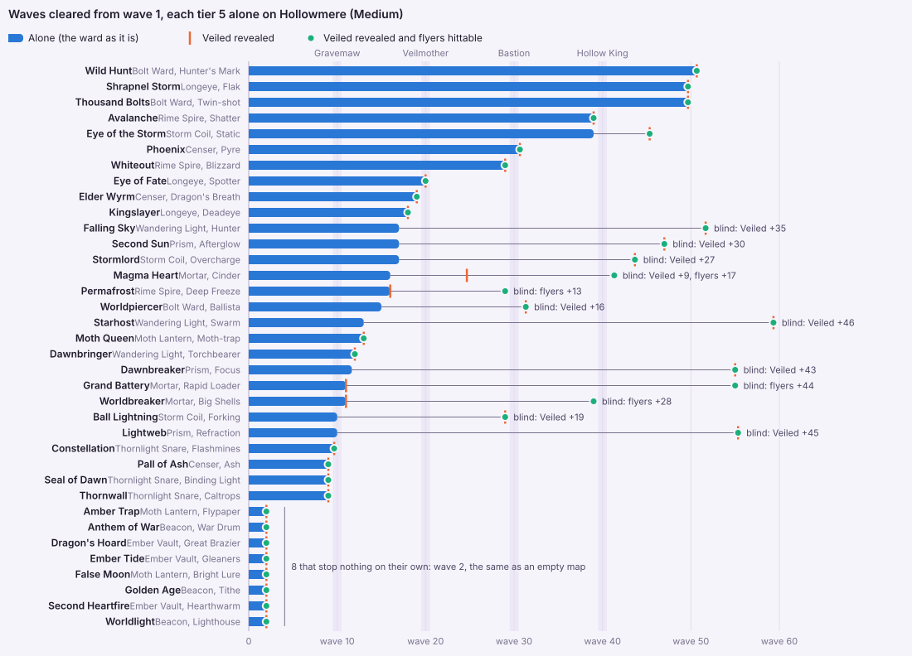
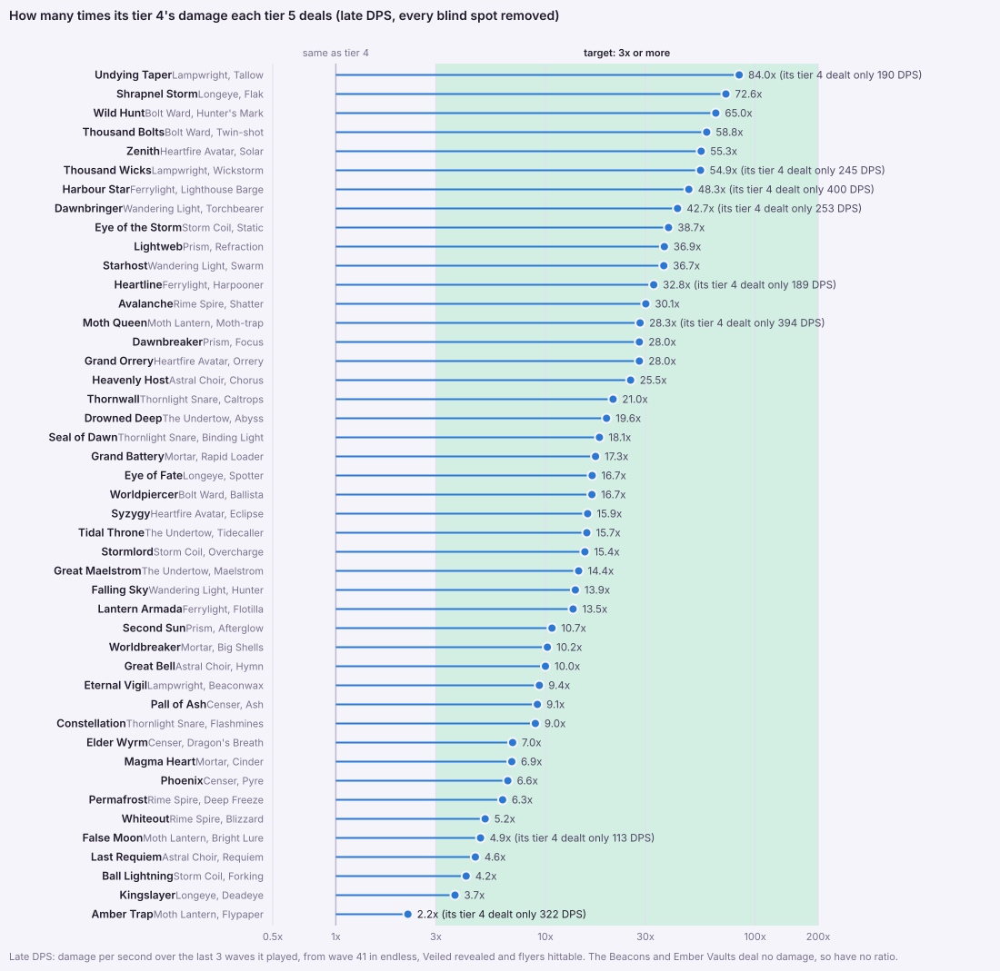
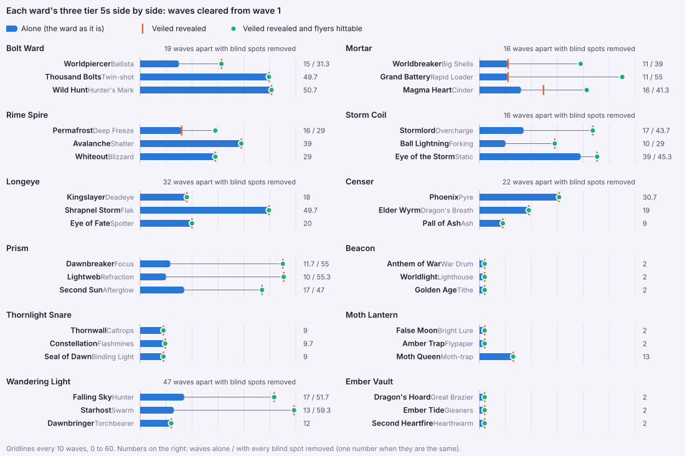

# Tier 5 report: every capstone tested on its own

Report only: nothing in the game, its balance or its art was changed for this. The numbers come from `tools/t5study.js` (built on `tools/solo.js`) and the tables from `tools/t5report.js` (the charts and summary table from `tools/t5charts.js`); how to rerun them is at the end. Hollowmere, Medium, 3 seeds per test, run on 2026-11-24 at `c9df88e`.

## Summary

- **The spread is huge.** On its own, the best tier 5, Shrapnel Storm (Longeye, Flak), gets to about wave 50. The weakest ones that attack, the three Snares and Pall of Ash (Censer, Ash), can't get past wave 9. Eight more, all three Beacons, all three Ember Vaults, False Moon (Moth Lantern, Bright Lure) and Amber Trap (Moth Lantern, Flypaper), can't kill anything on the road, so alone they do exactly as well as an empty map and lose on wave 3.
- **Most of the "weak" tier 5s are blind, not weak.** Starhost (Wandering Light, Swarm), Dawnbreaker (Prism, Focus), Lightweb (Prism, Refraction), Falling Sky (Wandering Light, Hunter), Second Sun (Prism, Afterglow), Stormlord (Storm Coil, Overcharge) and Ball Lightning (Storm Coil, Forking) all die to Veiled enemies alone: 100% of the lives they lose are Veiled Gloom they can't target. With the Veiled revealed (and no other help), **Starhost becomes the strongest tier 5 of all** (wave 59 from wave 1, 19 waves past 40 in endless), with Dawnbreaker and Lightweb right behind it. Grand Battery (Mortar, Rapid Loader) and Worldbreaker (Mortar, Big Shells) are the same story with flyers: Gloomwings take 80-100% of their lives, and once they can hit flyers Grand Battery is the 4th strongest.
- **A few are weak in raw power too**, even with every blind spot removed:
  - the three Snares, Thornwall (Thornlight Snare, Caltrops), Constellation (Thornlight Snare, Flashmines) and Seal of Dawn (Thornlight Snare, Binding Light), and Pall of Ash (Censer, Ash) all fall to the first boss, the Gravemaw on wave 10.
  - Dawnbringer (Wandering Light, Torchbearer) reaches wave 12 and Moth Queen (Moth Lantern, Moth-trap) wave 13, killed by Gloomwings, which are its speciality. Both barely fight.
  - Kingslayer (Longeye, Deadeye) and Eye of Fate (Longeye, Spotter) reach wave 18-20. They see everything and hit flyers, but single shots can't keep up with crowds of Skitters and Gloomwings.
  - Elder Wyrm (Censer, Dragon's Breath), Phoenix (Censer, Pyre), Magma Heart (Mortar, Cinder), Worldpiercer (Bolt Ward, Ballista) and Kingslayer (Longeye, Deadeye) are only 0.9-1.3x their tier 4's damage late on, far short of the 3-5x the tier 5 design aims for.
- **The strongest on their own** are Wild Hunt (Bolt Ward, Hunter's Mark), Thousand Bolts (Bolt Ward, Twin-shot) and Shrapnel Storm (Longeye, Flak): they see Veiled (the Longeye always does; the Bolt Wards through the Hunter's Mark path, as their main path or as the second path), hit flyers and deal with crowds. Avalanche (Rime Spire, Shatter), Eye of the Storm (Storm Coil, Static) and Whiteout (Rime Spire, Blizzard) follow.
- **Boss walls**: the Gravemaw (wave 10), the Bastion (wave 30) and the Hollow King (wave 40) end many runs outright. A campaign boss that gets through costs all of its leak (150 lives here), so Whiteout (Rime Spire, Blizzard) goes from full lives to nothing on wave 30, and the Bastion ends Phoenix (Censer, Pyre) there too.
- **A bug turned up** (not fixed): Second Heartfire (Ember Vault, Hearthwarm) is meant to be always warm (`warmAt: 0`), but `vault()` in `sim/towers.js` reads `s.warmAt || 0.5`, so 0 falls back to "warm from half full". Its +50% speed and +35% damage only switch on once it's half full.

## At a glance

All 36 tier 5s in one table, then four charts. On the report page (port 3002), click a column header to sort by it (click again to reverse), and hover over a chart for its numbers.
- **Waves** are the last wave cleared starting at wave 1 with the ward pre-built, mean of 3 seeds: alone, with Veiled revealed, and with Veiled revealed and flyers hittable.
- **vs tier 4** is its late DPS divided by its tier 4's, with every blind spot removed. The design aims for 3-5x.
- **Main killer** is the cause of most of the lives it lost alone, with its share.
- The charts and this table are made by `tools/t5charts.js`; the charts are also saved as SVG files in `docs/tier5-charts/`.

<!-- t5charts:summary -->
<div class="t5sum">
<table class="sortable"><thead><tr><th data-sort="num" class="r">#</th><th data-sort="text">Tier 5</th><th data-sort="text">Ward</th><th data-sort="text">Path</th><th data-sort="num" class="r">Alone</th><th data-sort="num" class="r">Veiled revealed</th><th data-sort="num" class="r">Veiled + flyers</th><th data-sort="num" class="r">vs tier 4</th><th data-sort="num" class="r">Cost</th><th data-sort="text">Main killer (alone)</th></tr></thead>
<tbody><tr><td data-v="1" class="r">1</td><td data-v="Wild Hunt"><strong>Wild Hunt</strong></td><td data-v="Bolt Ward">Bolt Ward</td><td data-v="Hunter's Mark">Hunter's Mark</td><td data-v="50.667" class="r q4">50.7</td><td data-v="50.667" class="r q4">50.7</td><td data-v="50.667" class="r q4">50.7</td><td data-v="2.676" class="r q1">2.7x</td><td data-v="21000" class="r">21k</td><td data-v="numbers 0.267" class="kill"><span class="t5sw t5sw-gray"></span>numbers 73%</td></tr>
<tr><td data-v="2" class="r">2</td><td data-v="Shrapnel Storm"><strong>Shrapnel Storm</strong></td><td data-v="Longeye">Longeye</td><td data-v="Flak">Flak</td><td data-v="49.667" class="r q4">49.7</td><td data-v="49.667" class="r q4">49.7</td><td data-v="49.667" class="r q4">49.7</td><td data-v="3.062" class="r q4">3.1x</td><td data-v="26070" class="r">26k</td><td data-v="numbers 0.000" class="kill"><span class="t5sw t5sw-gray"></span>numbers 100%</td></tr>
<tr><td data-v="3" class="r">3</td><td data-v="Thousand Bolts"><strong>Thousand Bolts</strong></td><td data-v="Bolt Ward">Bolt Ward</td><td data-v="Twin-shot">Twin-shot</td><td data-v="49.667" class="r q4">49.7</td><td data-v="49.667" class="r q4">49.7</td><td data-v="49.667" class="r q4">49.7</td><td data-v="2.355" class="r q1">2.4x</td><td data-v="22900" class="r">23k</td><td data-v="armour 0.458" class="kill"><span class="t5sw t5sw-s3"></span>armour 54%</td></tr>
<tr><td data-v="4" class="r">4</td><td data-v="Avalanche"><strong>Avalanche</strong></td><td data-v="Rime Spire">Rime Spire</td><td data-v="Shatter">Shatter</td><td data-v="39" class="r q3">39</td><td data-v="39" class="r q3">39</td><td data-v="39" class="r q3">39</td><td data-v="2.44" class="r q1">2.4x</td><td data-v="24845" class="r">25k</td><td data-v="flyers 0.000" class="kill"><span class="t5sw t5sw-s2"></span>flyers 100%</td></tr>
<tr><td data-v="5" class="r">5</td><td data-v="Eye of the Storm"><strong>Eye of the Storm</strong></td><td data-v="Storm Coil">Storm Coil</td><td data-v="Static">Static</td><td data-v="39" class="r q3">39</td><td data-v="45.333" class="r q4">45.3</td><td data-v="45.333" class="r q4">45.3</td><td data-v="2.056" class="r q1">2.1x</td><td data-v="26400" class="r">26k</td><td data-v="numbers 0.609" class="kill"><span class="t5sw t5sw-gray"></span>numbers 39%</td></tr>
<tr><td data-v="6" class="r">6</td><td data-v="Phoenix"><strong>Phoenix</strong></td><td data-v="Censer">Censer</td><td data-v="Pyre">Pyre</td><td data-v="30.667" class="r q3">30.7</td><td data-v="30.667" class="r q3">30.7</td><td data-v="30.667" class="r q3">30.7</td><td data-v="1.254" class="r q0">1.3x</td><td data-v="25095" class="r">25k</td><td data-v="bosses 0.333" class="kill"><span class="t5sw t5sw-s7"></span>bosses 67%</td></tr>
<tr><td data-v="7" class="r">7</td><td data-v="Whiteout"><strong>Whiteout</strong></td><td data-v="Rime Spire">Rime Spire</td><td data-v="Blizzard">Blizzard</td><td data-v="29" class="r q2">29</td><td data-v="29" class="r q2">29</td><td data-v="29" class="r q2">29</td><td data-v="1.477" class="r q0">1.5x</td><td data-v="22395" class="r">22k</td><td data-v="bosses 0.000" class="kill"><span class="t5sw t5sw-s7"></span>bosses 100%</td></tr>
<tr><td data-v="8" class="r">8</td><td data-v="Eye of Fate"><strong>Eye of Fate</strong></td><td data-v="Longeye">Longeye</td><td data-v="Spotter">Spotter</td><td data-v="20" class="r q2">20</td><td data-v="20" class="r q2">20</td><td data-v="20" class="r q2">20</td><td data-v="3.074" class="r q4">3.1x</td><td data-v="24150" class="r">24k</td><td data-v="numbers 0.000" class="kill"><span class="t5sw t5sw-gray"></span>numbers 100%</td></tr>
<tr><td data-v="9" class="r">9</td><td data-v="Elder Wyrm"><strong>Elder Wyrm</strong></td><td data-v="Censer">Censer</td><td data-v="Dragon's Breath">Dragon's Breath</td><td data-v="19" class="r q2">19</td><td data-v="19" class="r q2">19</td><td data-v="19" class="r q2">19</td><td data-v="0.907" class="r q0">0.9x</td><td data-v="26345" class="r">26k</td><td data-v="Veiled 0.000" class="kill"><span class="t5sw t5sw-s1"></span>Veiled 100%</td></tr>
<tr><td data-v="10" class="r">10</td><td data-v="Kingslayer"><strong>Kingslayer</strong></td><td data-v="Longeye">Longeye</td><td data-v="Deadeye">Deadeye</td><td data-v="18" class="r q2">18</td><td data-v="18" class="r q2">18</td><td data-v="18" class="r q2">18</td><td data-v="1.213" class="r q0">1.2x</td><td data-v="27470" class="r">27k</td><td data-v="numbers 0.000" class="kill"><span class="t5sw t5sw-gray"></span>numbers 100%</td></tr>
<tr><td data-v="11" class="r">11</td><td data-v="Falling Sky"><strong>Falling Sky</strong></td><td data-v="Wandering Light">Wandering Light</td><td data-v="Hunter">Hunter</td><td data-v="17" class="r q2">17</td><td data-v="51.667" class="r q4">51.7</td><td data-v="51.667" class="r q4">51.7</td><td data-v="2.497" class="r q1">2.5x</td><td data-v="25705" class="r">26k</td><td data-v="Veiled 0.000" class="kill"><span class="t5sw t5sw-s1"></span>Veiled 100%</td></tr>
<tr><td data-v="12" class="r">12</td><td data-v="Second Sun"><strong>Second Sun</strong></td><td data-v="Prism">Prism</td><td data-v="Afterglow">Afterglow</td><td data-v="17" class="r q2">17</td><td data-v="47" class="r q4">47</td><td data-v="47" class="r q4">47</td><td data-v="1.906" class="r q1">1.9x</td><td data-v="26970" class="r">27k</td><td data-v="Veiled 0.000" class="kill"><span class="t5sw t5sw-s1"></span>Veiled 100%</td></tr>
<tr><td data-v="13" class="r">13</td><td data-v="Stormlord"><strong>Stormlord</strong></td><td data-v="Storm Coil">Storm Coil</td><td data-v="Overcharge">Overcharge</td><td data-v="17" class="r q2">17</td><td data-v="43.667" class="r q3">43.7</td><td data-v="43.667" class="r q3">43.7</td><td data-v="2.214" class="r q1">2.2x</td><td data-v="29000" class="r">29k</td><td data-v="Veiled 0.000" class="kill"><span class="t5sw t5sw-s1"></span>Veiled 100%</td></tr>
<tr><td data-v="14" class="r">14</td><td data-v="Magma Heart"><strong>Magma Heart</strong></td><td data-v="Mortar">Mortar</td><td data-v="Cinder">Cinder</td><td data-v="16" class="r q2">16</td><td data-v="24.667" class="r q2">24.7</td><td data-v="41.333" class="r q3">41.3</td><td data-v="1.083" class="r q0">1.1x</td><td data-v="26370" class="r">26k</td><td data-v="flyers 0.073" class="kill"><span class="t5sw t5sw-s2"></span>flyers 93%</td></tr>
<tr><td data-v="15" class="r">15</td><td data-v="Permafrost"><strong>Permafrost</strong></td><td data-v="Rime Spire">Rime Spire</td><td data-v="Deep Freeze">Deep Freeze</td><td data-v="16" class="r q2">16</td><td data-v="16" class="r q2">16</td><td data-v="29" class="r q2">29</td><td data-v="1.516" class="r q1">1.5x</td><td data-v="22945" class="r">23k</td><td data-v="flyers 0.267" class="kill"><span class="t5sw t5sw-s2"></span>flyers 73%</td></tr>
<tr><td data-v="16" class="r">16</td><td data-v="Worldpiercer"><strong>Worldpiercer</strong></td><td data-v="Bolt Ward">Bolt Ward</td><td data-v="Ballista">Ballista</td><td data-v="15" class="r q2">15</td><td data-v="31.333" class="r q3">31.3</td><td data-v="31.333" class="r q3">31.3</td><td data-v="1.155" class="r q0">1.2x</td><td data-v="24760" class="r">25k</td><td data-v="numbers 0.000" class="kill"><span class="t5sw t5sw-gray"></span>numbers 100%</td></tr>
<tr><td data-v="17" class="r">17</td><td data-v="Starhost"><strong>Starhost</strong></td><td data-v="Wandering Light">Wandering Light</td><td data-v="Swarm">Swarm</td><td data-v="13" class="r q1">13</td><td data-v="59.333" class="r q4">59.3</td><td data-v="59.333" class="r q4">59.3</td><td data-v="7.914" class="r qhi">7.9x</td><td data-v="23855" class="r">24k</td><td data-v="Veiled 0.000" class="kill"><span class="t5sw t5sw-s1"></span>Veiled 100%</td></tr>
<tr><td data-v="18" class="r">18</td><td data-v="Moth Queen"><strong>Moth Queen</strong></td><td data-v="Moth Lantern">Moth Lantern</td><td data-v="Moth-trap">Moth-trap</td><td data-v="13" class="r q1">13</td><td data-v="13" class="r q1">13</td><td data-v="13" class="r q1">13</td><td data-v="15.712" class="r qhi">15.7x</td><td data-v="24380" class="r">24k</td><td data-v="numbers 0.000" class="kill"><span class="t5sw t5sw-gray"></span>numbers 100%</td></tr>
<tr><td data-v="19" class="r">19</td><td data-v="Dawnbringer"><strong>Dawnbringer</strong></td><td data-v="Wandering Light">Wandering Light</td><td data-v="Torchbearer">Torchbearer</td><td data-v="12" class="r q1">12</td><td data-v="12" class="r q1">12</td><td data-v="12" class="r q1">12</td><td data-v="1.657" class="r q1">1.7x</td><td data-v="23965" class="r">24k</td><td data-v="numbers 0.104" class="kill"><span class="t5sw t5sw-gray"></span>numbers 90%</td></tr>
<tr><td data-v="20" class="r">20</td><td data-v="Dawnbreaker"><strong>Dawnbreaker</strong></td><td data-v="Prism">Prism</td><td data-v="Focus">Focus</td><td data-v="11.667" class="r q1">11.7</td><td data-v="55" class="r q4">55</td><td data-v="55" class="r q4">55</td><td data-v="4.831" class="r q4">4.8x</td><td data-v="30150" class="r">30k</td><td data-v="Veiled 0.000" class="kill"><span class="t5sw t5sw-s1"></span>Veiled 100%</td></tr>
<tr><td data-v="21" class="r">21</td><td data-v="Grand Battery"><strong>Grand Battery</strong></td><td data-v="Mortar">Mortar</td><td data-v="Rapid Loader">Rapid Loader</td><td data-v="11" class="r q1">11</td><td data-v="11" class="r q1">11</td><td data-v="55" class="r q4">55</td><td data-v="3.57" class="r q4">3.6x</td><td data-v="26240" class="r">26k</td><td data-v="flyers 0.187" class="kill"><span class="t5sw t5sw-s2"></span>flyers 81%</td></tr>
<tr><td data-v="22" class="r">22</td><td data-v="Worldbreaker"><strong>Worldbreaker</strong></td><td data-v="Mortar">Mortar</td><td data-v="Big Shells">Big Shells</td><td data-v="11" class="r q1">11</td><td data-v="11" class="r q1">11</td><td data-v="39" class="r q3">39</td><td data-v="1.506" class="r q1">1.5x</td><td data-v="27590" class="r">28k</td><td data-v="flyers 0.038" class="kill"><span class="t5sw t5sw-s2"></span>flyers 96%</td></tr>
<tr><td data-v="23" class="r">23</td><td data-v="Ball Lightning"><strong>Ball Lightning</strong></td><td data-v="Storm Coil">Storm Coil</td><td data-v="Forking">Forking</td><td data-v="10" class="r q1">10</td><td data-v="29" class="r q2">29</td><td data-v="29" class="r q2">29</td><td data-v="1.602" class="r q1">1.6x</td><td data-v="27760" class="r">28k</td><td data-v="Veiled 0.000" class="kill"><span class="t5sw t5sw-s1"></span>Veiled 100%</td></tr>
<tr><td data-v="24" class="r">24</td><td data-v="Lightweb"><strong>Lightweb</strong></td><td data-v="Prism">Prism</td><td data-v="Refraction">Refraction</td><td data-v="10" class="r q1">10</td><td data-v="55.333" class="r q4">55.3</td><td data-v="55.333" class="r q4">55.3</td><td data-v="6.353" class="r qhi">6.4x</td><td data-v="27670" class="r">28k</td><td data-v="Veiled 0.000" class="kill"><span class="t5sw t5sw-s1"></span>Veiled 100%</td></tr>
<tr><td data-v="25" class="r">25</td><td data-v="Constellation"><strong>Constellation</strong></td><td data-v="Thornlight Snare">Thornlight Snare</td><td data-v="Flashmines">Flashmines</td><td data-v="9.667" class="r q1">9.7</td><td data-v="9.667" class="r q1">9.7</td><td data-v="9.667" class="r q1">9.7</td><td data-v="1.62" class="r q1">1.6x</td><td data-v="24910" class="r">25k</td><td data-v="flyers 0.413" class="kill"><span class="t5sw t5sw-s2"></span>flyers 59%</td></tr>
<tr><td data-v="26" class="r">26</td><td data-v="Pall of Ash"><strong>Pall of Ash</strong></td><td data-v="Censer">Censer</td><td data-v="Ash">Ash</td><td data-v="9" class="r q1">9</td><td data-v="9" class="r q1">9</td><td data-v="9" class="r q1">9</td><td data-v="1.716" class="r q1">1.7x</td><td data-v="23895" class="r">24k</td><td data-v="bosses 0.242" class="kill"><span class="t5sw t5sw-s7"></span>bosses 76%</td></tr>
<tr><td data-v="27" class="r">27</td><td data-v="Seal of Dawn"><strong>Seal of Dawn</strong></td><td data-v="Thornlight Snare">Thornlight Snare</td><td data-v="Binding Light">Binding Light</td><td data-v="9" class="r q1">9</td><td data-v="9" class="r q1">9</td><td data-v="9" class="r q1">9</td><td data-v="1.638" class="r q1">1.6x</td><td data-v="23740" class="r">24k</td><td data-v="bosses 0.480" class="kill"><span class="t5sw t5sw-s7"></span>bosses 52%</td></tr>
<tr><td data-v="28" class="r">28</td><td data-v="Thornwall"><strong>Thornwall</strong></td><td data-v="Thornlight Snare">Thornlight Snare</td><td data-v="Caltrops">Caltrops</td><td data-v="9" class="r q1">9</td><td data-v="9" class="r q1">9</td><td data-v="9" class="r q1">9</td><td data-v="3.964" class="r q4">4.0x</td><td data-v="23070" class="r">23k</td><td data-v="bosses 0.427" class="kill"><span class="t5sw t5sw-s7"></span>bosses 57%</td></tr>
<tr><td data-v="29" class="r">29</td><td data-v="Amber Trap"><strong>Amber Trap</strong></td><td data-v="Moth Lantern">Moth Lantern</td><td data-v="Flypaper">Flypaper</td><td data-v="2" class="r q0">2</td><td data-v="2" class="r q0">2</td><td data-v="2" class="r q0">2</td><td data-v="2.021" class="r q1">2.0x</td><td data-v="21310" class="r">21k</td><td data-v="zzz" class="kill"><span class="t5sw t5sw-none"></span>stops nothing alone</td></tr>
<tr><td data-v="30" class="r">30</td><td data-v="Anthem of War"><strong>Anthem of War</strong></td><td data-v="Beacon">Beacon</td><td data-v="War Drum">War Drum</td><td data-v="2" class="r q0">2</td><td data-v="2" class="r q0">2</td><td data-v="2" class="r q0">2</td><td data-v="-1" class="r qna">no damage</td><td data-v="26970" class="r">27k</td><td data-v="zzz" class="kill"><span class="t5sw t5sw-none"></span>stops nothing alone</td></tr>
<tr><td data-v="31" class="r">31</td><td data-v="Dragon's Hoard"><strong>Dragon's Hoard</strong></td><td data-v="Ember Vault">Ember Vault</td><td data-v="Great Brazier">Great Brazier</td><td data-v="2" class="r q0">2</td><td data-v="2" class="r q0">2</td><td data-v="2" class="r q0">2</td><td data-v="-1" class="r qna">no damage</td><td data-v="24320" class="r">24k</td><td data-v="zzz" class="kill"><span class="t5sw t5sw-none"></span>stops nothing alone</td></tr>
<tr><td data-v="32" class="r">32</td><td data-v="Ember Tide"><strong>Ember Tide</strong></td><td data-v="Ember Vault">Ember Vault</td><td data-v="Gleaners">Gleaners</td><td data-v="2" class="r q0">2</td><td data-v="2" class="r q0">2</td><td data-v="2" class="r q0">2</td><td data-v="-1" class="r qna">no damage</td><td data-v="22970" class="r">23k</td><td data-v="zzz" class="kill"><span class="t5sw t5sw-none"></span>stops nothing alone</td></tr>
<tr><td data-v="33" class="r">33</td><td data-v="False Moon"><strong>False Moon</strong></td><td data-v="Moth Lantern">Moth Lantern</td><td data-v="Bright Lure">Bright Lure</td><td data-v="2" class="r q0">2</td><td data-v="2" class="r q0">2</td><td data-v="2" class="r q0">2</td><td data-v="8.856" class="r qhi">8.9x</td><td data-v="22530" class="r">23k</td><td data-v="zzz" class="kill"><span class="t5sw t5sw-none"></span>stops nothing alone</td></tr>
<tr><td data-v="34" class="r">34</td><td data-v="Golden Age"><strong>Golden Age</strong></td><td data-v="Beacon">Beacon</td><td data-v="Tithe">Tithe</td><td data-v="2" class="r q0">2</td><td data-v="2" class="r q0">2</td><td data-v="2" class="r q0">2</td><td data-v="-1" class="r qna">no damage</td><td data-v="24750" class="r">25k</td><td data-v="zzz" class="kill"><span class="t5sw t5sw-none"></span>stops nothing alone</td></tr>
<tr><td data-v="35" class="r">35</td><td data-v="Second Heartfire"><strong>Second Heartfire</strong></td><td data-v="Ember Vault">Ember Vault</td><td data-v="Hearthwarm">Hearthwarm</td><td data-v="2" class="r q0">2</td><td data-v="2" class="r q0">2</td><td data-v="2" class="r q0">2</td><td data-v="-1" class="r qna">no damage</td><td data-v="25500" class="r">26k</td><td data-v="zzz" class="kill"><span class="t5sw t5sw-none"></span>stops nothing alone</td></tr>
<tr><td data-v="36" class="r">36</td><td data-v="Worldlight"><strong>Worldlight</strong></td><td data-v="Beacon">Beacon</td><td data-v="Lighthouse">Lighthouse</td><td data-v="2" class="r q0">2</td><td data-v="2" class="r q0">2</td><td data-v="2" class="r q0">2</td><td data-v="-1" class="r qna">no damage</td><td data-v="23170" class="r">23k</td><td data-v="zzz" class="kill"><span class="t5sw t5sw-none"></span>stops nothing alone</td></tr></tbody></table>
</div>
<!-- /t5charts:summary -->
<div class="key"><span class="kq0">waves: 2 (stops nothing)</span> <span class="kq1">under 15</span> <span class="kq2">15-30</span> <span class="kq3">30-45</span> <span class="kq4">45 and up</span> <span class="kq0">vs tier 4: under 1.5x</span> <span class="kq1">1.5-3x</span> <span class="kq4">3-5x (on target)</span> <span class="kqhi">over 5x</span></div>


**Take from it:** a long line after the bar means blind, not weak: Starhost, Lightweb, Dawnbreaker, Falling Sky, Second Sun and Stormlord clear 27-46 more waves once Veiled are revealed, and Grand Battery 44 more once it can hit flyers, while the Snares, Pall of Ash and the bottom eight stay low whatever they're given.


**Take from it:** only 5 of the 30 that deal damage land in the intended 3-5x (shaded); 21 fall short, and Elder Wyrm, Magma Heart, Worldpiercer, Kingslayer, Phoenix and Whiteout barely improve on their tier 4 (0.9-1.5x), while Moth Queen and False Moon only look big because their tier 4 did almost nothing.


**Take from it:** Veiled (blue) alone ends 8 of them, flyers (orange) end the Mortars, Avalanche and Permafrost, and bosses (violet) end Whiteout, Phoenix, Pall of Ash and the Snares; only grey means a ward was simply outnumbered.


**Take from it:** judged by the dots (blind spots removed), the weak paths are the Wandering Light's Torchbearer, the Censer's Ash, the Longeye's Deadeye and Spotter, the Bolt Ward's Ballista and the Storm Coil's Forking; the Prism's three are even, and the Snare, Moth Lantern, Beacon and Ember Vault are low on every path.

## Method

- **The harness** (`tools/solo.js`) starts a real game (the same simulation the game runs) with one ward on the map, already built: tier 5 (or tier 4) on one path and tier 2 on a secondary path. Each wave is called when the last one clears, and it plays until it loses (or wave 150). Lives, leak caps and the one free Last Light save are as in a game. The ward's own ability is used the way `tools/bot.js` uses abilities (when 40+ Gloom are out or a hulk is). The Heartfire Flare is never used, because it isn't the ward's power.
- **Two starts.** **W1** is the last wave cleared starting at wave 1, ward pre-built (the campaign is 40 waves, then it carries on into endless). **E41** is how many waves it clears past wave 40 when dropped straight into endless at wave 41 with fresh lives (0 means it lost wave 41).
- **Three conditions**, all test-only switches set on the one game object in the harness:
  1. **Alone**: the ward as it is.
  2. **Reveal**: every Veiled enemy counts as seen by it. The harness asks `Game.targetable` to skip the Veiled check, as it already does for area attacks. Nothing else changes: no range, rate or damage, unlike a Beacon.
  3. **Full**: reveal, and flyers are targetable and hittable by it (its stats get `hitsAir`, and `targetable` skips the flyer check). Effects that only exist on the ground still miss flyers: a Snare's thorns and mines, burning pools.
- **Placement and secondary path.** For each tier 5 and condition, four candidate spots were tried: the best by road in reach, kept apart from each other, and for wards that can hit flyers, two of the four by road plus flight line. Each spot was tried with both other paths at tier 2, seed 1, from both starts. The best (W1 + E41, then damage) was kept for the other seeds and for the tier 4. This matters a lot: the same ward can swing by up to 37 waves between spots (Thousand Bolts, on the Bolt Ward's Twin-shot path, went from wave 10 to 47 depending on the spot), and Eye of the Storm (Storm Coil, Static) only did well once flight-line spots were included.
- **Seeds.** Three seeds per test. The campaign waves are fixed, so seeds barely matter from wave 1. In endless they change the waves; only 13 of 216 tier 5 cells differ by 3+ waves between seeds.
- **Damage per second.** The whole-run rate mostly measures how much there is to hit (early waves run out of targets), so the tables use **late DPS**: damage per second over the last three waves it played, in the full condition from wave 41, when there's always more Gloom than it can kill.
- **Leaks.** Every life lost is put down to one cause, the first that fits: boss, Veiled (alone, and it can't see Veiled), flyer (it can't hit flyers in that condition; always, for a Snare), shielded, healed by a Mender, armour (resists its damage type), hulk, otherwise sheer numbers.
- **Other map.** The extremes were rerun on Ashfork (Medium, alone and full, 3 seeds, with its own placement search). See the spot check below.
- **Beacon and Ember Vault** have no attack, so alone they measure nothing. As an extra (not part of the ranking), each was also tested beside a fixed partner: a Bolt Ward at tier 4 on the Twin-shot path with Ballista at tier 2, which hits flyers but can't see Veiled.

## The outliers

**Strongest alone: Shrapnel Storm (Longeye, Flak), Wild Hunt (Bolt Ward, Hunter's Mark), Thousand Bolts (Bolt Ward, Twin-shot)**: W1 about 50, E41 8-14. All three have no blind spot: the Longeye sees Veiled and hits flyers everywhere, and the two Bolt Wards hit flyers and see Veiled through the Hunter's Mark path (as their main path, or as the chosen second path). They lose to sheer numbers and, for the Bolts, to Husks (Kinetic does half damage to them). Their reveal and full results are identical to alone.

**Strongest in raw power: Starhost (Wandering Light, Swarm), Dawnbreaker (Prism, Focus), Lightweb (Prism, Refraction), Grand Battery (Mortar, Rapid Loader)**: full W1 55-59, E41 15-19, late DPS 7-12k against 5-11k for the alone leaders. In the plain game they rank 14th, 16th, 22nd and 23rd, because each has one blind spot that ends it early:
- Starhost (Wandering Light, Swarm), Dawnbreaker (Prism, Focus) and Lightweb (Prism, Refraction) can't see Veiled (Veiled Gloom start on wave 6).
- Grand Battery (Mortar, Rapid Loader) can't hit flyers (wave 9 on).

Starhost's jump from its tier 4 is the biggest of any (late DPS x7.9) but invisible alone (wave 13 at both tiers). In a real defence, where something else sees Veiled, these are probably the best tier 5s in the game.

**Weak from blind spots** (alone far below full):
- Veiled: Starhost (Wandering Light, Swarm), Dawnbreaker (Prism, Focus), Lightweb (Prism, Refraction), Falling Sky (Wandering Light, Hunter), Second Sun (Prism, Afterglow), Stormlord (Storm Coil, Overcharge), Ball Lightning (Storm Coil, Forking).
- Flyers: Grand Battery (Mortar, Rapid Loader), Worldbreaker (Mortar, Big Shells), Magma Heart (Mortar, Cinder), Permafrost (Rime Spire, Deep Freeze).
- Some of each: Eye of the Storm (Storm Coil, Static).

Worldpiercer (Bolt Ward, Ballista) is a case of its own: alone the search gave it the Hunter's Mark path as its second path just to see Veiled; with Veiled revealed it took Twin-shot instead, and went from wave 15 to 31.

**Weak from raw power** (low even in full):
- **Thornwall (Thornlight Snare, Caltrops), Constellation (Thornlight Snare, Flashmines), Seal of Dawn (Thornlight Snare, Binding Light)**: W1 9-10, E41 0. Every Snare dies on wave 10. The Gravemaw walks over them, and Gloomwings fly over them. They are road tools for a defence, not a defence.
- **Pall of Ash (Censer, Ash)**: W1 9. Also stopped by the Gravemaw. Its damage is mostly a debuff for other wards (Ash strips resistances), so alone it has little to show.
- **Dawnbringer (Wandering Light, Torchbearer)**: W1 12, late DPS about 400, the lowest of any attacking tier 5. A support tier 5 (the torch boosts other wards) on a weak attack.
- **Moth Queen (Moth Lantern, Moth-trap)**: W1 13. All its lost lives are Gloomwings, the flyers it's built to lure and burn. It goes from nearly nothing at tier 4 (wave 2) to wave 13, but that's still low.
- **Kingslayer (Longeye, Deadeye) and Eye of Fate (Longeye, Spotter)**: W1 18-20, E41 0. No blind spots, but neither handles a crowd. Kingslayer is a single-target boss and hulk killer. Eye of Fate mostly Dooms the 10 toughest enemies (+60% damage from everything) for other wards. Alone, a crowd of small Gloom gets past them.
- **Elder Wyrm (Censer, Dragon's Breath)**: W1 19. Alone its losses are all Veiled Wisps, but revealing them changes nothing (still 19), so the real limit is damage. Its late DPS is slightly *below* its tier 4, Dragon's Breath (0.9x): the only tier 5 that doesn't beat its own tier 4. Worth a closer look at whether its river of fire and its x2 flame reach the enemies as intended (not traced for this report).

**Small jumps from tier 4** (late DPS, tier 5 against tier 4): Elder Wyrm (Censer, Dragon's Breath) 0.9x, Magma Heart (Mortar, Cinder) 1.1x, Kingslayer (Longeye, Deadeye) 1.2x, Worldpiercer (Bolt Ward, Ballista) 1.2x, Phoenix (Censer, Pyre) 1.3x, Whiteout (Rime Spire, Blizzard) 1.5x, Permafrost (Rime Spire, Deep Freeze) 1.5x, Worldbreaker (Mortar, Big Shells) 1.5x. The design says 3-5x power for about 4.5x the cost. The big jumps are Moth Queen (Moth Lantern, Moth-trap) 15.7x (from almost nothing), Starhost (Wandering Light, Swarm) 7.9x, Lightweb (Prism, Refraction) 6.4x, Dawnbreaker (Prism, Focus) 4.8x and Thornwall (Thornlight Snare, Caltrops) 4.0x.

**No attack** (W1 2, the same as an empty map): Anthem of War (Beacon, War Drum), Worldlight (Beacon, Lighthouse), Golden Age (Beacon, Tithe), Dragon's Hoard (Ember Vault, Great Brazier), Ember Tide (Ember Vault, Gleaners), Second Heartfire (Ember Vault, Hearthwarm), False Moon (Moth Lantern, Bright Lure), Amber Trap (Moth Lantern, Flypaper). False Moon and Amber Trap only lure or glue flyers for other wards (a few hundred damage a second to flyers, and nothing on the road). Beside the partner Bolt Ward:
- **Anthem of War (Beacon, War Drum)** helps the most: the partner goes from wave 10 to 38 (25 with the reveal switch alone, so most of that is its second path, the Beacon's Lighthouse, giving sight). Its late DPS is 3.2x.
- **Worldlight (Beacon, Lighthouse)**: 10 to 29, through sight and range.
- **Golden Age (Beacon, Tithe), Dragon's Hoard (Ember Vault, Great Brazier) and Ember Tide (Ember Vault, Gleaners)** only make gold, which a fixed defence can't spend: 0 by construction.
- **Second Heartfire (Ember Vault, Hearthwarm)**: a small gain (25.7 to 30 with reveal), held back by the bug above.

## What might explain the gaps (observations only)

- **Veiled is the biggest divider.** From wave 6, a ward that can't see Veiled has a hard ceiling around wave 10-17 on its own, whatever its damage. The tier 5s that rank high alone are exactly the ones with sight built in (the Longeye itself, the Bolt Ward's Hunter's Mark path, the Rime Spire's Blizzard path through Frost Sight) or that pick a sight path as their tier 2 second path. The harness was free to choose the second path, and it chose a sight path wherever one was offered (Hunter's Mark for both other Bolt Ward paths, Blizzard for Avalanche, the Rime Spire's Shatter tier 5).
- **Flyers are the second.** Mortars, Rime Spires and Snares can't hit Gloomwings from wave 9. Grand Battery (Mortar, Rapid Loader) is a top-4 damage dealer that loses 80% of its lives to flyers.
- **Boss leaks are all-or-nothing in the campaign.** A boss that gets through costs everything left in it (the Bastion cost 150 lives, the whole bar), so a ward that is fine against the waves around it still loses on 10, 30 or 40. Whiteout (Rime Spire, Blizzard) loses every life on wave 30 to the Bastion, and everything else it leaked is nothing.
- **Single-target capstones look bad alone by nature.** Kingslayer (Longeye, Deadeye) and Eye of Fate (Longeye, Spotter) are made for bosses and hulks next to other wards. This test punishes them more than a real defence would.
- **Support capstones can't be measured alone**: the 3 Beacons, 3 Vaults, False Moon (Moth Lantern, Bright Lure) and Amber Trap (Moth Lantern, Flypaper). The partner table gives a first idea, but comparing them fairly needs a defence test, like `bot.js` with and without each one.
- **Some tier 5s add a mechanic more than power.** Elder Wyrm (Censer, Dragon's Breath), Magma Heart (Mortar, Cinder), Worldpiercer (Bolt Ward, Ballista), Phoenix (Censer, Pyre) and Kingslayer (Longeye, Deadeye) gain 0.9-1.3x late DPS. Their signature (the wyrm's river of fire, magma eruptions, the every-third colossal lance, the phoenix, a share of a hulk's health per shot) either doesn't fire often enough alone or doesn't add much damage. These are guesses from the numbers; the code wasn't traced.

## Caveats

- One ward alone is an unusual situation: support, debuff and single-target capstones are undervalued, and wards that cover everything are overvalued. The ranking answers "how much can this tier 5 do by itself", not "how good is it in a defence".
- Four candidate spots per ward, chosen by road coverage. A cleverer spot could do better for short-range wards. The Wandering Light's post is a spot like any other.
- Each ward keeps its default targeting (Longeyes on Strong); the bot's switching of Longeyes to First when flyers close in isn't used.
- Late DPS counts damage actually dealt. A huge hit on a 10-health Mote counts as 10, which is fair to how the game plays but is hard on single-target wards.

## Spot check on Ashfork

Ashfork is harder late on (its ramp is x1.4 by wave 40) and has two roads, so everything does a little worse. The picture holds:
- The weakest, the Snares, Pall of Ash (Censer, Ash), Dawnbringer (Wandering Light, Torchbearer) and Moth Queen (Moth Lantern, Moth-trap), land on the same waves.
- The blind-spot group, Starhost (Wandering Light, Swarm), Dawnbreaker (Prism, Focus), Lightweb (Prism, Refraction) and Grand Battery (Mortar, Rapid Loader), is still near the bottom alone and near the top in the full condition.
- The alone leaders stay the alone leaders.

The one change at the top: Shrapnel Storm (Longeye, Flak) drops the most (wave 50 to 35) and falls behind the two Bolt Wards (43), maybe because a map-wide ward on Strong spreads its fire over two roads. The table is at the end.

## Tables

### Ranking (hollowmere, Medium)

Ranked by the plain game (alone): W1 + E41. "Power" ranks the same 36 by the full condition (Veiled revealed and flyers targetable), i.e. raw damage with the blind spots removed. Late DPS and kills are from the full condition from wave 41 and the alone condition from wave 1. Cost is the ward plus tiers 1-5 and the secondary tier 2.

| # | Tier 5 | Ward (path) | Cost | Alone W1 | Alone E41 | Reveal W1 | Reveal E41 | Full W1 | Full E41 | Power # | Late DPS | Kills (alone W1) | 2nd path |
|--:|---|---|--:|--:|--:|--:|--:|--:|--:|--:|--:|--:|---|
| 1 | **Shrapnel Storm** | Longeye (Flak) | 26k | 49.7 | 14 | 49.7 | 14 | 49.7 | 14 | 5 | 11k | 150k | Deadeye |
| 2 | **Wild Hunt** | Bolt Ward (Hunter's Mark) | 21k | 50.7 | 10.3 | 50.7 | 10.3 | 50.7 | 10.3 | 7 | 6.9k | 150k | Twin-shot |
| 3 | **Thousand Bolts** | Bolt Ward (Twin-shot) | 23k | 49.7 | 8.3 | 49.7 | 8.3 | 49.7 | 8.3 | 8 | 5.3k | 146k | Hunter's Mark |
| 4 | **Avalanche** | Rime Spire (Shatter) | 25k | 39 | 7.7 | 39 | 7.7 | 39 | 9 | 11 | 6.6k | 110k | Blizzard |
| 5 | **Eye of the Storm** | Storm Coil (Static) | 26k | 39 | 5 | 45.3 | 6.7 | 45.3 | 6.7 | 10 | 4.4k | 111k | Overcharge |
| 6 | **Whiteout** | Rime Spire (Blizzard) | 22k | 29 | 7 | 29 | 7 | 29 | 8.7 | 17 | 3.8k | 54k | Shatter |
| 7 | **Phoenix** | Censer (Pyre) | 25k | 30.7 | 0 | 30.7 | 0 | 30.7 | 0 | 19 | 2.5k | 62k | Dragon's Breath |
| 8 | **Falling Sky** | Wandering Light (Hunter) | 26k | 17 | 7.7 | 51.7 | 10.7 | 51.7 | 10.7 | 6 | 5.5k | 14k | Swarm |
| 9 | **Second Sun** | Prism (Afterglow) | 27k | 17 | 6.7 | 47 | 6 | 47 | 6 | 9 | 4.2k | 14k | Refraction |
| 10 | **Stormlord** | Storm Coil (Overcharge) | 29k | 17 | 3 | 43.7 | 4 | 43.7 | 4 | 13 | 3.8k | 14k | Static |
| 11 | **Eye of Fate** | Longeye (Spotter) | 24k | 20 | 0 | 20 | 0 | 20 | 0 | 20 | 2.5k | 22k | Flak |
| 12 | **Elder Wyrm** | Censer (Dragon's Breath) | 26k | 19 | 1 | 19 | 1 | 19 | 1 | 21 | 2.1k | 20k | Pyre |
| 13 | **Kingslayer** | Longeye (Deadeye) | 27k | 18 | 0 | 18 | 0 | 18 | 0 | 22 | 5.6k | 18k | Flak |
| 14 | **Starhost** | Wandering Light (Swarm) | 24k | 13 | 4.7 | 59.3 | 19.3 | 59.3 | 19.3 | 1 | 10k | 8.0k | Hunter |
| 15 | **Magma Heart** | Mortar (Cinder) | 26k | 16 | 1.3 | 24.7 | 1 | 41.3 | 2.3 | 14 | 2.5k | 13k | Big Shells |
| 16 | **Dawnbreaker** | Prism (Focus) | 30k | 11.7 | 5 | 55 | 15.7 | 55 | 15.7 | 2 | 12k | 6.2k | Afterglow |
| 17 | **Permafrost** | Rime Spire (Deep Freeze) | 23k | 16 | 0 | 16 | 0 | 29 | 9 | 16 | 4.0k | 12k | Blizzard |
| 18 | **Worldpiercer** | Bolt Ward (Ballista) | 25k | 15 | 0 | 31.3 | 3.7 | 31.3 | 3.7 | 18 | 3.4k | 11k | Hunter's Mark |
| 19 | **Ball Lightning** | Storm Coil (Forking) | 28k | 10 | 4.7 | 29 | 9 | 29 | 9 | 15 | 4.7k | 4.2k | Overcharge |
| 20 | **Moth Queen** | Moth Lantern (Moth-trap) | 24k | 13 | 0 | 13 | 0 | 13 | 0 | 23 | 2.0k | 7.2k | Bright Lure |
| 21 | **Dawnbringer** | Wandering Light (Torchbearer) | 24k | 12 | 0 | 12 | 0 | 12 | 0 | 24 | 420 | 6.6k | Swarm |
| 22 | **Lightweb** | Prism (Refraction) | 28k | 10 | 1.7 | 55.3 | 15 | 55.3 | 15 | 3 | 7.1k | 4.6k | Focus |
| 23 | **Grand Battery** | Mortar (Rapid Loader) | 26k | 11 | 0 | 11 | 0 | 55 | 15 | 4 | 7.5k | 5.8k | Big Shells |
| 24 | **Worldbreaker** | Mortar (Big Shells) | 28k | 11 | 0 | 11 | 0 | 39 | 9 | 12 | 4.3k | 5.8k | Rapid Loader |
| 25 | **Constellation** | Thornlight Snare (Flashmines) | 25k | 9.7 | 0 | 9.7 | 0 | 9.7 | 0 | 25 | 2.1k | 4.2k | Binding Light |
| 26 | **Pall of Ash** | Censer (Ash) | 24k | 9 | 0 | 9 | 0 | 9 | 0 | 27 | 2.1k | 3.5k | Dragon's Breath |
| 27 | **Thornwall** | Thornlight Snare (Caltrops) | 23k | 9 | 0 | 9 | 0 | 9 | 0 | 26 | 2.2k | 3.5k | Flashmines |
| 28 | **Seal of Dawn** | Thornlight Snare (Binding Light) | 24k | 9 | 0 | 9 | 0 | 9 | 0 | 28 | 830 | 3.4k | Caltrops |
| 29 | **Anthem of War** | Beacon (War Drum) | 27k | 2 | 0 | 2 | 0 | 2 | 0 | 31 | - | 0 | Lighthouse |
| 30 | **Worldlight** | Beacon (Lighthouse) | 23k | 2 | 0 | 2 | 0 | 2 | 0 | 32 | - | 0 | Tithe |
| 31 | **Golden Age** | Beacon (Tithe) | 25k | 2 | 0 | 2 | 0 | 2 | 0 | 33 | - | 0 | War Drum |
| 32 | **False Moon** | Moth Lantern (Bright Lure) | 23k | 2 | 0 | 2 | 0 | 2 | 0 | 29 | 655 | 0 | Moth-trap |
| 33 | **Amber Trap** | Moth Lantern (Flypaper) | 21k | 2 | 0 | 2 | 0 | 2 | 0 | 30 | 640 | 0 | Moth-trap |
| 34 | **Dragon's Hoard** | Ember Vault (Great Brazier) | 24k | 2 | 0 | 2 | 0 | 2 | 0 | 34 | - | 0 | Gleaners |
| 35 | **Ember Tide** | Ember Vault (Gleaners) | 23k | 2 | 0 | 2 | 0 | 2 | 0 | 35 | - | 0 | Hearthwarm |
| 36 | **Second Heartfire** | Ember Vault (Hearthwarm) | 26k | 2 | 0 | 2 | 0 | 2 | 0 | 36 | - | 0 | Great Brazier |

`+`: some seed reached the 150-wave cap. `*`: some seed stalled (a wave still running after 900 s counts as a loss).

### Tier 5 against its tier 4 (same placement and secondary path)

| Tier 5 | Tier 4 | Cost T4 -> T5 | Alone W1 T4 -> T5 | Alone E41 T4 -> T5 | Full W1 T4 -> T5 | Full E41 T4 -> T5 | Late DPS T4 -> T5 | DPS x |
|---|---|--:|--:|--:|--:|--:|--:|--:|
| Shrapnel Storm (Longeye, Flak) | Flak Curtain | 6.6k -> 26k | 27 -> 49.7 | 0 -> 14 | 27 -> 49.7 | 0 -> 14 | 3.5k -> 11k | 3.1 |
| Wild Hunt (Bolt Ward, Hunter's Mark) | Death Sentence | 5.0k -> 21k | 29.3 -> 50.7 | 1.7 -> 10.3 | 29.3 -> 50.7 | 1.7 -> 10.3 | 2.6k -> 6.9k | 2.7 |
| Thousand Bolts (Bolt Ward, Twin-shot) | Storm of Bolts | 5.4k -> 23k | 29 -> 49.7 | 1.3 -> 8.3 | 29 -> 49.7 | 1.3 -> 8.3 | 2.3k -> 5.3k | 2.4 |
| Avalanche (Rime Spire, Shatter) | Winter's Verdict | 5.8k -> 25k | 20 -> 39 | 4.7 -> 7.7 | 19 -> 39 | 4.7 -> 9 | 2.7k -> 6.6k | 2.4 |
| Eye of the Storm (Storm Coil, Static) | Ion Storm | 6.4k -> 26k | 9 -> 39 | 0 -> 5 | 23.3 -> 45.3 | 0 -> 6.7 | 2.1k -> 4.4k | 2.1 |
| Whiteout (Rime Spire, Blizzard) | Endless Winter | 5.4k -> 22k | 14 -> 29 | 0 -> 7 | 19 -> 29 | 1.3 -> 8.7 | 2.6k -> 3.8k | 1.5 |
| Phoenix (Censer, Pyre) | Wildfire | 6.1k -> 25k | 19 -> 30.7 | 0 -> 0 | 19 -> 30.7 | 0 -> 0 | 2.0k -> 2.5k | 1.3 |
| Falling Sky (Wandering Light, Hunter) | Comet | 6.2k -> 26k | 17 -> 17 | 0.7 -> 7.7 | 33.7 -> 51.7 | 1 -> 10.7 | 2.2k -> 5.5k | 2.5 |
| Second Sun (Prism, Afterglow) | Supernova | 7.0k -> 27k | 17 -> 17 | 0 -> 6.7 | 39 -> 47 | 0.3 -> 6 | 2.2k -> 4.2k | 1.9 |
| Stormlord (Storm Coil, Overcharge) | Smite | 7.0k -> 29k | 16 -> 17 | 0 -> 3 | 21.7 -> 43.7 | 0 -> 4 | 1.7k -> 3.8k | 2.2 |
| Eye of Fate (Longeye, Spotter) | Eye in the Dark | 6.2k -> 24k | 16 -> 20 | 0 -> 0 | 16 -> 20 | 0 -> 0 | 801 -> 2.5k | 3.1 |
| Elder Wyrm (Censer, Dragon's Breath) | Dragon's Breath | 6.3k -> 26k | 9 -> 19 | 0 -> 1 | 9 -> 19 | 0 -> 1 | 2.3k -> 2.1k | 0.9 |
| Kingslayer (Longeye, Deadeye) | Headhunter | 7.0k -> 27k | 16 -> 18 | 0 -> 0 | 16 -> 18 | 0 -> 0 | 4.6k -> 5.6k | 1.2 |
| Starhost (Wandering Light, Swarm) | Starswarm | 5.9k -> 24k | 13.3 -> 13 | 0 -> 4.7 | 29 -> 59.3 | 0 -> 19.3 | 1.3k -> 10k | 7.9 |
| Magma Heart (Mortar, Cinder) | Inferno | 6.4k -> 26k | 11 -> 16 | 0 -> 1.3 | 27 -> 41.3 | 0 -> 2.3 | 2.3k -> 2.5k | 1.1 |
| Dawnbreaker (Prism, Focus) | Sunspear | 7.7k -> 30k | 10 -> 11.7 | 0 -> 5 | 24 -> 55 | 0 -> 15.7 | 2.6k -> 12k | 4.8 |
| Permafrost (Rime Spire, Deep Freeze) | Absolute Zero | 5.4k -> 23k | 9 -> 16 | 0 -> 0 | 9 -> 29 | 0 -> 9 | 2.6k -> 4.0k | 1.5 |
| Worldpiercer (Bolt Ward, Ballista) | Siege Lance | 5.8k -> 25k | 10.7 -> 15 | 0 -> 0 | 25.7 -> 31.3 | 3 -> 3.7 | 3.0k -> 3.4k | 1.2 |
| Ball Lightning (Storm Coil, Forking) | Maelstrom | 6.8k -> 28k | 9 -> 10 | 0 -> 4.7 | 9 -> 29 | 0 -> 9 | 2.9k -> 4.7k | 1.6 |
| Moth Queen (Moth Lantern, Moth-trap) | Thousand Moths | 5.9k -> 24k | 2 -> 13 | 0 -> 0 | 2 -> 13 | 0 -> 0 | 130 -> 2.0k | 15.7 |
| Dawnbringer (Wandering Light, Torchbearer) | Lamplighter | 6.0k -> 24k | 9.7 -> 12 | 0 -> 0 | 9.7 -> 12 | 0 -> 0 | 253 -> 420 | 1.7 |
| Lightweb (Prism, Refraction) | Kaleidoscope | 7.2k -> 28k | 10 -> 10 | 0 -> 1.7 | 18 -> 55.3 | 0 -> 15 | 1.1k -> 7.1k | 6.4 |
| Grand Battery (Mortar, Rapid Loader) | Barrage Battery | 6.2k -> 26k | 10 -> 11 | 0 -> 0 | 19 -> 55 | 1.3 -> 15 | 2.1k -> 7.5k | 3.6 |
| Worldbreaker (Mortar, Big Shells) | Cataclysm | 6.6k -> 28k | 10.7 -> 11 | 0 -> 0 | 25.7 -> 39 | 2.7 -> 9 | 2.9k -> 4.3k | 1.5 |
| Constellation (Thornlight Snare, Flashmines) | Starfield | 5.9k -> 25k | 9 -> 9.7 | 0 -> 0 | 9 -> 9.7 | 0 -> 0 | 1.3k -> 2.1k | 1.6 |
| Pall of Ash (Censer, Ash) | Ashen Brand | 5.9k -> 24k | 8.7 -> 9 | 0 -> 0 | 8.7 -> 9 | 0 -> 0 | 1.2k -> 2.1k | 1.7 |
| Thornwall (Thornlight Snare, Caltrops) | Iron Briar | 5.6k -> 23k | 9 -> 9 | 0 -> 0 | 9 -> 9 | 0 -> 0 | 559 -> 2.2k | 4.0 |
| Seal of Dawn (Thornlight Snare, Binding Light) | Lightbound | 5.7k -> 24k | 9 -> 9 | 0 -> 0 | 9 -> 9 | 0 -> 0 | 507 -> 830 | 1.6 |
| Anthem of War (Beacon, War Drum) | Warhorn | 7.0k -> 27k | 2 -> 2 | 0 -> 0 | 2 -> 2 | 0 -> 0 | - | - |
| Worldlight (Beacon, Lighthouse) | Pharos | 6.2k -> 23k | 2 -> 2 | 0 -> 0 | 2 -> 2 | 0 -> 0 | - | - |
| Golden Age (Beacon, Tithe) | Golden Hearth | 6.8k -> 25k | 2 -> 2 | 0 -> 0 | 2 -> 2 | 0 -> 0 | - | - |
| False Moon (Moth Lantern, Bright Lure) | Great Lure | 5.5k -> 23k | 2 -> 2 | 0 -> 0 | 2 -> 2 | 0 -> 0 | 74 -> 655 | 8.9 |
| Amber Trap (Moth Lantern, Flypaper) | Glue Trap | 5.3k -> 21k | 2 -> 2 | 0 -> 0 | 2 -> 2 | 0 -> 0 | 317 -> 640 | 2.0 |
| Dragon's Hoard (Ember Vault, Great Brazier) | Everburning Hearth | 6.3k -> 24k | 2 -> 2 | 0 -> 0 | 2 -> 2 | 0 -> 0 | - | - |
| Ember Tide (Ember Vault, Gleaners) | Harvest Moon | 6.0k -> 23k | 2 -> 2 | 0 -> 0 | 2 -> 2 | 0 -> 0 | - | - |
| Second Heartfire (Ember Vault, Hearthwarm) | Heart of the Hearth | 6.5k -> 26k | 2 -> 2 | 0 -> 0 | 2 -> 2 | 0 -> 0 | - | - |

### What broke it (lives lost by cause, % of all lives lost; from wave 1)

Each leak is put down to the first of: boss; Veiled (alone, and it can't see Veiled); flyer (it can't hit flyers, in the conditions that don't give it that); shielded (Aegis); healed (a Mender, or anything a Mender patched); armour (resists its damage type: Husks and the Bastion against Kinetic, Nullbacks against Arcane); hulk (Dreadhulk, Gloomcolossus); otherwise sheer numbers. "Top leaks" are the enemy types that cost it the most lives, alone from wave 1.

| Tier 5 | Alone | Reveal | Full | Top leaks (alone) |
|---|---|---|---|---|
| Shrapnel Storm (Longeye, Flak) | numbers 100% | numbers 100% | numbers 100% | gloomwing 73, veiled wisp 35, brood 29 |
| Wild Hunt (Bolt Ward, Hunter's Mark) | numbers 73%, armour 26% | numbers 73%, armour 26% | numbers 73%, armour 26% | brood 57, shambler 50, husk 38 |
| Thousand Bolts (Bolt Ward, Twin-shot) | armour 54%, numbers 26%, bosses 9%, hulks 8% | armour 54%, numbers 26%, bosses 9%, hulks 8% | armour 54%, numbers 26%, bosses 9%, hulks 8% | husk 81, shambler 17, brood 15 |
| Avalanche (Rime Spire, Shatter) | flyers 100% | flyers 100% | bosses 100% | gloomwing 137, veiled gloomwing 13 |
| Eye of the Storm (Storm Coil, Static) | numbers 39%, bosses 38%, veiled 13%, hulks 6% | hulks 59%, numbers 41% | hulks 59%, numbers 41% | hollowking 58, husk 27, brood 19 |
| Whiteout (Rime Spire, Blizzard) | bosses 100% | bosses 100% | bosses 100% | bastion 150 |
| Phoenix (Censer, Pyre) | bosses 67%, numbers 33% | bosses 67%, numbers 33% | bosses 67%, numbers 33% | bastion 100, husk 50 |
| Falling Sky (Wandering Light, Hunter) | veiled 100% | numbers 46%, hulks 36%, bosses 18% | numbers 46%, hulks 36%, bosses 18% | veiled wisp 81, veiled shambler 49, veiled skitter 20 |
| Second Sun (Prism, Afterglow) | veiled 100% | numbers 97% | numbers 97% | veiled wisp 128, veiled shambler 22 |
| Stormlord (Storm Coil, Overcharge) | veiled 100% | numbers 88%, hulks 11% | numbers 88%, hulks 11% | veiled wisp 129, veiled shambler 21 |
| Eye of Fate (Longeye, Spotter) | numbers 100% | numbers 100% | numbers 100% | veiled wisp 57, gloomwing 47, skitter 46 |
| Elder Wyrm (Censer, Dragon's Breath) | veiled 100% | numbers 100% | numbers 100% | veiled wisp 150 |
| Kingslayer (Longeye, Deadeye) | numbers 100% | numbers 100% | numbers 100% | gloomwing 79, skitter 48, shambler 13 |
| Starhost (Wandering Light, Swarm) | veiled 100% | numbers 62%, hulks 23%, bosses 14% | numbers 62%, hulks 23%, bosses 14% | veiled shambler 82, veiled wisp 39, veiled skitter 29 |
| Magma Heart (Mortar, Cinder) | flyers 93%, veiled 7% | flyers 100% | numbers 50%, bosses 33%, hulks 16% | gloomwing 139, veiled wisp 9, veiled shambler 2 |
| Dawnbreaker (Prism, Focus) | veiled 100% | numbers 100% | numbers 100% | veiled shambler 111, veiled skitter 38, veiled wisp 1 |
| Permafrost (Rime Spire, Deep Freeze) | flyers 73%, numbers 27% | flyers 73%, numbers 27% | bosses 85%, numbers 10%, shields 5% | gloomwing 110, husk 20, brood 14 |
| Worldpiercer (Bolt Ward, Ballista) | numbers 100% | numbers 69%, armour 31% | numbers 69%, armour 31% | shambler 79, brood 65, skitter 5 |
| Ball Lightning (Storm Coil, Forking) | veiled 100% | bosses 52%, numbers 44% | bosses 52%, numbers 44% | veiled shambler 81, veiled skitter 69 |
| Moth Queen (Moth Lantern, Moth-trap) | numbers 100% | numbers 100% | numbers 100% | gloomwing 150 |
| Dawnbringer (Wandering Light, Torchbearer) | numbers 90%, shields 10% | numbers 90%, shields 10% | numbers 90%, shields 10% | brood 63, shambler 60, aegis 16 |
| Lightweb (Prism, Refraction) | veiled 100% | numbers 95% | numbers 95% | veiled shambler 81, veiled skitter 69 |
| Grand Battery (Mortar, Rapid Loader) | flyers 81%, veiled 19% | flyers 100% | numbers 83%, shields 9% | gloomwing 122, veiled shambler 14, veiled skitter 14 |
| Worldbreaker (Mortar, Big Shells) | flyers 96% | flyers 100% | bosses 64%, numbers 25%, hulks 11% | gloomwing 144, veiled skitter 5, veiled shambler 1 |
| Constellation (Thornlight Snare, Flashmines) | flyers 59%, hulks 22%, bosses 19% | flyers 59%, hulks 22%, bosses 19% | flyers 59%, hulks 22%, bosses 19% | gloomwing 88, dreadhulk 33, gravemaw 29 |
| Pall of Ash (Censer, Ash) | bosses 76%, numbers 24% | bosses 76%, numbers 24% | bosses 76%, numbers 24% | gravemaw 114, skitter 30, brood 5 |
| Thornwall (Thornlight Snare, Caltrops) | bosses 57%, flyers 43% | bosses 57%, flyers 43% | bosses 57%, flyers 43% | gravemaw 86, gloomwing 64 |
| Seal of Dawn (Thornlight Snare, Binding Light) | bosses 52%, flyers 48% | bosses 52%, flyers 48% | bosses 52%, flyers 48% | gravemaw 78, gloomwing 72 |
| Anthem of War (Beacon, War Drum) | numbers 100% | numbers 100% | numbers 100% | skitter 90, mote 42, shambler 18 |
| Worldlight (Beacon, Lighthouse) | numbers 100% | numbers 100% | numbers 100% | skitter 90, mote 42, shambler 18 |
| Golden Age (Beacon, Tithe) | numbers 100% | numbers 100% | numbers 100% | skitter 90, mote 42, shambler 18 |
| False Moon (Moth Lantern, Bright Lure) | numbers 100% | numbers 100% | numbers 100% | skitter 90, mote 42, shambler 18 |
| Amber Trap (Moth Lantern, Flypaper) | numbers 100% | numbers 100% | numbers 100% | skitter 90, mote 42, shambler 18 |
| Dragon's Hoard (Ember Vault, Great Brazier) | numbers 100% | numbers 100% | numbers 100% | skitter 90, mote 42, shambler 18 |
| Ember Tide (Ember Vault, Gleaners) | numbers 100% | numbers 100% | numbers 100% | skitter 90, mote 42, shambler 18 |
| Second Heartfire (Ember Vault, Hearthwarm) | numbers 100% | numbers 100% | numbers 100% | skitter 90, mote 42, shambler 18 |

### Beacon and Ember Vault beside a partner

The partner is a Bolt Ward, Twin-shot tier 4 with Ballista 2 (hits flyers, can't see Veiled), on its best spot; the tier 5 stands right beside it. Best secondary path of the two shown. "Reveal" turns on the reveal switch for the partner.

| Tier 5 | 2nd path | Alone W1 | Alone E41 | Reveal W1 | Reveal E41 | Partner late DPS (reveal, E41) |
|---|---|--:|--:|--:|--:|--:|
| partner alone | - | 10 | 0 | 25.3 | 0 | 1.1k |
| Anthem of War (Beacon, War Drum) | Lighthouse | 38.3 | 4.7 | 38.3 | 4.7 | 3.5k |
| Worldlight (Beacon, Lighthouse) | War Drum | 29 | 0 | 29 | 0 | 2.2k |
| Golden Age (Beacon, Tithe) | Lighthouse | 26 | 0 | 26 | 0 | 1.4k |
| Dragon's Hoard (Ember Vault, Great Brazier) | Hearthwarm | 10 | 0 | 25.7 | 0 | 1.1k |
| Ember Tide (Ember Vault, Gleaners) | Hearthwarm | 10 | 0 | 25.7 | 0 | 1.1k |
| Second Heartfire (Ember Vault, Hearthwarm) | Gleaners | 11 | 0 | 30 | 0 | 1.1k |

### Spot check on ashfork (Medium)

| Tier 5 | Alone W1 (hollowmere -> ashfork) | Alone E41 | Full W1 | Full E41 |
|---|--:|--:|--:|--:|
| Shrapnel Storm (Longeye, Flak) | 49.7 -> 35 | 14 -> 4.3 | 49.7 -> 35 | 14 -> 4.3 |
| Wild Hunt (Bolt Ward, Hunter's Mark) | 50.7 -> 42.7 | 10.3 -> 4.3 | 50.7 -> 42.7 | 10.3 -> 4.3 |
| Thousand Bolts (Bolt Ward, Twin-shot) | 49.7 -> 43.3 | 8.3 -> 4.7 | 49.7 -> 43.3 | 8.3 -> 4.7 |
| Elder Wyrm (Censer, Dragon's Breath) | 19 -> 16 | 1 -> 0 | 19 -> 16 | 1 -> 0 |
| Starhost (Wandering Light, Swarm) | 13 -> 13 | 4.7 -> 4 | 59.3 -> 47.7 | 19.3 -> 6.7 |
| Dawnbreaker (Prism, Focus) | 11.7 -> 11 | 5 -> 4.3 | 55 -> 42.3 | 15.7 -> 5.7 |
| Moth Queen (Moth Lantern, Moth-trap) | 13 -> 14 | 0 -> 0.3 | 13 -> 14 | 0 -> 0.3 |
| Dawnbringer (Wandering Light, Torchbearer) | 12 -> 12.3 | 0 -> 0 | 12 -> 12.3 | 0 -> 0 |
| Lightweb (Prism, Refraction) | 10 -> 10 | 1.7 -> 1 | 55.3 -> 46.7 | 15 -> 6.7 |
| Grand Battery (Mortar, Rapid Loader) | 11 -> 10 | 0 -> 0 | 55 -> 46 | 15 -> 5.7 |
| Pall of Ash (Censer, Ash) | 9 -> 9 | 0 -> 0 | 9 -> 9 | 0 -> 0 |
| Thornwall (Thornlight Snare, Caltrops) | 9 -> 9 | 0 -> 0 | 9 -> 9 | 0 -> 0 |
| Seal of Dawn (Thornlight Snare, Binding Light) | 9 -> 9 | 0 -> 0 | 9 -> 9 | 0 -> 0 |


## Rerunning it

```
node tools/solo.js wander 1 cond=reveal start=1 seed=1   # one run, JSON out
node tools/t5study.js out=hollowmere.jsonl support=1            # everything above (~70 min here)
node tools/t5study.js out=ashfork.jsonl map=ashfork conds=alone,full tiers=5 paths=bolt:2,wander:1,...
node tools/t5report.js hollowmere.jsonl ashfork.jsonl           # the tables
node tools/t5charts.js hollowmere.jsonl                         # the charts and the summary table
```

`t5study.js` skips runs already in its output file, so it can be stopped and resumed. The raw
results (about 3,000 runs) aren't committed.
