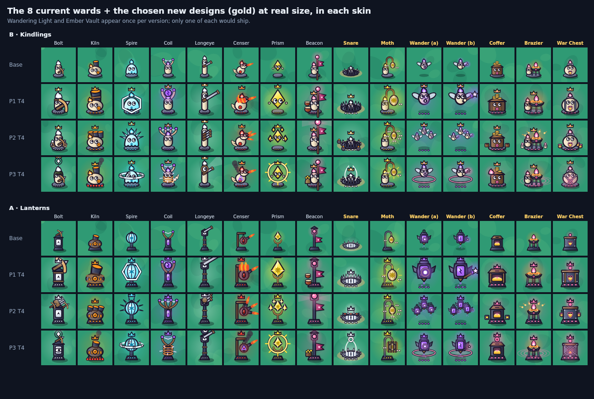
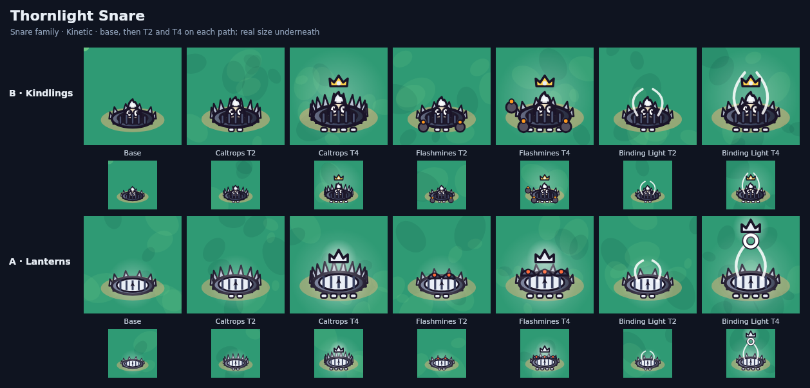
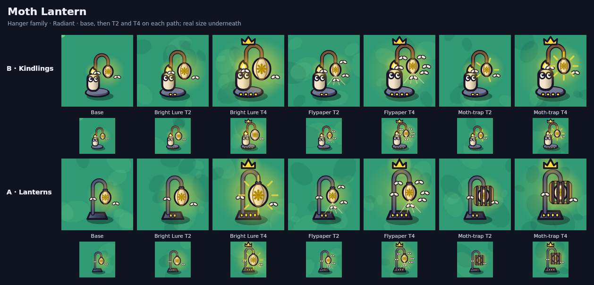
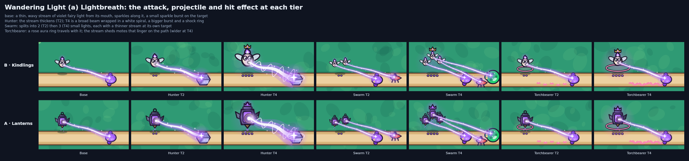
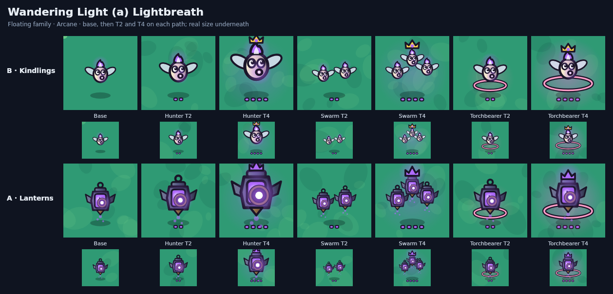
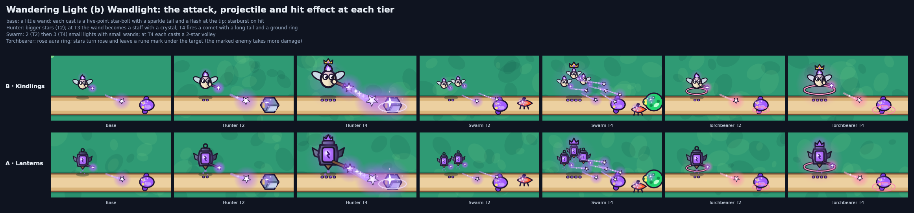
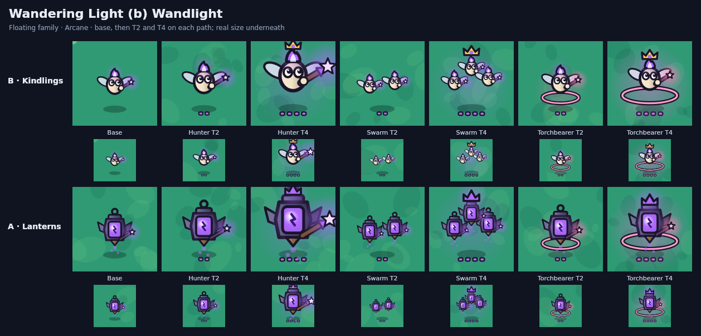
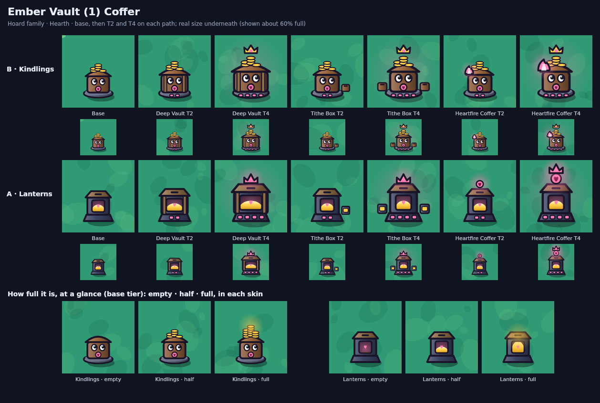
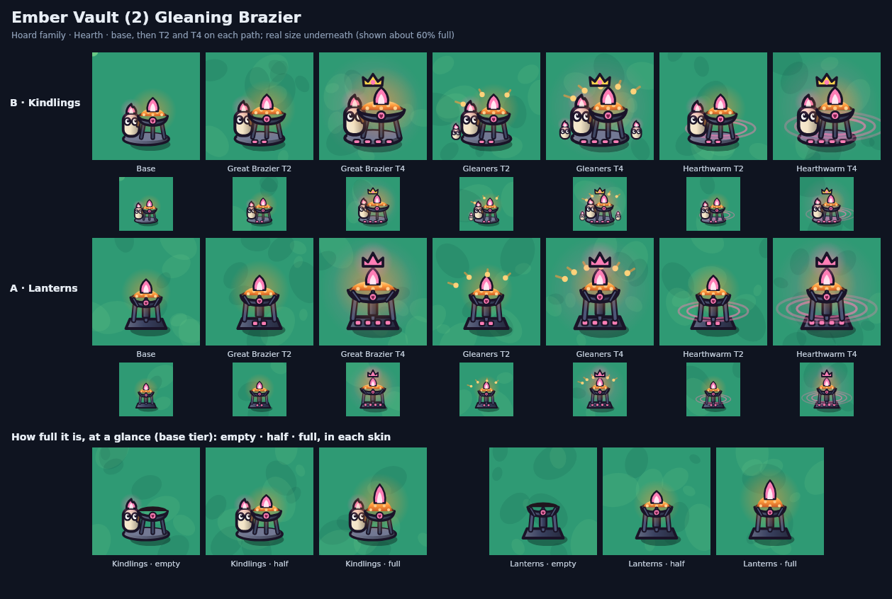
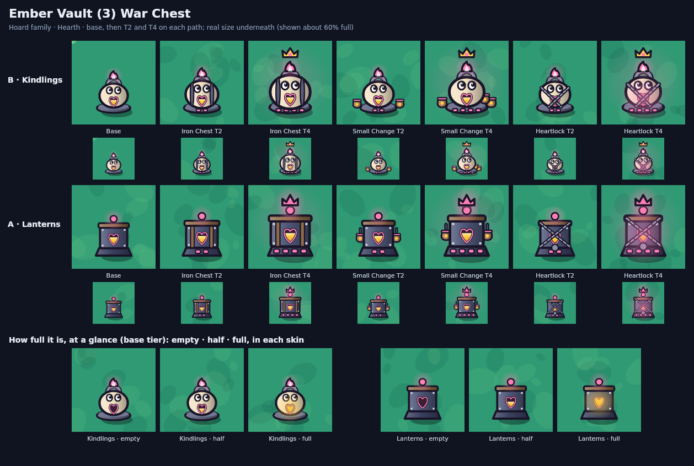

# New ward ideas (2026-11-19)

Thirteen new ward concepts, each adding a mechanic and a player decision that the current eight don't have. The trap ward from the redesign plan is #1.

For each concept:
- **role** and **core mechanic**
- **the decision it adds**
- **three paths**, following the path grammar from the design system: path 1 *Might* (one bigger, heavier thing), path 2 *Many* (it multiplies), path 3 *Craft* (a special trick)
- **how it would look** under the recommended direction (**A · Lanterns**): its role family, damage colour and housing

The mechanics survey behind this list (16 games, ~35 sources) is summarised in [visual-research.md](visual-research.md). The four I'd build first are mocked up in `concepts/lanterns/new-wards.png` and shown alongside the current eight in `concepts/lanterns/lineup-12.png`.

All names, mechanics and looks are Hollowlight's own. Where an idea is inspired by another game's mechanic, the inspiration is named so you can judge the distance.

All 13 are also mocked up in the Kindlings style in `concepts/kindlings/ideas/`.

---

## 0. Chosen wards (2026-11-20)

> **Final:** Thornlight Snare, Moth Lantern, Wandering Light (b) Wandlight (Arcane), and Ember Vault (2) Gleaning Brazier. Kindlings is the active skin, with Lanterns as a complete second skin. See [Decided](#decided-2026-11-20).

You picked **Moth Lantern, Thornlight Snare, Wandering Light and Ember Vault**. They will be built *after* the visual overhaul, so they are drawn once, in the new style. This section refines them; the original write-ups in §2 still hold except where this section changes them.

Every design is mocked up in **both skins** (B · Kindlings and A · Lanterns) at base, T2 and T4 on each path, in `concepts/chosen/`:

| File | Shows |
|---|---|
| `snare.png`, `moth.png` | the two wards kept as designed |
| `wanderA.png`, `wanderB.png` | the two Wandering Light versions |
| `wander-a-attack.png`, `wander-b-attack.png` | each version attacking real enemies at every tier: the attack, projectile and hit effect |
| `vaultA.png`, `vaultB.png`, `vaultC.png` | the three Ember Vault versions, each with an empty / half / full strip |
| `lineup.png` | the current 8 plus every chosen design at real size, in both skins |

### Decisions I made while drawing (easy to reverse)

- **Wandering Light is Arcane (violet), not Kinetic or Radiant.**
  - Kinetic is the "unlit" type, and magic glows.
  - Radiant would put three gold wards on the map (Prism, Moth Lantern and Wandering Light), which is the kind of blending the overhaul is meant to fix.
  - Arcane gives the Storm Coil a sibling instead. It also gives the flying ward a real weakness: Nullback take only 20% Arcane damage.
- **In the Lanterns skin the "mouth" is an open round port in the lantern's window**, because lanterns don't have faces.
- **Every Ember Vault version shows how full it is**, because the whole decision is "cash out now or wait":
  - the Coffer: a coin stack or coin heap;
  - the Brazier: an ember pile and a flame that grows;
  - the War Chest: a heart-shaped window that fills with gold and shines when full.
- **Ember Vault stays Hearth (rose)**, with gold coins as the fill. Beacon's Tithe path should change if any version ships (see §2.5).

### Coverage note

With this set:
- **Heavy** gets a brief control answer (Snare, Binding Light T4).
- **Flyers** get two new answers (Moth Lantern, Wandering Light).
- **Fast leakers** get a last line (Snare).
- **Herald** still has no dedicated answer (the Recall Bell was the one that covered it).
- **Mender** still has only Scorched.

That's fine if it's deliberate. It could matter for the endless "Mending" modifier.

### 1. Thornlight Snare: kept as designed

There are no changes from §2.1. It is the only ward with no height, so it lies flat on the road:
- **Kindlings skin:** a spirit peeking up through the grate.
- **Lanterns skin:** a floor-lantern grate.

### 2. Moth Lantern: kept as designed

There are no changes from §2.6:
- **Kindlings skin:** a spirit holding the shepherd's crook.
- **Lanterns skin:** an iron crook on a plinth.

The paper lantern hangs from the hook in both, with moths circling it. On the Moth-trap path the paper lantern becomes a cage.

### 3. Wandering Light: two magic attacks

The base is the same as §2.10:
- a floating ward with no plinth, over a soft shadow;
- it patrols between two points or follows the lead enemy;
- paths **Hunter** (Might), **Swarm** (Many: splits into 2, then 3 smaller lights) and **Torchbearer** (Craft: carries a rose, Beacon-like aura ring).

Only the attack changes.

#### (a) Lightbreath: a stream of fairy light from its mouth *(not chosen)*

- **Attack:** a continuous, short-range stream. It hits the first enemy and anything in a short line behind it, and deals damage every tick while the stream is on.
- **Look:**
  - a wavy violet ribbon with a white core, sparkles scattered along it, and a sparkle burst where it lands;
  - the Kindling spirit has an open "O" mouth;
  - the lantern opens a round port in its window.
- **Higher tiers:**
  - **Hunter:** a thicker stream with longer reach (T2). T4 is a broad beam wrapped in a white spiral, with a bigger burst and a shock ring on the target.
  - **Swarm:** 2 lights at T2 and 3 at T4, each with a thinner stream at its own target.
  - **Torchbearer:** the aura ring travels with it. The stream sheds rose motes that linger on the path and hurt Gloom that walk through them (wider at T4).
- **Pros:**
  - very "fairy", and it's easy to see that the ward is attacking;
  - the beam follows naturally as the ward moves;
  - the hit test is a short line, like the Censer's cone;
  - no projectiles to simulate.
- **Cons:**
  - **Streams are already the Prism's (beam) and the Ember Censer's (spray) attack.** A third stream attack works against the readability the overhaul is for.
  - In the Lanterns skin it reads like a flamethrower lantern.
  - Short range means more repositioning micro.

#### (b) Wandlight: casts with a wand *(chosen)*

- **Attack:** casts homing star-bolts at a steady rate, at medium range. Each star bursts on hit.
- **Look:**
  - a little wand with a star tip, flashing as it casts;
  - the bolt is a five-point star with a sparkle tail, and lands in a starburst;
  - the Kindling spirit holds the wand; the lantern carries it as its aiming rod.
- **Higher tiers:**
  - **Hunter:** bigger stars at T2. At T3 the wand becomes a staff with a crystal, which is the T3 silhouette milestone. T4 fires a comet with a long tail that bursts over a small area, leaving a ground ring.
  - **Swarm:** 2 lights at T2 and 3 at T4, each with a small wand. At T4 each one casts a 2-star volley.
  - **Torchbearer:** the stars turn rose and leave a rune mark under the target. Marked Gloom take more damage from every ward, and the mark is bigger at T4.
- **Pros:**
  - **No other ward fires stars**, so both the projectile and the ward read as distinct.
  - The wand is a part that grows with tier (wand, then staff), so upgrades show clearly.
  - It works equally well in both skins.
  - It reuses the existing projectile code (Bolt).
- **Cons:**
  - less unusual than a breath;
  - small projectiles can get lost in a busy wave (the star shape and the tail help);
  - there's a risk it plays like "a Bolt Ward that flies". The Hunter comet and Torchbearer marks are there to prevent that.

**My recommendation: (b) Wandlight.** Readability is the whole point of the overhaul, and (a) adds a third stream attack. If you love the breath, a middle option is the (b) mechanics with the open-mouth cast pose from (a) on the Kindling.

### 4. Ember Vault: three ways to do "bank it and let it grow"

The core idea is the same in all three: **the ward stores gold that grows while you leave it there, and you choose when to cash out.** What changes is where the gold comes from, what else you can do with it, and how much its placement matters.

#### (1) Coffer: an interest bank (the original concept) *(not chosen)*

- **Mechanic:**
  - At wave end it takes a share of that wave's gold.
  - Stored gold grows by a percentage each wave, up to a cap.
  - Click it to withdraw everything.
- **Decision:** spend now or compound; cash out before the boss wave.
- **Paths:**
  - **Deep Vault:** bigger cap, better interest.
  - **Tithe Box:** kills in its radius pay bonus gold.
  - **Heartfire Coffer:** spend stored gold to recharge the Flare and abilities.
- **Look:**
  - **Kindlings skin:** a chest spirit whose lid is its hat, with coins stacking on the lid.
  - **Lanterns skin:** a squat box-lantern whose window shows the coin heap.
- **Pros:**
  - familiar and instantly understood;
  - one formula, so it's easy to build and balance;
  - a strong "investment" feeling.
- **Cons:**
  - **placement doesn't matter**, so it's a menu that happens to stand on the map;
  - passive, and withdrawing every few waves is a chore;
  - can snowball on easy maps.

#### (2) Gleaning Brazier: banks embers from kills in its radius *(chosen)*

- **Mechanic:**
  - Gloom that die inside its radius drop an ember into it, worth part of their bounty.
  - Stored embers grow by a percentage each wave, up to a cap. At the cap it stops collecting.
  - Click it to cash out.
- **Decision:**
  - **Where to put it.** It wants the kill zone, which is also where your damage wards want to be.
  - When to empty it.
- **Paths:**
  - **Great Brazier:** bigger cap and growth.
  - **Gleaners:** ember-wisps collect from a wider radius.
  - **Hearthwarm:** while it is over half full, nearby wards attack faster, so emptying it has a real cost.
- **Look:**
  - **Kindlings skin:** a spirit tending a brazier.
  - **Lanterns skin:** an iron cresset on three legs.
  - In both, the ember pile and the rose flame on top grow as it fills.
- **Pros:**
  - **placement matters**, so it's a real ward;
  - income is tied to how well you defend;
  - the fill is very visible;
  - Hearthwarm makes "cash out or keep the buff" a good tension.
- **Cons:**
  - the rich get richer (a strong defence earns more);
  - weak on maps where kills are spread out;
  - it takes a premium tile;
  - its value is harder to predict.

#### (3) War Chest: savings you can spend as defence *(not chosen)*

- **Mechanic:**
  - Banks and grows gold like the Coffer.
  - You can also **break it open**: the stored gold erupts as a Heartfire blast in its radius, with damage scaled to the gold inside. Then it starts again, empty.
- **Decision:** save for upgrades, or spend the savings to stop a leak. Where to put the "panic button" (near the end of the path, or at a choke).
- **Paths:**
  - **Iron Chest:** bigger cap and interest.
  - **Small Change:** break it in up to 3 smaller bursts instead of one.
  - **Heartlock:** the blast also stuns and Scorches.
- **Look:**
  - **Kindlings skin:** a round spirit with a padlock shackle on its head.
  - **Lanterns skin:** an iron strongbox.
  - Both have a heart-shaped glass window that fills with gold and shines when full.
- **Pros:**
  - **gold is never dead money**;
  - a dramatic comeback moment;
  - placement matters for the blast;
  - the strongest identity of the three.
- **Cons:**
  - overlaps the Flare, the abilities and Flarepot as a "panic button";
  - the conversion rate from gold to damage is hard to balance;
  - breaking your savings can feel bad;
  - it needs an extra button.

**My recommendation: (2) Gleaning Brazier.** It's the only version where *where you put it* matters every wave, which is what makes it a ward rather than a menu. Hearthwarm also gives it a support role without competing with Beacon's aura. (3) War Chest is a close second if you'd rather have the drama.

### Decided (2026-11-20)

1. **Wandering Light: (b) Wandlight.** (a) Lightbreath is kept above for reference only.
2. **Wandering Light damage type: Arcane (violet).**
3. **Ember Vault: (2) Gleaning Brazier.** (1) Coffer and (3) War Chest are kept above for reference only.
4. **Skin:**
   - **Kindlings is the active skin.**
   - **Lanterns is maintained alongside it as a complete second skin**, so every ward, including these four, is drawn in both.
   - **Exception: the Longeye uses the Lantern body with the Kindling eye.**

The final four are **Thornlight Snare, Moth Lantern, Wandering Light (Wandlight) and Ember Vault (Gleaning Brazier)**. They will be built after the visual overhaul.

---

## 1. Gaps in the current roster

### Threat coverage today

I checked this against `data/towers.js`, `data/enemies.js` and the sim, not from memory.

| Threat (enemy) | What answers it today | Count |
|---|---|---|
| **Flying** (Gloomwing) | Bolt, Storm Coil, Longeye (x2 vs flyers), Ember Censer, Prism; Mortar/Rime only inside a Lighthouse Beacon (T3) | many |
| **Veiled** (Wisp, Veilmother) | Hunter's Mark, Frost Sight, Longeye, Lighthouse, any area attack, Censer cone | many |
| **Plated** (Husk, Bastion) | Mortar (Blast x1.5), Ballista and Hunting Party armour-pierce, Hollow Points, Ashen Brand | many |
| **Shielded** (Aegis, Bastion) | Storm Coil (Arcane x2), Shieldbreaker, Censer Melt; Scorched stops recharge | 3 |
| **Null-hide** (Nullback) | everything except Storm Coil | many |
| **Splitting / crowds** (Brood) | Mortar, Rime, Coil, Censer, Prism Afterglow | many |
| **Heavy** (Dreadhulk, colossus, bosses) | damage only: Prism, Deadeye, Overcharge, Pyre. **No control works on them**: they ignore stun, freeze and knockback, and slows are halved | damage only |
| **Heals** (Mender; endless "Mending") | **only Scorched** (Ember Censer, or the Firestorm ability); otherwise just burst it down | **1** |
| **Haste aura** (Herald) | **nothing dedicated**: kill it first with Strong targeting or a sniper | **0** |
| **Fast leakers near the end** (Skitter, Wisp) | slows and stuns; then Last Light once per run and the Flare | thin |

### Missing roles and decisions

- **Nothing is placed on the path.** Every ward sits beside it, so "where on the path" is never a decision. (The trap ward was already flagged as a future ninth ward.)
- **Nothing holds the Gloom in place.** Slow, freeze and stun all fail on Heavy. There is no blocker and no way to choose where a crowd bunches up.
- **Nothing moves the Gloom backwards.** The only knockback is a small one on the Ballista path.
- **Wards don't interact except through auras.** Beacon's radius buff and the damage-taken marks (Hunter's Mark, Brittle, Ash, Conductive) are the only synergies. Nothing changes *another ward's shots*, and nothing rewards firing-line geometry.
- **Economy is a path, not a ward.** Tithe competes with Beacon's support paths, so taking income means giving up support.
- **Nothing is repositionable**, single-use, or banked: no live micro, no "spend it now or save it".
- **Unused damage slot.** The design system reserves **Blight** (green) for a future damage-over-time type. Nothing uses it yet.

---

## 2. The concepts

### 1. Thornlight Snare: the trap ward (Snare family, Kinetic)

- **Role:** a path-placed trap.
- **Mechanic:** it is built **on the path**, unlike any other ward. It has a stock of charges. Every Gloom that walks over it loses a layer per charge spent, and charges refill slowly between hits and fully at wave end. It never targets or misses, but it only touches what walks over it. Flyers pass over it.
- **Decision:** *where on the path?* The best spots are just after a slow (enemies linger), at corners, or right before the Heartfire as a last line. You also choose whether to spend a high-value placement on the path itself.
- **Paths:**
  - **Caltrops (Might):** heavier thorns, two layers per charge; at T3 it bites through armour; at T4 "Iron Briar" strips 4 layers per step and slows.
  - **Flashmines (Many):** the grate sows small mine-lamps that burst for splash when stepped on; more mines per wave at each tier.
  - **Binding Light (Craft):** chains of light root the first non-heavy enemy over it for a moment. At T4 it can hold one Heavy briefly, giving the game its first control answer to Heavy.
- **Look:** a floor-lantern, an iron grate sunk into the road with white light shining up through it, ringed with thorns. It has **no height at all**, which makes it the only silhouette that lies flat (the Snare family).

### 2. Lychgate Wardens: blocker / summoner (Garrison family, Radiant)

- **Role:** holds the line. *Inspired by Kingdom Rush barracks and Arknights block counts.*
- **Mechanic:**
  - The gate musters 1-3 Wardens (little lamp-bearers) who stand at a **rally point you drag onto the path** and hold the Gloom that reaches them.
  - Each Warden blocks a number of enemies. **Heavy enemies take 2 block slots and bosses take 4**, so blocking is a control answer to Heavy that doesn't depend on stun.
  - Wardens fight back weakly. They fall and re-muster after a delay.
- **Decision:** *where to hold the crowd.* Put the rally point inside your Mortar, Rime and Censer overlap. Move it mid-wave when a leak starts.
- **Paths:**
  - **Shieldwall (Might):** tougher Wardens with more block slots each; at T4 "Bulwark" holds a boss for several seconds.
  - **Muster (Many):** more Wardens, faster re-muster; at T4 a double rank.
  - **Lamplighters (Craft):** Wardens carry lamps that reveal Veiled and Scorch what they hold (stopping Mender heals); at T4 their lamps mark held enemies for +damage.
- **Look:** a round-arched lychgate with a lantern hanging in the arch. The Wardens stand at its feet (on the map they stand at the rally point). This is the arch (Garrison) primitive.

### 3. Burning Glass: projectile modifier (Frame family, Fire)

- **Role:** synergy. *Inspired by PvZ's Torchwood, a plant that sets peas on fire as they pass through it.*
- **Mechanic:** it never attacks. **Any friendly bolt, shell, round or beam that passes through its lens** is changed:
  - base: projectiles gain a Fire burn;
  - each path changes something else (below).

  It does nothing on its own, so its worth depends entirely on where it stands relative to other wards' firing lines.
- **Decision:** *firing-line geometry.* Place it between your shooters and the path, and choose which wards to "feed" it. Bolt, Longeye and Prism become different wards when their shots go through a glass.
- **Paths:**
  - **Kindling Glass (Might):** a hotter burn, and Scorched (stops healing). This gives Menders a second answer.
  - **Splitting Glass (Many):** each projectile splits into 2, then 3. This turns Longeye or Ballista shots into crowd damage.
  - **Truing Glass (Craft):** projectiles become **Radiant**, so they ignore Plated (Kinetic half damage) and Null-hide (Arcane immunity). At T4, beams through it gain range.
- **Look:** a great round lens standing upright in an iron ring on a swivel stand, glowing red. A pale bolt enters it and leaves burning. This is the upright ring (Frame) primitive.
- **Risk:** it needs the sim to test projectiles against the lens each frame, which is cheap with the existing grid. Beams (Prism) and instant shots (Longeye) need a line-segment test.

### 4. Recall Bell: rewind / push (Hanger family, Arcane)

- **Role:** path control.
- **Mechanic:** every few seconds it tolls, and every non-heavy Gloom in range is **pushed back along the path** (not slowed) by a set distance. Heavies are only nudged. Pushed Gloom walk through your killing ground again, and over your Snares again.
- **Decision:** *where on the path, and how hard to rewind.*
  - Near the Heartfire it is an anti-leak tool.
  - Mid-path it makes crowds pass the same kill zone twice.
  - Pushing also *spreads* crowds out, which weakens splash. Pairing the Bell with splash is a real trade-off, not a free win.
- **Paths:**
  - **Great Bell (Might):** a bigger push, and a stun on the toll; at T4 "Doom Bell" pushes Heavies too.
  - **Carillon (Many):** small, frequent chimes. Each one **dispels the Herald's haste** in range, the first dedicated answer to Heralds.
  - **Knell (Craft):** tolled Gloom are marked and take more damage until they reach the spot they were pushed from; at T4 the toll reveals Veiled map-wide for a moment.
- **Look:** a little belfry: two posts, a beam and a roof, with a bronze bell whose mouth glows violet, and sound rings around it. This is the hanging, top-heavy (Hanger) primitive.

### 5. Ember Vault: economy (Hoard family, Hearth)

- **Role:** a standalone economy ward, so income no longer competes with Beacon's support paths. *Inspired by BTD's Monkey Bank.*
- **Mechanic:** stores a share of each wave's gold and grows it by a percentage each wave, up to a cap. You withdraw by clicking it. It never attacks.
- **Decision:** spend now or compound; when to cash out before a boss.
- **Paths:**
  - **Deep Vault (Might):** a bigger cap and better interest.
  - **Tithe Box (Many):** kills inside its radius pay bonus gold, so it rewards *where* you kill.
  - **Heartfire Coffer (Craft):** spends gold to recharge the Flare and abilities.

  If you build this, Beacon's Tithe path could become a different support path.
- **Look:** a squat, lidded lantern-chest with a coin slot and a rose glow, in the boxy Hoard silhouette.

### 6. Moth Lantern: lure for flyers (Hanger or Spotter variant, Radiant)

- **Role:** pulls flyers onto the ground. *Inspired by Anomaly's decoys.*
- **Mechanic:** Gloomwings within its pull radius leave their corner-cutting route and circle the lantern for a few seconds. That brings them into reach of Mortars and Rimes, which can't otherwise hit flyers.
- **Decision:** where to drag the flock, and whether to spend gold on ground splash plus a lure instead of anti-air.
- **Paths:**
  - **Bright Lure (Might):** a wider, stronger pull.
  - **Flypaper (Many):** lured flyers are slowed and stuck.
  - **Moth-trap (Craft):** lured flyers take Radiant damage while circling, and Veiled flyers are revealed.
- **Look:** a paper lantern on a tall shepherd's crook, with moths circling it. This sits close to the Spotter needle, so it would need the crook's hook to read clearly.

### 7. Vigil Candles: adjacency amplifier (Emitter variant, Hearth)

- **Role:** a precise booster. *Inspired by GemCraft amplifiers and Infinitode modifiers.*
- **Mechanic:** a small-footprint ward that boosts only the wards **touching** it, and only their *specials*: burn, chain length, slow strength, pierce, beam ramp. It is not a radius aura, so it doesn't compete with Beacon.
- **Decision:** a packing puzzle. Which wards cluster around the candles, at the cost of a less flexible layout.
- **Paths:**
  - **Tall Candle (Might):** a stronger boost to one neighbour.
  - **Candelabra (Many):** boosts up to 4 neighbours.
  - **Votive (Craft):** neighbours' abilities recharge faster.
- **Look:** a small cluster of candles on a stand. **Risk:** three flames on arms can look like the Storm Coil's prongs. Keep the candles short and fat, with flames rather than balls.

### 8. Gloom Jar: capture (Snare or Hoard, Blight)

- **Role:** capture and payout. *Inspired by BTD's Bloon Trap.*
- **Mechanic:** a jar on the roadside that **draws in loose layers** from small Gloom in its radius, removing them outright (no shedding, no regrowth), until it is full. Then you choose what to do with it: empty it for gold, or smash it as a Blight cloud.
- **Decision:** capacity timing. Empty it now for safety, or hold it full for a big release before a boss.
- **Paths:**
  - **Great Jar (Might):** more capacity.
  - **Many Jars (Many):** several small jars that fill in parallel.
  - **Rot Jar (Craft):** the smash leaves a Blight cloud. Blight stops regrowth and Mending, a second answer to Menders and the endless Mending modifier.
- **Look:** a glass jar-lantern with a cork and a green Blight swirl inside, sitting low beside the path.

### 9. Sunwell Dial: vulnerability floor (Spotter or Frame, Radiant)

- **Role:** a damage-taken zone. *Inspired by Sanctum's Amp Field.*
- **Mechanic:** projects a sigil of light onto a stretch of path. Gloom inside it take +X% damage from everything and can't stay Veiled.
- **Decision:** overlap planning. The sigil is only worth it where many wards reach.
- **Paths:**
  - **Searing Sigil (Might):** a bigger amp.
  - **Long Sigil (Many):** a longer stretch of path.
  - **Dawn Sigil (Craft):** Gloom that die in it shed one fewer form.
- **Look:** a sundial obelisk with a gnomon that casts a gold line onto the path.

### 10. Wandering Light: movable ward (new "floating" family, Kinetic or Radiant)

- **Role:** live repositioning. *Inspired by BTD's Heli Pilot.*
- **Mechanic:** a lantern that floats. It patrols between two points you set, or follows the leading enemy, and fires small bolts. It is the only ward that can **go and meet flyers** on their route.
- **Decision:** live micro versus a fixed layout. Where to patrol this wave.
- **Paths:**
  - **Hunter (Might):** chases the strongest enemy and hits hard.
  - **Swarm (Many):** splits into 2-3 smaller lights.
  - **Torchbearer (Craft):** carries a Beacon-like aura with it.
- **Look:** a lantern with **no plinth**, hovering over a soft shadow. The missing plinth is itself the family signal.

### 11. Kindred Shrine: tethered buff (Emitter variant, Hearth)

- **Role:** a single-ward carry buff. *Inspired by BTD's Engineer Overclock.*
- **Mechanic:** you tether it to **one** ward of your choice, which gains a large boost. You can re-tether it on a cooldown.
- **Decision:** picking a carry (a Prism for a boss, a Censer for a Mender wave) and timing the re-tether.
- **Paths:**
  - **Overcharge (Might):** a bigger boost.
  - **Twin Tether (Many):** two targets at once.
  - **Kindle (Craft):** the tethered ward's ability recharges faster.
- **Look:** a small shrine with a rose flame, and a visible thread of light to its partner. The thread doubles as state, so you can always see which ward is tethered.

### 12. Rot Lantern: damage-over-time (Sprayer variant, Blight)

- **Role:** a slow-burning debuffer, from the redesign plan's "Rot Censer" note.
- **Mechanic:** lobs Blight motes that **stack**. Blighted Gloom take growing damage over time, can't regrow (Mender or Mending), and pass Blight on when they die.
- **Decision:** apply early to big targets so stacks build, and avoid wasting it on Motes.
- **Paths:**
  - **Deep Rot (Might):** stacks grow faster, and it eats through shells.
  - **Spore Bloom (Many):** Blight spreads on death through crowds.
  - **Wither (Craft):** Blighted Gloom shed one layer fewer, so they break into fewer children.
- **Look:** a crooked green-lit lantern on a gallows. **Watch out:** it shares the Sprayer's gallows with the Ember Censer, so it must lob from a different housing, such as a squat pot with a dripping spout.

### 13. Flarepot: consumable (Snare family, Blast)

- **Role:** a single-use ward. *Inspired by PvZ's Potato Mine and Cherry Bomb.*
- **Mechanic:** a cheap pot of Heartfire set beside the path. It arms after a few seconds, and when Gloom come near it erupts in a huge blast, then is gone. Rebuilding is cheap.
- **Decision:** the right target at the right time, and spending gold each wave instead of once.
- **Paths:**
  - **Great Pot (Might):** a bigger blast that cracks shells.
  - **String of Pots (Many):** places 3 small ones at once.
  - **Heartfire Pot (Craft):** the blast also stuns and Scorches.
- **Look:** a small clay pot with a lit wick. This is the lowest Snare and must not be confused with the Thornlight Snare, so it should have no grate and no thorns.

### Also considered

- **Route diverter at forks:** this needs a map with forks; worth it if you add a second map.
- **Merging wards:** two identical wards fusing. That is a system rather than a ward; noted for later.
- **Banked overcharge pickups**, like PvZ2's Plant Food: glowing Gloom drop a charge you spend on any ward. Also a system, and a good fit for the home-row ability keys.

---

## 3. The four I'd add first

> **Superseded (2026-11-20):** you picked Moth Lantern, Thornlight Snare, Wandering Light and Ember Vault instead (see §0). My original reasoning is kept below for reference.

| # | Ward | New decision | Threat it answers | Build cost (my estimate) |
|---|---|---|---|---|
| 1 | **Thornlight Snare** | *where on the path* | fast leakers, last line; Binding Light holds a Heavy | **low**: a ward that damages what walks over it, plus placement that allows the path |
| 2 | **Recall Bell** | *where on the path and when to rewind*; crowding vs spreading | **Herald (0 answers today, Carillon dispels haste)**, leaks, fast Gloom | **low-medium**: move an enemy back along the path by distance (the path code already maps distance to position) |
| 3 | **Burning Glass** | *firing-line geometry*; turns existing wards into new ones | **Mender (1 answer today, Kindling Scorches)**, Plated and Null-hide (Truing makes shots Radiant) | **medium**: segment tests for projectiles, beams and instant shots passing through the lens |
| 4 | **Lychgate Wardens** | *where to hold the crowd* (rally point) | **Heavy (no control answer today)**, via block weight | **high**: new units with health, blocking, re-muster and a rally-point UI |

Why these four:
- **Each adds a different decision.** Path placement, path position, firing lines and holding ground are four axes the game doesn't have yet. None of them is a stronger shooter.
- **They answer the thin spots:**
  - the Herald has no dedicated answer (the Bell's Carillon dispels haste);
  - the Mender has one (the Glass's Kindling path Scorches);
  - Heavy has no control answer (the Wardens' block weight);
  - leaks near the end are thin (the Snare and the Bell).
- **They work together.** The Bell pushes Gloom back over Snares, the Wardens hold Gloom on Snares, and the Glass turns a Longeye into a burning, splitting cannon. Players who discover these combinations get the "big brain" moments the earlier research identified (Dungeon Warfare's trap chains).
- **They fill four new role families** (Snare, Hanger, Frame, Garrison), so the visual system gets more distinct rather than more crowded. `lineup-12.png` shows all twelve reading apart at real size, in colour and in greyscale.
- **Suggested build order:** Snare, Bell, Glass, Wardens. That is cheapest first, and it banks the "where on the path" decision before the heavier blocker system.

**Why not the others first:**
- **Ember Vault** is good, but Beacon's Tithe already covers income.
- **Vigil Candles and Kindred Shrine** add support depth, but the game already has one support ward.
- **Rot Lantern and Gloom Jar** are the natural home for Blight, and Rot Lantern is the redesign plan's earlier pick. But Scorched already handles Menders, so they are less urgent than the Herald and Heavy gaps.
- **Wandering Light** is great fun but needs new input UI.
- **Flarepot** overlaps the Snare's Flashmines path.
