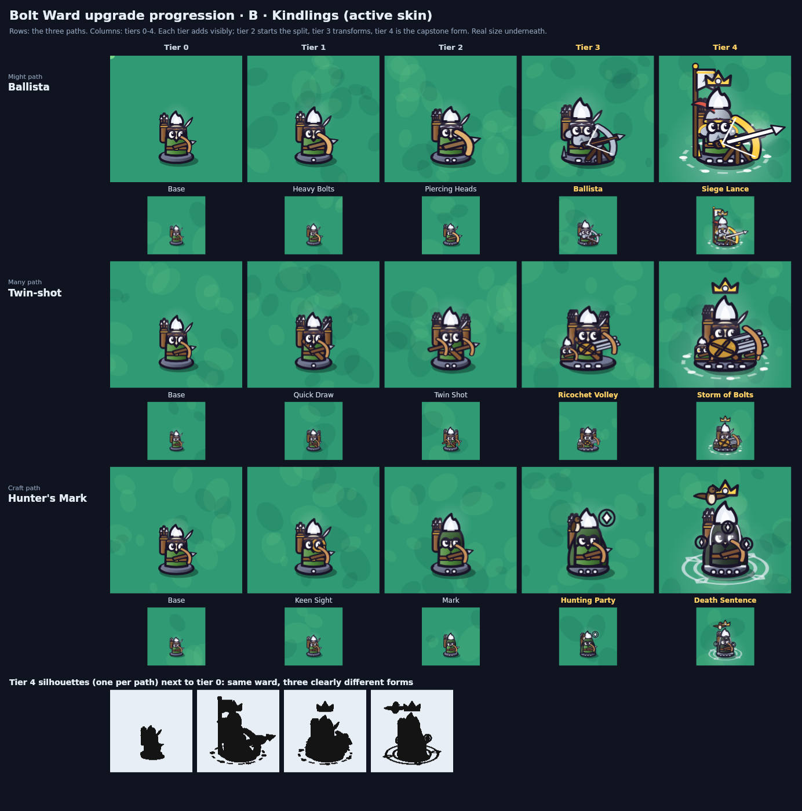

# Upgrade visuals: research and a progression framework (2026-11-20)

**The problem.** Our tier 4 wards look underwhelming, and the paths barely diverge. Apart from one small difference, the same ward looks nearly the same on every path.

**The goal.** Every tier should be a visible reward. By tier 4, each path should be a clearly different, impressive form that is still recognisably the same ward. There should be room for a tier 5 later. All of this has to work in both skins and for any future ward.

**What this document holds:**
- §1: what other games do.
- §2: the framework.
- §3: the Bolt Ward mock-up, in both skins, that tests it.

The game itself is unchanged. The framework waits for your OK before it is applied to the other wards.

**Where to look:** `concepts/progression/` (also in the gallery on :3002, in the "Upgrade progression" section).
- `bolt-kindlings.png` and `bolt-lanterns.png`: paths as rows, tiers 0-4 as columns, at 2.6× with real size underneath, and the three tier 4 silhouettes.
- `bolt-both.png`: both skins at real size.

**Sources.** The research was done by three sub-agents with web search, about 1 hour in total. Their raw notes, with source URLs, are in `research-notes/upgrade-btd6.md`, `upgrade-other-games.md` and `upgrade-principles.md`.

**Caveats:**
- The main Bloons and Kingdom Rush wikis, and some Clash sites, blocked automated fetching. Those facts come from search summaries.
- No studio has published much about how it draws upgrades, so several game-specific observations are marked *(unverified)* in the notes.
- The principles below are the ones that held up across several sources.

---

## 1. What the research found

### Bloons TD 6: the closest model

Each tower has three paths of five tiers.
- **Tiers 1-2 change accessories and colours on an unchanged body.** For example, a Ninja's suit darkens and its headband turns red. The silhouette stays the same.
- **Tier 3 is the biggest jump: the tower gets a new identity.** The weapon, costume or whole body is swapped. A Dart Monkey becomes a catapult crew, a Super Monkey a sun-god, a dark knight or a robot. From tier 3 on, the three paths are clearly different, and each path keeps one *kind* of change and one colour family (gold for sun, black for dark, metal for tech).
- **Tier 4 is the tier 3 idea scaled up and ornamented:** bigger, more armour, some glow.
- **Tier 5 is a trophy:**
  - a new silhouette plus one signature effect, such as orbiting glaives, a summoned phoenix or a temple;
  - glowing eyes and a new colour scheme are reliable "final form" cues.
- **Identity anchors.** The same monkey body and pose stay throughout, and each tower keeps one signature item that every path upgrades but none removes (the Engineer's hard hat, the Ninja's headband). When the body becomes a machine, a plain monkey stays visible as its operator.
- **The secondary path shows only lightly** (a colour swap on one part), and not at all once the main path reaches tier 3.
- **The footprint never changes.** Growth goes into height, props that reach outward, and effects.
- **Projectiles progress along with the model.** At the top tiers, roughly half the impressiveness is in effects (the agent's estimate).

### Kingdom Rush, Clash of Clans, Clash Royale and others

- **Kingdom Rush** keeps levels 1-3 small: the same building with better materials and a little taller. It spends the big change on the level 4 branch, where each specialisation gets its own silhouette and crew.
  - **Branch shapes:** one huge barrel (Big Bertha) versus a vertical coil spire (Tesla); a leafy hideout versus a stone fort.
  - **Origins' druid branch:** one branch *intensifies the original form* (a bigger stone circle). The other *turns the theme into a living thing* (a walking treant).
- **Clash of Clans** redraws only at milestone levels, with a material ladder in between: stone, then iron, then gold, then crystal, then lava, then dark stone with gold. The crew on top upgrades on a different schedule from the building.
  - **Inferno Tower:** its two modes differ by one honest shape change: one big hole for single target versus three small holes for several.
- **Clash Royale evolutions** keep the troop fully recognisable and add an accessory, a reserved accent colour (purple) and a new attack effect.
- **Defense Grid** found that weapons on generic bases were "small and hard to distinguish". It gave each tower a tall, distinct silhouette, tested in silhouette studies, and capped the game at about ten tower types.
- **League of Legends skin tiers** stack *channels*: texture, then model, then effects and animation and sound, then voice, then a form that transforms. The top tier is the one that changes while you watch.
- **WoW tier sets** add an effects layer at the top tier. Players complain whenever variants look too alike, so the steps must be visibly distinct.
- **Pokémon** carries signature features through a line and checks every stage in solid black at small size. Big palette changes break the family link.

### General art principles

- **Start modest, so there is room to climb.** Give each tier a budget and never let it overflow (Riot's "bucket").
- **Keep one anchor that never changes.** Each path *pushes one trait* (Overwatch pushed traits for stronger silhouettes).
- **Read order is colour, then silhouette, then detail** (Valve). Paths must therefore differ in silhouette, not only colour, which also matters for colour-blind players.
- **At 35-68 px:**
  - a dark base and a bright focal point;
  - large calm areas, with nothing finer than about 3 px;
  - wards stay below enemies and effects in saturation.
- **Effects:** one bright focal layer with soft supporting layers. Anticipation, then peak, then a quick fade. Higher tiers get a bigger wind-up, not longer-lasting effects.
- **Idle motion:** subtle, scaled by tier, and out of sync across wards.
- **Keep temporary power-up visuals (pulsing glow) separate from permanent tier visuals** (structure, material, silhouette).

### What this means for us

1. **Spend change unevenly.** Small at tiers 1-2, the big transformation at tier 3, and the trophy at the top. We had spread one small change evenly across every tier, which is why our tier 4s looked like tier 1s with a crown.
2. **Each path pushes one trait into its own silhouette.** Colour alone isn't enough.
3. **Keep a fixed anchor, plus one signature item that every path upgrades.**
4. **Make the top tier impressive by stacking channels** (shape, material, motion, light, particles, effects), and hold one channel back for tier 5.
5. **Test the result in silhouette, at real size, side by side.**

---

## 2. The framework

### 2.1 What never changes (the ward's anchors)

On every path and tier, in both skins:

| Anchor | Kindlings | Lanterns |
|---|---|---|
| **Body and face** | the ward's body shape, eyes and head flame | the ward's housing shape and its window of light |
| **Light** | the head flame in the damage colour | the window in the damage colour + glyph |
| **Signature item** | the role tool, which every path upgrades and none removes (Bolt: the crossbow; Censer: the fire; Rime: the frost dome or globe; Longeye: the gun and eye) | same |
| **Base** | the hearthstone, with tier notches (main path) and pips (second path) | the plinth, with the same marks |
| **Palette family** | the ward's role colours (Bolt: green and leather) | the housing materials (Bolt: green iron and wood) |
| **Footprint** | fixed: growth goes up and outward, never wider at the ground | same |

### 2.2 What each path pushes (shared by every ward)

Each path exaggerates **one trait**, so its tier 3-4 silhouette differs from the other two even in solid black:

| Path | Trait | Silhouette | Materials and accent | Signature at tier 4 |
|---|---|---|---|---|
| **1 · Might** | *one bigger, heavier thing* | wider and grounded; one dominant weapon or machine; a tall standard (banner, spire) | steel, then gold-trimmed steel; dark metal | a single huge glowing projectile or weapon, a war banner |
| **2 · Many** | *it multiplies* | broad and busy: repeated small elements, helpers, racks, things that spin | brass and wood; warm accents | a battery or crew; rotating mechanisms; crates or ammo |
| **3 · Craft** | *the special trick* | tall and hooded; a floating or detached part; a companion | cloth and night colours, silver trim; a glowing focus (eye, lens, rune) | orbiting motes or marks, a companion aloft, a ground sigil instead of the plain aura |

Each ward interprets these in its own theme. A Censer's "many" is more heads; a Rime's "craft" is a snow ring. The trait stays the same across wards, so players learn one language.

### 2.3 What each tier adds (the budget)

Change is spent **unevenly**: little early, a transformation at tier 3, a trophy at tier 4. Every tier still adds something you can see.

| Tier | Budget | Rules | Bolt Ward example (Kindlings) |
|---|---|---|---|
| **0** | the base identity | body, face, light, signature item, plinth | a green archer with a crossbow and a quiver |
| **1** | **one small attachment** on the path's anchor part, plus a material hint | the silhouette is unchanged; you notice it on a second look | Might: a heavier steel-tipped crossbow and a bracer · Many: a second quiver and a bandolier · Craft: a keen-eye lens on a chain |
| **2** | **the paths visibly split**: a second, larger attachment, plus the path's material or colour accent | readable at real size; the silhouette starts to change at one edge | Might: a steel pauldron and steel bolt heads · Many: twin crossbows, one in each hand · Craft: a hood and a mark charm |
| **3** | **transformation**: the signature item becomes the path's machine, costume or companion; a **new silhouette**; the first always-on animated or glowing part | the three paths are clearly different in solid black at real size | Might: a mounted ballista on a tripod and a steel breastplate · Many: a rotary repeater and an archer helper · Craft: a dark cloak and mask, a hawk on the shoulder, a floating mark |
| **4** | **the capstone**: the tier 3 idea scaled up and ornamented (gold or rare material, a symmetrical crown), the path's tier 4 signature, constant motion, and the strongest effects so far | the "impressive" read comes mostly from motion, light and attack effects, within the 68 px height cap | Might: full armour, a plumed helm, a war banner, a gold ballista with a glowing lance · Many: a spinning bolt battery, two helpers, ammo crates · Craft: glowing eyes under a dark hood, three orbiting marks, the hawk aloft, a hunter's sigil on the ground |
| **5** *(later)* | **a second form**: see 2.5 | uses only the channels held back at tier 4 | e.g. Might: the ballista becomes a walking siege engine |

**Size:**
- Wards grow on the main path: ×1.06 at tier 1, ×1.13 at tier 2, ×1.22 at tier 3, ×1.35 at tier 4, within the height caps (46 px base, 68 px tier 4).
- Wider props (a ballista, a battery, helpers) count as growth too, but never at ground level.

**The second path stays light:** white pips on the plinth, and at most one tier 1-2 attachment from the second path.

### 2.4 Effects grow with the form

Following Bloons and the VFX research, projectiles and attack effects progress with the model:
- **tier 1-2:** projectiles a little bigger;
- **tier 3:** a new projectile shape for the path;
- **tier 4:** the path's signature effect (lance streaks and shock rings; volleys with streaks; marks bursting and executions).

The upgrade moment should get bigger with tier too. We already have the pop, rings and the tier 4 pillar. A later addition: a quick silhouette flash that swaps the old form for the new one.

### 2.5 Headroom for tier 5

Tier 4 deliberately leaves these channels unused, so a tier 5 has somewhere to go:
1. **A second form:** the ward itself transforms, not just its weapon. The ballista becomes a walking siege engine; the archer's hawk becomes a great spirit-hawk carrying the mark.
2. **The top value and saturation range:** pure-white highlights and full-saturation colour stay reserved.
3. **Height above 68 px:** a tier 5 cap of about 76 px, plus the "enemies show through" rule.
4. **A summon or companion with its own behaviour** that acts in the world.
5. **Merged motifs:** a tier 5 may borrow one cue from the ward's other paths (Bloons' Paragons do this).

### 2.6 Checks before a ward is approved

1. **Silhouette:** the three tier 4s (and the three tier 3s) look different in solid black at real size. The progression sheets include this strip.
2. **Each tier is a visible step from the one before** at real size. Tier 1 may be subtle at a glance, but must be visible.
3. **The anchors in 2.1 are all present** on every path and tier.
4. **Both skins are complete,** and all ward heights pass `tools/wards.mjs`.
5. **Crowd test:** 8-10 mixed tier 4 wards beside a dense wave, checked in greyscale (`tools/frame.mjs`). Enemies stay readable and the frame rate holds.

### 2.7 How to apply it to any ward, now or future

1. Name the anchors (2.1) and the signature item.
2. For each path, pick its trait (2.2) in the ward's theme, and write one line per tier using the budget (2.3).
3. Sketch tier 3 and tier 4 first, and run the silhouette check. Then fill in tiers 1-2 as stepping stones towards them.
4. Draw it in both skins, in the same order.

A first pass at tier 3 / tier 4 motifs for the other wards, to be worked out properly after your OK:

| Ward | Might (one big thing) | Many (it multiplies) | Craft (the trick) |
|---|---|---|---|
| Mortar Kiln | a giant howitzer kiln, then an armoured earthshaker | a rack of barrels, then a battery with a loader crew | a furnace kiln, then an inferno kiln venting fire |
| Rime Spire | an ice monolith, then an absolute-zero glacier crown | a crown of orbiting ice blades, then a shard storm | a blizzard snow ring, then an endless-winter spirit with falling snow |
| Storm Coil | a great charged sun on a coil, then a thunderhead | tesla pylons, then a ring of arcing pylons | gyroscope rings, then an ion-storm eye |
| Longeye | a long rail rifle, then a headhunter rail gun with a bipod and a scope | flak barrels, then a flak battery with ammo belts | a searchlight lens, then the all-seeing eye with a sweeping beam |
| Ember Censer | a brazier blaze, then a white-hot wildfire crest | more heads, then a three-headed spinning dragon | ash smoke, then a soot-wreathed brand-bearer |
| Prism | a great lens, then a sun disc | orbiting shards, then a kaleidoscope ring | a halo crystal, then a supernova star |
| Beacon | a war drum, then a warhorn and standards | a lighthouse lamp, then twin sweeping beams | a coffer, then a golden hearth |

---

## 3. The Bolt Ward mock-up: how well it fits

**What works:**
- Each path tells its own story: heavier, then a mounted engine, then armoured; more crossbows, then helpers and a repeater, then a battery and crew; keen-eyed, then hooded with a hawk, then a night hunter with marks and the hawk aloft.
- From tier 3, the three forms read as different shapes in solid black: a bannered siege engine, a wide battery, and a tall hooded hunter with a hawk and sigil.
- The anchors hold throughout: the same face and green archer (or green watch-post), the crossbow, the silver light and the plinth with its notches.

**Where it falls short (to fix when it's applied for real):**
- **Tier 1 is subtle at real size.** That is deliberate, but the Might path's tier 1 is the weakest step.
- **Storm of Bolts (Kindlings):** the right-hand helper is partly hidden behind the battery.
- **Death Sentence (Kindlings):** the dark hood reads as a dome at real size. It could use a sharper hood peak.
- **Siege Lance (Lanterns):** the crown sits on top of the war banner, close to the 68 px cap.

The mock-up is concept code (`concepts/_src/dir-bolt-progression.mjs`, rendered by `render-progression.mjs`). It reuses the game's drawing helpers read-only, and nothing in the game has changed.
