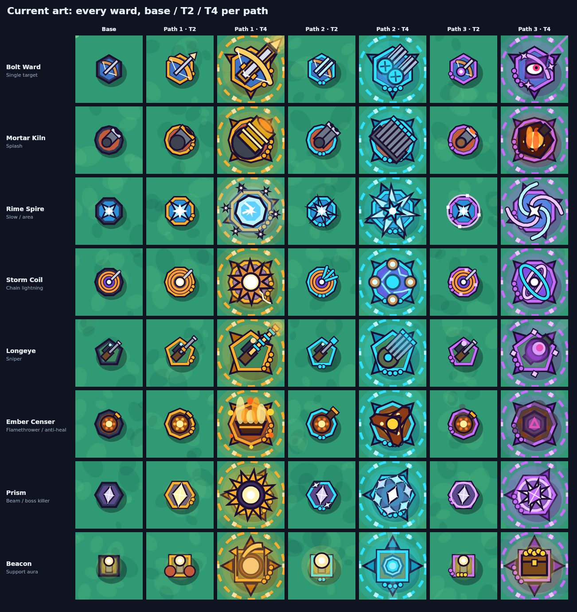
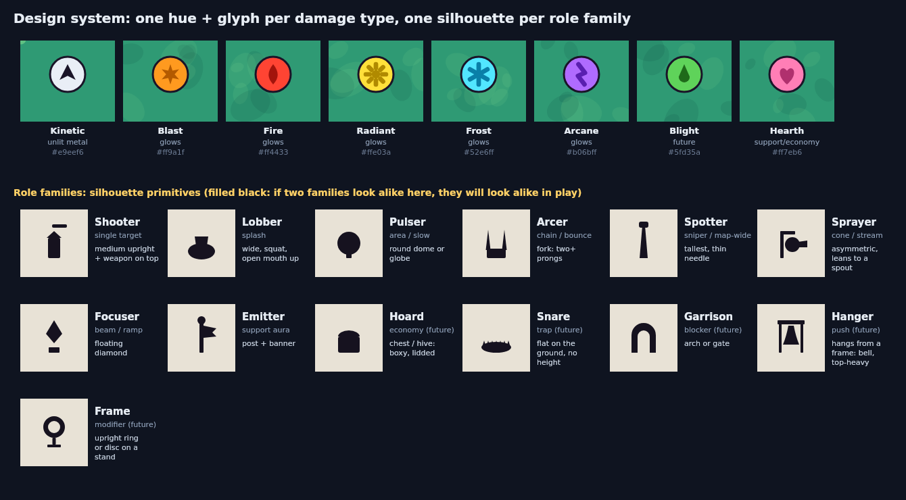
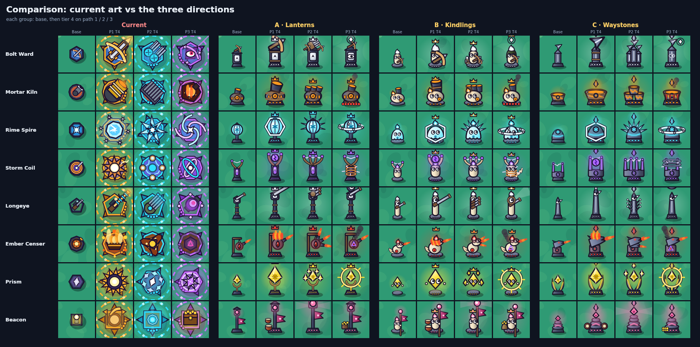

# Ward visual design system (proposal, 2026-11-19)

## Summary for the morning

### What I found

- **The wards blend because path colour beats ward identity.** At tier 2 and above, the global path colours (gold / cyan / violet) dominate everything:
  - the base band, buttresses and pips;
  - the T4 glow disc and rotating rune ring.

  So a *column* of the upgrade grid (same path, different wards) looks more alike than a *row* (same ward, different paths). The measurement backs this up. For each upgraded render I found its closest look-alike among all the others: only **23%** (11 of 48) were the same ward, while 77% were a different ward, usually on the same path and tier. Every T4 also shares one capstone kit (a path-coloured glow disc, a rune ring and buttresses), so **in silhouette all 24 capstones are the same disc**.
- **The top-down view is the structural cause.** Seen from above, the 5- to 12-sided platforms all read as circles at ~40 px. Height, the best shape channel, is thrown away. Defense Grid's art director describes hitting exactly this and fixing it with tall towers that each have their own silhouette.
- **The damage colours collide.** Kinetic (`#ffe9a8`) and Radiant (`#fff3b0`) are nearly identical *even with normal vision* (ΔE 4.9). Arcane and Frost are both pale blue, and Blast and Fire are both orange.
- **Shared motifs make it worse.** Starbursts, orbiting shards and white "sun" cores recur across Rime, Prism, Storm Coil and Ember Censer. Perception research shows shared colour and motifs group things together and mask shape.

### What I propose

**One design system** (section 2), shared by all three directions:
- an **upright three-quarter view**: the body never rotates, and a small part aims;
- **one silhouette per role family** (13 families defined, room for 20+ wards);
- **one hue plus glyph per damage type** (8 slots, checked for colour blindness);
- **countable tier notches**, with a silhouette change only at T3 and T4;
- a path grammar, **Might / Many / Craft**;
- **no path colours on the map**; they stay in the UI only.

**Three gimmicks on top of it**, all mocked up for the 8 wards at tiers 0, 2 and 4 on every path:
- **A · Lanterns:** every ward is a lantern holding a captured light.
- **B · Kindlings:** every ward is a little wax spirit of the Heartfire with big eyes.
- **C · Waystones:** every ward is a rune-carved standing stone.

### Recommended direction

**A · Lanterns.**
- **It reads best.** 100% of upgraded states are nearest to their own ward (current art: 23%), and 96% with the height cap applied.
- **The template is the mechanic.** Wards *are* lights against the Gloom.
- **It scales.** Lantern housings are a huge real-world vocabulary, so the silhouette never runs out. That is the weak point of a same-body template like the Kindlings.
- **It is the cheapest to draw procedurally.**
- **Its weakness:** dark iron bodies give low value contrast. The fix is a lighter body value, with the light kept as the brightest point.

Kindlings is the charming runner-up, and its best idea could be borrowed as an option: a little face in the light. Section 4 has the full comparison.

### Top 4 new wards (details in [tower-ideas.md](tower-ideas.md))

1. **Thornlight Snare:** the trap ward, placed *on* the path.
2. **Recall Bell:** pushes the Gloom back along the path. It is the first dedicated answer to the Herald, which has none today.
3. **Burning Glass:** a lens that changes other wards' shots as they pass through. It is a second answer to Menders, which have one today.
4. **Lychgate Wardens:** blockers at a rally point, with block weight. It is the first control answer to Heavy Gloom.

All four are mocked up in the Lanterns style in `concepts/lanterns/new-wards.png`.

### What you need to decide

1. **The view.** Do we switch to an upright three-quarter view?
   - This is the biggest call and the biggest job: every ward's art, depth sorting, muzzle offsets and hit-testing all change.
   - The crowd test (section 2.1) shows it hides *less* than today's art, as long as T4s are capped at about 48 px tall.
   - The cheaper first step is to prototype 3-4 wards in the real game.
2. **The direction.** Lanterns (recommended), Kindlings or Waystones? And do you want the optional "face in the light" from Kindlings?
3. **Path colours off the map.** Do we drop gold / cyan / violet from the map art and keep them in the UI only? I recommend yes. It is the single change that fixes the most blending, and it can be done even without the other changes.
4. **The new damage palette.** It changes the colours of projectiles and damage numbers as well as wards: Kinetic becomes silver-white and unlit, Radiant becomes yellow, Arcane violet, Frost cyan, Fire red, Blast orange. Pink is reserved for support and economy, and green for a future Blight type.
5. **T4 power fantasy.** The proposed capstones are deliberately calmer: a crown and a soft halo instead of big path-coloured auras. Is that acceptable? The excitement moves to the moment of attack and the upgrade burst.
6. **Which new wards, and in what order.** Are the blocker and trap mechanics (units on the path, building on the path) in scope?

### What's in the repo

| Where | What |
|---|---|
| `docs/research-notes/` | the five agents' raw notes, with every source link |
| `docs/visual-research.md` | research from five web-research agents: case studies, gimmicks, scaling systems, principles, camera view, and a 15-point readability checklist |
| `docs/visual-design-system.md` | this document: diagnosis, design system, three directions, recommendation |
| `docs/tower-ideas.md` | 13 new ward concepts, roster gap analysis, the top 4 |
| `docs/concepts/current/` | the current art at base / T2 / T4 per path: one sheet per ward, `roster.png`, `roster-tests.png` (colour, greyscale, silhouette and blur at real size), `blend-pairs.png` |
| `docs/concepts/{lanterns,kindlings,waystones}/` | the same sheets for each direction, plus `tier-ladder.png` (every tier and two crosspaths). Lanterns also has `new-wards.png` and `lineup-12.png` |
| `docs/concepts/comparison.png`, `comparison-realsize.png` | current vs A / B / C side by side, zoomed and at real size in colour and greyscale |
| `docs/concepts/system-sheet.png` | the damage palette and glyphs, and the 13 family silhouette primitives |
| `docs/concepts/palette-cvd.png` | colour-blindness simulation of the proposed palette vs the current colours |
| `docs/concepts/crowd-test.png` | occlusion test at minimum ward spacing with real enemy art |
| `docs/concepts/_src/` | the headless render scripts (Node with `@napi-rs/canvas`; no game code touched, and `package.json` unchanged). Every image and number here can be regenerated; see `_src/README.md` |

No game code was changed.

---

## 1. Diagnosis: the current art

### 1.1 What blends, and why

**High-tier Rime, Ember Censer and Prism** (`concepts/current/blend-pairs.png`, top row):
- **Rime Winter's Verdict and Prism Kaleidoscope** are both a cyan star or shard crown inside a cyan-banded polygon, with cyan pips and a cyan dashed ring. The only difference is interior detail too small to read at 40 px.
- **Ember Censer Ashen Brand, Prism Supernova and Storm Coil Ion Storm** are all a violet disc with a small central emblem inside a violet ring.
- **Rime Absolute Zero, Prism Sunspear, Storm Coil Smite and Censer Wildfire** are all a gold sun or star disc in a gold ring.

  The ward's own colour (Rime's blue body, the Censer's rust, the Prism's purple) is a small inner fill that the path colour overpowers by tier 2.

**Longeye and Mortar Kiln** (middle row):
- **At base,** both are a dark diagonal barrel on a dark platform, aimed the same way, with the same scale and value. A pentagon and a 12-gon are indistinguishable at 34 px.
- **Flak Curtain and Barrage Battery** are both a cyan rack of parallel grey barrels pointing up-right.
- **Headhunter and Cataclysm** are both a gold barrel on a gold ring.
- The Longeye's defining trait, **reaching anywhere on the map**, has no visual expression at all. It is a short gun like the others.

**Root causes, in order of impact:**

1. **The path colour is global and wins.** The same three colours are used for path bands, buttresses, pips, T4 glows and rune rings on every ward. Gestalt similarity groups same-coloured things, and colour masks shape, so the eye sorts wards by *path* before *ward*.
   - **Measured:** I found each render's closest look-alike, using its blurred real-size thumbnail as a glance proxy. For only **11 of 48** upgraded states was it the same ward. (An earlier run with a slightly smaller thumbnail frame gave 8 of 48: the metric is sensitive to framing, but the gap to the proposals is not.)
   - The mean difference between different wards on the same path and tier is **0.73×** the difference between one ward's own paths. In plain terms, wards look more alike than a ward's own paths do.
2. **Every T4 uses the same capstone kit:** a path-coloured glow disc, a rotating dashed rune ring with six squares, and buttresses. In the silhouette panel of `roster-tests.png`, all 24 capstones become the same filled circle.
3. **The top-down view erases shape.** Every ward is a polygon platform with 4 to 12 sides, seen from above, at nearly the same radius. The platform is the biggest shape on each ward, and at 34-40 px it is a circle on all eight. The parts that differ (bow, barrel, crystal) are small, rotate, and sit inside the platform.
4. **Shared motif vocabulary.** Starbursts (Rime, Prism, Coil), orbiting shards or crystals (Rime Shatter, Prism Kaleidoscope, Hunter's stars), white glowing cores (Coil, Prism, Pharos, Rime) and violet discs recur across unrelated wards.
5. **The damage colours are not a usable code** (`concepts/palette-cvd.png`):
   - Kinetic vs Radiant is ΔE 4.9 with normal vision. Under ~10 is near-identical.
   - Arcane vs Frost are both pale blue, and Blast vs Fire are both orange.
   - So a ward's light can't carry its type, and today nothing tries to.
6. **Glow is spent on idle states.** Permanent T4 auras compete with enemies and attacks for attention, and neighbouring halos wash toward white. In the crowd test, the current art hides 17% of enemy pixels and 27% of each ward's own pixels behind its neighbours.

**What works today, and should be kept:**
- the dark ink outline on everything (it separates wards from the turf);
- the saturated palette against the green map;
- recoil and attack animation;
- the *idea* of path-specific T3 designs and countable pips.

The T3 designs are good ideas executed in a shared vocabulary.

---

## 2. The design system

These rules hold whichever gimmick is chosen. In the mock-ups, most of the readability gain comes from these rules, not from the gimmick. All three directions jump from 23% to 88-100% on the blend metric. The gimmick decides charm, cost and how far the roster can scale.

### 2.1 View: upright three-quarter, fixed body, small aiming part

- **The body stands up and never rotates.** Only a small, asymmetric aiming part turns: a crossbow, barrel, nozzle, eye or bell mouth. This is the Kingdom Rush / Fieldrunners model, and it gives every ward a *side* silhouette (height, waist, top shape) that top-down throws away.
- **Light comes from the top left** and never rotates with the aim.
- **Height cap.** Base wards are at most ~32 px tall above the footprint centre, and T4s at most ~48 px. The family's identity feature sits in the top half.
  - My mock-ups exceed this: T4s average 57-64 px. Scaled to the cap, the Lanterns still score 96% on the blend metric.
- **Engine changes:**
  - depth-sort wards and enemies together by footprint y;
  - shots, beams and flames leave from the aiming part's tip at (x, y − h);
  - range stays a ground circle around the footprint;
  - click targets are the footprint plus the body box, front-most first;
  - when an enemy is behind a ward, fade the ward or draw the enemy's outline through it (make this a setting).

**Crowd test** (`concepts/crowd-test.png`). Late-game wards are packed at the game's real minimum spacing (38 px between centres, 38 px from the path centre) in two rows each side of a path, with real enemy art, depth-sorted:

| | Current (top-down) | A · Lanterns | A · Lanterns, height-capped | B · Kindlings | C · Waystones |
|---|---|---|---|---|---|
| Enemy pixels hidden behind wards | 17% | 7% | 6% | 6% | 7% |
| Each ward's pixels hidden by other wards (average / worst) | 27% / 64% | 17% / 59% | **9% / 41%** | 12% / 41% | 11% / 48% |
| Average height at T4, px above the footprint | 39 | 64 | 48 | 57 | 62 |

So the main risk of going upright is real but manageable. Today's wide T4 rune rings already overlap both the path and each other, and an upright view with the height cap hides less than today's art does.

### 2.2 One channel per fact

| Fact | Channel | Never used for |
|---|---|---|
| **Role family** | body silhouette (2.3) | anything else; all wards in a family share the primitive |
| **Which ward** | family silhouette plus the ward's gear and housing details | not hue alone |
| **Damage type** | the hue of the ward's *light* (its one brightest region), plus a glyph in it (2.4) | body or housing colour |
| **Tier (main path)** | 1-4 notches in the damage colour on the plinth front, always in the same place | glow, aura or size alone |
| **Main path** | shape grammar on the head: Might / Many / Craft (2.6) | colour |
| **Secondary path** | small white pips beside the notches, plus at most one small body attachment | the head or silhouette |
| **State** (selected, buffed, ability ready, disabled) | rings and markers drawn on the ground layer, outside the ward art | baked into ward art |

### 2.3 Role families and silhouette primitives

`concepts/system-sheet.png` draws each primitive as a solid black shape. **If two families look alike there, they will look alike in play.** Each family gets 2-3 wards before it needs a sub-variant, which is enough for 25-35 wards.

| Family | Role | Silhouette primitive | Current / proposed wards |
|---|---|---|---|
| **Shooter** | single target | medium upright body with the weapon on top | Bolt Ward |
| **Lobber** | splash | wide and squat, with an open mouth up | Mortar Kiln |
| **Pulser** | area / slow | round dome or globe | Rime Spire |
| **Arcer** | chain / bounce | a fork with two or more prongs | Storm Coil |
| **Spotter** | sniper / map-wide | the tallest and thinnest: a needle | Longeye (its height now says "reaches far") |
| **Sprayer** | cone / stream | asymmetric, leaning toward a spout | Ember Censer; Rot Lantern (proposed) |
| **Focuser** | beam / ramp | a floating diamond | Prism |
| **Emitter** | support aura | a post with a banner | Beacon; Vigil Candles, Kindred Shrine (proposed) |
| **Hoard** | economy | boxy and lidded: a chest or hive | Ember Vault (proposed) |
| **Snare** | trap on the path | flat on the ground, no height | Thornlight Snare, Flarepot (proposed) |
| **Garrison** | blocker / summoner | an arch or gate | Lychgate Wardens (proposed) |
| **Hanger** | push / control | hangs from a frame: a bell, top-heavy | Recall Bell (proposed) |
| **Frame** | modifier | an upright ring or disc on a stand | Burning Glass (proposed) |

Reserved for later: **Floating** (no plinth at all) for movable wards like the Wandering Light.

**Rules for a new ward:**
- It joins an existing family, or proposes a new primitive that passes the black-shape test against all the others.
- It must also own a verb no other ward in its hue owns (the colour-pie idea).

### 2.4 Damage palette: one hue plus glyph per type

| Type | Light colour | Glyph | Verbs it owns (colour pie) |
|---|---|---|---|
| Kinetic | `#e9eef6` silver-white, **unlit** (no glow: "if it glows, it's elemental") | arrowhead | pierce, knockback, precision |
| Blast | `#ff9a1f` orange | 6-point burst | splash, stun, cracking plate |
| Fire | `#ff4433` red | flame drop | burn, Scorch (no healing), spread |
| Radiant | `#ffe03a` yellow | sun | ramp, ignoring resistances, reveal |
| Frost | `#52e6ff` cyan | snowflake | slow, freeze, brittle |
| Arcane | `#b06bff` violet | zigzag | chain, shields, stun, push |
| Blight (future) | `#5fd35a` green | drip | damage over time, stop regrowth |
| Hearth (support / economy) | `#ff7eb6` rose: the Heartfire's own colour, never used for damage | heart | buffs, gold |

**Colour-blind check** (`concepts/palette-cvd.png`, Machado 2009 simulation, closest pair in each palette):

| | Normal | Protanopia | Deuteranopia | Tritanopia |
|---|---|---|---|---|
| Proposed palette (8 colours) | **37.7** (Kinetic / Frost) | 14.6 | 15.5 | 12.9 (Blast / Hearth) |
| Current damage colours (6) | **4.9** (Kinetic / Radiant) | 3.2 | 3.0 | 5.2 |

These are ΔE values: under ~20 is hard to tell apart at a glance, and under ~10 is near-identical. My first Blight lime collapsed into Radiant yellow under deuteranopia (ΔE 2.9), so I moved Blight to a mid green. Every remaining weak pair is covered by its glyph.

**Rules:**
- The light is the only place the damage hue appears at full strength.
- Bodies use neutral materials (iron, wax or stone, depending on the direction).
- A path that adds a secondary element (Cinder fire on a Blast mortar, for example) shows it as a small accent, never by recolouring the light.
- At most 8 hues roster-wide. A 9th type would need a strong argument and a glyph test.

### 2.5 Tier ladder

| Tier | What changes | Why |
|---|---|---|
| T0 | the family silhouette, the light, the plinth | the read you learn |
| T1 | **1 notch**; the light a little bigger; +3.5% size | countable, quiet |
| T2 | **2 notches**; the first path attachment at body level (bands, a second barrel, a shard collar, a hood) | path visible, silhouette intact |
| T3 | **3 notches**; the milestone: the path *transforms the head* (ballista arms, triple mouth, ice crust, searchlight) | the one silhouette change, as at BTD tier 5 and KR level 4 |
| T4 | **4 notches**; the head at full size; a **crown finial in the ward's own light colour**; a soft halo (low alpha, own colour); +8% size | the "capstone" read; one shared motif roster-wide, and it can't drown the silhouette |

**Never changes:** the family silhouette and housing, the light hue and glyph, body materials, where the notches are, and the kind of aiming part.

**Never at any tier:**
- path-coloured auras;
- orbiting clouds of shards on several wards;
- permanent glows larger than ~1.3× the footprint;
- near-white idle pixels.

Brightness peaks belong to attacks.

### 2.6 How paths diverge: Might / Many / Craft

The current paths already follow this pattern, and new wards should too (or document why not):
- **Path 1 · Might:** one bigger, heavier thing. The weapon or light scales up, and gains bands and mass. *Ballista, Big Shells, Deep Freeze, Overcharge, Deadeye, Pyre, Focus, War Drum.*
- **Path 2 · Many:** the head multiplies: two, then three or more emitters, barrels, prongs or mouths. *Twin-shot, Rapid Loader, Shatter, Forking, Flak, Dragon's Breath, Refraction, Lighthouse.*
- **Path 3 · Craft:** an emblem or trick is added: an eye, smoke, a halo, rings, coins. *Hunter's Mark, Cinder, Blizzard, Static, Spotter, Ash, Afterglow, Tithe.*

So "one huge thing", "lots of things" and "a strange add-on" read the same way on every ward, *without* colour. Players learn it once.

**Crosspaths:**
- The secondary path shows as white pips beside the notches, plus at most its T1-T2 body attachment. It never changes the head.
- The mock-ups show the pips. The 4-2-0 and 0-2-4 columns of each `tier-ladder.png` show that the secondary attachment isn't drawn yet.

### 2.7 Brightness and noise budget

1. **Primary:** enemies and attacks.
2. **Secondary:** ward silhouettes and lights.
3. **Tertiary:** tier marks and idle motion.

Idle glows stay at low alpha and in each ward's own hue. The upgrade moment gets a one-shot burst (the existing pop) instead of a permanent aura. The upright view also frees the damage colours to carry through to projectiles, beams and damage numbers: a Fire ward's flame, a Frost ward's pulse and an Arcane ward's arc all use their light colour.

---

## 3. Three directions

All three are drawn at real game scale and enlarged 2-3× on the sheets. They are concept mock-ups, not production art:
- T1 and T3 are implied between the rendered tiers (the tier ladders show them);
- secondary-path attachments are not drawn;
- the animations are frozen.

### A · Lanterns: every ward is a lantern holding a captured light

**The gimmick.** The wards *are* the Hollowlight: lamps that hold the dark back.
- The **housing** is the family silhouette.
- The **light inside** is the damage colour and glyph.
- Everything else is dark iron and bronze.
- Range could literally be drawn as the reach of the ward's light.

| Family | Lantern | Might / Many / Craft |
|---|---|---|
| Shooter (Bolt) | square carriage lantern with a crossbow on its roof | ballista arms / twin bows, then a rotary drum / an eye-shutter over the pane, then a floating mark |
| Lobber (Mortar) | squat round kiln-lantern with glowing vents and a stubby mouth | fat banded mouth / 2-3 mouths / spilled coals and smoke |
| Pulser (Rime) | glass globe on a stem, with ribs | hexagonal ice crust / shard spikes / a ring of snow cloud |
| Arcer (Coil) | tall lantern with horn prongs and an arc between them | thick prongs plus a storm orb / 3-4 prongs / copper coil rings |
| Spotter (Longeye) | the tallest: a lamp-pole with a spyglass head | longer barrel / 2-3 barrels / a searchlight eye with a beam |
| Sprayer (Censer) | a gallows post with a hanging fire-pot that has a spout | flames over the pot / 2-3 spouts / smoke and a brand rune |
| Focuser (Prism) | a big crystal held in a bronze claw | the crystal grows / satellite crystals / a halo ring with rays |
| Emitter (Beacon) | a lamp-post flying a pennant | war drums / a taller post with beams / a coin chest |

**Numbers:**
- Blend metric: **48/48 (100%)**, ward/path ratio 2.45 (current: 0.73). Capped at 48 px: 46/48.
- Crowd test, capped: 9% of each ward hidden (current: 27%).

**Strengths:**
- The strongest theme fit.
- Silhouettes come from a large real-world vocabulary (carriage, globe, gallows, lighthouse, brazier, paper, sconce, chandelier, storm lantern…), so 20+ wards don't run dry. The same-body template problem from the research doesn't apply, because the housing *is* the variable.
- Procedural geometry is close to the current code style, so it is the cheapest to draw.

**Weaknesses:**
- The dark iron bodies are low in value, so at real size the two Kinetic wards (Bolt, Longeye) and the Coil are dark shapes on the turf. Fix: lift body value one step (a lighter iron or pewter), keeping the light the brightest point.
- Less charm than B.

### B · Kindlings: every ward is a little spirit of the Heartfire

**The gimmick.** The BTD / PvZ template:
- every ward is the same species, a wax-pale body with big eyes that **look at the target** (the aiming indicator) and a flame on its head in the damage colour;
- the body shape plus the tool it holds is the family;
- Many literally adds more kindlings.

| Family | Kindling | Might / Many / Craft |
|---|---|---|
| Shooter | candle-stub body holding a crossbow | a heavier crossbow, then a ballista / 1-2 helper kindlings / a hunter's hood, then a floating mark |
| Lobber | fat round kindling with a mortar on its back | bigger tube / 2-3 tubes / coals and smoke |
| Pulser | jelly-skirted frost dome | ice crust / spikes / snow ring |
| Arcer | kindling with antlers that arc | thick antlers plus an orb / more tines / coiled tail |
| Spotter | tall, long-necked, one big eye, with a spyglass rifle | longer rifle / pepperbox / monocle-lamp |
| Sprayer | salamander leaning forward, breathing fire | belly flames / 2-3 heads / smoke |
| Focuser | floating crystal-bodied kindling | bigger / crystal satellites / halo |
| Emitter | kindling holding up a banner with a lamp | drums / a taller lamp / coin sack |

**Numbers:** blend metric **47/48 (98%)**, ratio 2.08. The one confusion is Prism Kaleidoscope vs Censer Ashen Brand.

**Strengths:**
- By far the most charm. Faces and eyes are what the research says create attachment ("adding blinking really sold it").
- Eyes that track the target are an excellent aim read.
- Bright wax bodies have the best value contrast on the turf.

**Weaknesses:**
- **The template eats the silhouette.** Every ward is "a cream blob with eyes", so the tool has to carry identity. That gets harder past ~20 wards (the research's ~25-variant ceiling).
- At 36 px the eyes become the dominant read, *and they are identical on every ward*.
- The white Kinetic flame almost vanishes against the cream wax.
- "Many = more kindlings" adds clutter beside neighbours.
- The highest art cost: faces invite blinking, reactions and idle animation.

### C · Waystones: every ward is a rune-carved standing stone

**The gimmick.** Megaliths the Hollowlight wakes: slate stones whose carved channels glow in the damage colour.

| Family | Stone | Might / Many / Craft |
|---|---|---|
| Shooter | a pillar with a floating arrowhead stone that aims | massive spearhead / twin, then triple pillars / carved eye and floating mark |
| Lobber | wide stone cauldron on legs | wider, banded / 2-3 bowls / lava drips and smoke |
| Pulser | domed boulder with a carved ring | ice crust / spikes / snow ring |
| Arcer | forked stone (U, then trident) | thick prongs plus an orb / 3-4 prongs / ring stones |
| Spotter | needle obelisk with an eye | taller with a spear tip / side spikes / floating eye-lens |
| Sprayer | carved beast head on a block, breathing fire | flames / 2-3 heads / smoke |
| Focuser | crystal floating between horn-stones | bigger / satellite crystals / halo |
| Emitter | stacked cairn with a lamp-stone on top | drum stones / taller cairn with beams / coin hoard |

**Numbers:** blend metric **42/48 (88%)**, ratio 2.12. The confusions are mostly Bolt vs Longeye: two grey Kinetic pillars.

**Strengths:**
- The most systematic: pure geometry, cheap to draw, and the family primitives map one-to-one onto stone shapes.
- Ancient and solid, which contrasts well with soft, blobby Gloom (the Defense Grid "opposed shape languages" idea).

**Weaknesses:**
- One material at one value makes everything the same mid-grey, which is the weakest greyscale read of the three.
- The two Kinetic stones blend, because there is no light to separate them.
- The least charm, and it reads "stone" more than "light".

---

## 4. Comparison and recommendation

| | Current | A · Lanterns | B · Kindlings | C · Waystones |
|---|---|---|---|---|
| Blend metric: same-ward nearest neighbour | 23% | **100%** (96% capped) | 98% | 88% |
| Ward/path distance ratio (higher = wards apart, paths together) | 0.73 | **2.45** | 2.08 | 2.12 |
| Greyscale read | poor (everything is a disc) | good silhouettes, dark bodies | **best value contrast** | weakest (all mid-grey) |
| Theme fit (light vs Gloom) | n/a | **the wards *are* lights** | spirits of the Heartfire | stones the light wakes |
| Scales to 20+ | n/a | **the housing vocabulary is huge** | the same-body template strains past ~20 | good (geometry), but monotonous |
| Charm | medium | medium | **high** | low |
| Production cost (procedural canvas) | n/a | **low** | high (faces, animation) | lowest |

**Recommendation: A · Lanterns.**
- It reads as well as anything here.
- Its template is the game's core fiction: wards are lights.
- It is the only one of the three where the *variable part is the silhouette*, which is the property that lets a roster grow to 20-30 without blending.

**Before committing, decide on two refinements:**
1. **Lift the body value.** Use pewter or blued steel instead of near-black iron, so the bodies separate from the turf in greyscale. The light remains the brightest point.
2. **Optional, borrowed from B:** give the light inside each lantern a tiny face (two eyes in the pane that follow the target). That would add most of the Kindlings' charm, and the aim read, at a fraction of the cost. It needs a test at 36 px against the damage glyph, which shares the same pane.

**If you'd rather not switch views at all:** the single most valuable change that works in the *current* top-down art is section 2.2's channel discipline:
- take the path colours off the map;
- colour each ward's light or core by the new damage palette;
- replace the shared T4 aura and rune ring with notches plus a small own-colour crown;
- give each family a distinct plan-view protrusion pattern.

This is the "lifted top-down" option from the research. It would recover part of the gain, but not the silhouette channel.

---

## 5. If approved: implementation sketch

1. **Prototype** (a small step): draw 3-4 Lantern wards (Bolt, Mortar, Longeye, Rime) in `towerArt.js` alongside the old art, behind a flag. Add depth sorting and muzzle offsets. Play waves 20-30 and run the crowd test in the real game.
2. **Rules:** move the damage palette into `data/damage.js` (projectiles and damage numbers pick it up), and remove path colours from map art.
3. **Roll out** the remaining 4 wards, then the shop icons (the same draw function at icon scale; the upright view makes better icons).
4. **Polish:** idle rhythm per family, attack anticipation, the upgrade burst, and the occlusion fade setting.
5. **Keep `_src/`'s metrics as a regression check:** rerun the blend metric and crowd test on each art change.

---

## 6. Method and caveats

- **Who designed what.** I designed all three directions, so they share my habits. The blend metric rewards the *system* rules more than the gimmicks. Treat the gap between A, B and C as indicative, and the gap between them and the current art as the real finding.
- **What the blend metric is.** A crude glance proxy: blurred 16×16 colour thumbnails at real size, nearest neighbour by luminance-weighted RGB distance. It doesn't model attention, animation or play. Playtest readability (the checklist in `visual-research.md`) is the real test.
- **The mock-ups don't yet show** secondary-path attachments, animation, or attack VFX (flames, beams and pulses are frozen or simplified).
- **The crowd test** uses one dense, random, late-game layout. Real layouts vary.
- **Research sources.** Several fan wikis blocked fetches, so some claims rest on search snippets or official screenshots. `visual-research.md` marks each one.
